# 探索记录：optimize-verify-review-explore-001

> 变更主题：spec-verify / spec-verify-proposal / review 能力优化（提示词门触发中）
> 创建时间：2026-11-13
> 编排上下文：iagent-auto-workflow Phase 1（mode=delegated，强制检查点体系）
> 跟踪说明：宿主未暴露 TodoWrite 工具，阶段跟踪以本文件各段状态承担

## Background

**用户原始输入（未经改写）**：

> 根据proposal生成提案内容，重新分析检查检查优化spec-verify、spec-verify-proposal提案验证能力是否需要调整检查逻辑和能力点，检查待实现功能覆盖和影响范围；根据apply实现结果和提案内容，进行review代码审查能力优化，完善提案和实现结果一致性检查

**适用护栏**：impl 域蒸馏（`.iagent/rules/coding-rules.md`）；未定义项标 [待确认]，禁止猜测。

## 项目规则基线

| 源 | 存在 | 读取 | 关键约束摘要 |
| :--- | :--- | :--- | :--- |
| `.iagent/config.yaml` | 是 | 已读 | 技术栈 TS 5.9 + Node ≥20.19 ESM + Commander 14 + pnpm 10 + Vitest 3.2.6；分层：模板层→生成层→命令层；模板改动后须 `pnpm build && pnpm generate:skills`；workflows 含 spec-verify / spec-verify-proposal；compileCheck 段缺省启用 |
| `.iagent/rules/coding-rules.md` | 是 | 已读 | 零猜测：未明确项标 [待确认]；设计先行过确认门再改码；模板正文唯一源、指令版由 derive-command.ts 派生禁止手改；allowedTools 走 tool-whitelist.ts 共享常量禁止逐模板手写；外部进程走 child-process.ts；改模板后 build + generate:skills |
| `.iagent/rules/spec.md` | 是 | 已读 | 变更真源为 openspec/changes/ 下 Markdown；写入后跑 `iagent spec validate`；提案实现前评分门阈值 90%；handoff 包 propose 一次产出、跨阶段只读只追加阶段结论；MUST NOT 重新引入 JSON 制品 |
| `.iagent/rules/testing-rules.md` | 是 | 已读 | Vitest 3.2.6，用例 test/**/*.test.ts；主目录沙箱到临时目录；CLI e2e 跑 bin/iagent.js 与 dist/（改 CLI 行为先 build）；单测超时 20000ms；改模板先 build+generate:skills 否则 skills-parity 失败 |
| `CLAUDE.md` | 否 | — | 不存在（合法终态，不阻断） |
| `AGENTS.md` | 是 | 已读 | 仓库地图与修改守则：模板守则第 1/2/7 条（build+generate:skills、白名单三层组合、spec 模板单一源 CMD:SKIP）、spec 驱动 Markdown-first、verify-report 落盘 `.openspec-tmp/pipeline-<change>/`、门白名单 5 类 |

## 项目技能基线

| 源 | 存在 | 读取 | 完整性 | 关键约束摘要 |
| :--- | :--- | :--- | :--- | :--- |
| `.iagent/skills/backend-design.md` | 是 | 已读 | ok | 单一真源优先（同一规则一个代码落点）；派生而非复制；扩展点接口化；技能正文不硬编码宿主机制词；委派 fail-safe 默认 inline；门承载收敛 `GATE_SKIP_IDS`；新增公共能力面同步版本判定信号 |
| `.iagent/skills/backend-implement.md` | 是 | 未读 | ok | phases=implement：不入设计基线（按 1.1.1.5 阶段筛选规则排除），实现阶段（Phase 4）按需加载 |

## 能力探索记忆注入（1.2.0.5）

- 涉及能力推断：`openspec/specs/` 目录扫描结果为空（主 spec 未创建 / 未迁移入库）
- 涉及能力候选（待扫描后确认归属）：spec-workflow-skills / workflow-suite-skills / host-orchestration / code-review
- 结果：**无能力级探索记忆 — 全新探索**

## 提示词基线 (Prompt Baseline)

**原始提示词**（原文，未经改写）：

> 根据proposal生成提案内容，重新分析检查检查优化spec-verify、spec-verify-proposal提案验证能力是否需要调整检查逻辑和能力点，检查待实现功能覆盖和影响范围；根据apply实现结果和提案内容，进行review代码审查能力优化，完善提案和实现结果一致性检查

**六维判定**（2026-11-13，门触发）：

| 维度 | 判定 | 说明 |
| :--- | :--- | :--- |
| 目标 Goal | ✓ | 优化 spec-verify / spec-verify-proposal 的验证检查逻辑与能力点；优化 review 的提案↔实现一致性检查能力 |
| 对象 Object | ⚠️ 实质歧义 | 改动对象推断为三个内置技能模板（[推断]），是否涉及支撑代码（`src/core/spec/validation/` 等）未明说 |
| 范围 Scope | ⚠️ 实质歧义 | "检查待实现功能覆盖和影响范围"指向不明：是 verify 能力应新增的检查维度，还是本次变更自身的影响面要求 |
| 约束 Constraints | ✓ | 项目护栏（coding-rules）+ 未定义项标 [待确认] |
| 验收 Acceptance | — | 无明确验收标准（非硬判据维度，缺失记录不阻断） |
| 歧义 Ambiguity | ⚠️ | "根据proposal生成提案内容"语义模糊（推断为"创建变更提案"）；维度/阈值语义是否可动未明说 |

**结论**：不明确（Object / Scope 实质 ⚠️）→ 触发优化流程，输出【优化后提示词】并与 grill 批量 1（L1-L3）合并为同一确认轮（门预算约束）。

**确认后的提示词基线**（2026-11-13 用户确认：确认/按建议继续）：

> 在本仓库（MiAgentTools）创建一个变更提案，对三个内置技能的验证/审查能力做「再分析 → 结论 → 落地调整」：
> 1. spec-verify 与 spec-verify-proposal：重新分析两者现有检查逻辑与能力点（前置验证门 D1-D10、后置验证三维度）是否需要调整，重点评估「待实现功能覆盖」「影响范围」两类检查应否新增/强化为检查维度/能力点；产出「保留/调整/新增」结论并落地。
> 2. review：基于 apply 实现结果与提案内容，完善「提案↔实现结果一致性检查」能力点（语义层，与 `iagent spec conformance` 结构校验分工不重复）。
> 改动对象：三个技能模板（spec-verify.ts / spec-verify-proposal.ts / review.ts）+ 派生与配套测试；不动 CLI 校验代码。
> 约束：遵循 coding-rules（模板单一源、白名单共享常量、改模板后 build+generate:skills）；未定义项标 [待确认]。

> 下游（提案 / 设计 / 规格 / 任务）以确认后的提示词基线为唯一语义来源；基线若变更 MUST 回到 1.1.2 重新确认。

## 功能流程图

```mermaid
flowchart TD
    subgraph SA["流程 A：提案验证门（spec-verify-proposal）"]
        N1["N1 读取变更制品与 handoff 包"] --> N2["N2 变更类型自动检测"]
        N2 --> N3{"N3 影响面制品存在性判定"}
        N1 --> N4["N4 D1-D5 核心评分（D3 并入待实现功能覆盖检查点）"]
        N3 -- "无制品：SKIP 排除分母" --> N4
        N3 -- "有制品" --> N5["N5 影响范围一致性评分（脱节即 FAIL 可定位）"]
        N4 --> N5
        N5 --> N6["N6 D6-D10 条件维度评分"]
        N6 --> N7{"N7 总分判定（90% 统一阈值）"}
        N7 -- "PASS" --> N8["N8 内联深度复查"]
        N7 -- "FAIL" --> N9["N9 自动修复循环（至多 3 次）"]
    end
    subgraph SB["流程 B：实现后验证（spec-verify）"]
        N10["N10 读取制品与任务状态"] --> N11["N11 Completeness 校验"]
        N11 --> N12["N12 Correctness 校验（并入实现影响面对比）"]
        N12 --> N13["N13 Coherence 校验"]
        N13 --> N14["N14 生成验证报告"]
    end
    subgraph SC["流程 C：代码审查（review）"]
        N15["N15 规则基线"] --> N16["N16 确定审查范围"]
        N16 --> N17{"N17 变更关联检测"}
        N17 -- "无关联：检查点不触发" --> N18
        N17 -- "有关联" --> N19["N19 提案与实现一致性检查（语义层）"]
        N18["N18 五维度检查"] --> N19
        N18 --> N20["N20 分级审查报告"]
        N19 --> N20
    end
```

<!-- 1.5.5 固化（2026-11-13）：Mermaid + 节点清单；✅ 已确认（2026-11-13 流程最终确认门：确认/按图推进）→ 流程基准生效，flowBaselineConfirmed=true -->

| 节点 | 操作 | 触发条件 | 证据位置 | 异常路径 |
| :--- | :--- | :--- | :--- | :--- |
| N1 | 读取变更制品与 handoff 包 | verify-proposal 调用 | spec-verify-proposal.ts:197-203 | 缺 exploration.md → 报告退出（:205） |
| N2 | 变更类型自动检测（D6-D10 触发判定） | N1 完成 | spec-verify-proposal.ts:260-280 | 未触发维度标「不适用」跳过（:280） |
| N3 | 影响面制品存在性判定（proposal Impact / design 架构影响 / tasks Caller Updates） | N2 后 | [新建] verify-proposal 新增检查步骤（预期产物：模板 D2/D3 检查段扩展） | JSON-only 降级无制品 → BS-5 SKIP+WARN |
| N4 | D1-D5 核心评分（D3 并入「待实现功能覆盖」检查点） | N1 后 | spec-verify-proposal.ts:284-379（[调整] D3 检查段） | Spec Ref 缺上下文/歧义 → fail-safe 诊断（:328） |
| N5 | 影响范围一致性评分（三制品 ↔ specs/tasks 对齐） | N3 判定有制品 | [新建] 并入 D2/D3 的检查能力点（预期产物：模板检查段 + references 同步） | 脱节 → BS-2 FAIL 逐条列出偏差模块（:155-156 先例）；无制品 → BS-1 SKIP 排除分母（:152-153 先例） |
| N6 | D6-D10 条件维度评分 | N2 触发命中 | spec-verify-proposal.ts:8-163（CONDITIONAL_DIMENSIONS_FULL） | 未触发维度不适用跳过 |
| N7 | 总分计算与 90% 阈值判定 | N4-N6 完成 | spec-verify-proposal.ts:383-395 | <90% → N9 |
| N8 | PASS：内联深度复查 | N7 ≥90% | spec-verify-proposal.ts:464-483 | — |
| N9 | FAIL：自动修复循环（≤3 后呈现选项） | N7 <90% | spec-verify-proposal.ts:486-521 | 仍 FAIL → 手动修改 / 返回探索 / 查看差异 |
| N10 | 读取制品与任务状态 | spec-verify 调用 | spec-verify.ts:46-74 | JSON-only 降级 WARN（:74） |
| N11 | Completeness 校验（任务勾选 + 逐需求覆盖对比） | N10 后 | spec-verify.ts:85-114 | 未完成任务 → CRITICAL |
| N12 | Correctness 校验（并入：实现影响面 vs 提案声明影响面对比） | N11 后 | spec-verify.ts:115-132（[调整] 扩展对比检查） | 越面 → BS-4 WARNING 逐条列差异 |
| N13 | Coherence 校验（设计遵循/模式/数据结构/技能/分层/契约/UI） | N12 后 | spec-verify.ts:134-193 | 矛盾 → WARNING/CRITICAL |
| N14 | 生成验证报告（分级 + 可操作建议） | N11-N13 完成 | spec-verify.ts:195-231 | — |
| N15 | 规则基线读取 | review 调用 | review.ts:17 | 源缺失记「不存在」 |
| N16 | 确定审查范围 | N15 后 | review.ts:31-34 | 工作区干净 → 提示指定范围 |
| N17 | 变更关联检测（条件触发判定） | N16 后 | [新建] review 新增检测步骤（预期产物：模板执行步骤段） | 无关联 → 一致性检查点不触发（BS-3），N18 后直入 N20 |
| N18 | 五维度检查（正确性/安全性/性能/可维护性/规范符合度） | N16 后 | review.ts:21-27 | 拿不准 → 标「待验证」（:44） |
| N19 | 提案↔实现一致性检查（语义层；引用 conformance 结构层证据） | N17 检测到关联 | [新建] review 新增一致性检查点（预期产物：模板检查段；结构层 `iagent spec conformance`） | 偏离 → WARNING/CRITICAL 分级（BS-4） |
| N20 | 分级审查报告 | N18/N19 完成 | review.ts:46-56 | — |

> 确认后的流程图 = 流程基准；未经用户确认的流程图 MUST NOT 作为提案生成锚点。

## Analysis

### Deep Analysis Trigger

- Triggered: **Yes**（🔴 自动：Scope.Modify「优化/调整/检查」+ Depth.Targeted「重新分析」；类目命中 Architecture / Impact / Business）
- Reason: 修改既有技能模板的检查逻辑与能力点，非新增独立功能
- Scope: spec-verify.ts / spec-verify-proposal.ts / review.ts 三模板 + 其在 workflow / auto-workflow / debug / proposal-review 的引用面（爆炸半径已扫描）

### Security Findings
- Semgrep 未触发（无 Security 类目关键词）— 跳过并记录（可选增强，非阻塞）

### Architecture Flow
- 模板层（spec-verify / spec-verify-proposal / review.ts）→ registry.ts WORKFLOW_PAIRS（:105）→ command-generation（frontmatter/指纹/适配器）→ 生成产物
- 验证链：propose 产制品 → verify-proposal（D1-D10 评分，90% 阈值）→ workflow/auto-workflow 内联合并清单（D1-D10+B1-B7）→ apply → verify（三维度）→ archive
- 影响面链（**生成侧已有、验证侧缺失**）：explore Pending 符号 → workflow/auto-workflow Phase 2.0 影响分析 → proposal.md Impact 小节 / design.md 架构影响小节 / tasks.md Caller Updates 小节（workflow.ts:273-279）

### Business Flow
- verify-proposal：读制品 → 变更类型检测（D6-D10 触发）→ D1-D5 核心评分 + 条件维度 → 总分 90% 判定 → PASS 内联深度复查 / FAIL 自动修复循环
- review：范围确定 → 五维度检查 → 逐发现验证 → 分级报告（CRITICAL/WARNING/SUGGESTION）

### Identified Symbols
- getSpecVerifyChangeSkillTemplate (src/core/templates/workflows/spec-verify.ts:8) — 后置验证三维度定义处 — Priority: HIGH
- getSpecVerifyProposalSkillTemplate (src/core/templates/workflows/spec-verify-proposal.ts:168) — D1-D5 内联 + D6-D10 条件维度 — Priority: HIGH
- CONDITIONAL_DIMENSIONS_FULL (src/core/templates/workflows/spec-verify-proposal.ts:8) — D6-D10 完整细则常量 — Priority: HIGH
- getReviewSkillTemplate (src/core/templates/workflows/review.ts:7) — 五维度 + allowedTools — Priority: HIGH
- getWorkflowSkillTemplate (src/core/templates/workflows/workflow.ts:133) — 合并清单维度名枚举（:31-39）— Priority: HIGH
- getAutoWorkflowSkillTemplate (src/core/templates/workflows/auto-workflow.ts:16) — Phase 3 固定清单枚举（:95）— Priority: HIGH
- getProposalReviewSkillTemplate (src/core/templates/workflows/proposal-review.ts:415) — dependsOn reportPath 增量核对（:438）— Priority: MEDIUM
- getSpecProposeSkillTemplate (src/core/templates/workflows/spec-propose.ts:16) — 制品生成侧（影响面小节上游）— Priority: MEDIUM

## Codebase Findings (NEW)

### Discovered Files
- `src/core/templates/workflows/spec-verify.ts`: 后置验证模板（三维度 report-only；:39 引用合并清单 D1-D10+B1-B7）
- `src/core/templates/workflows/spec-verify-proposal.ts`: 前置验证门模板（D1-D5 内联 + D6-D10 常量 + 90% 统一阈值 + 内联深度复查）
- `src/core/templates/workflows/review.ts`: 审查模板（五维度；**无提案↔实现一致性能力点**）
- `src/core/templates/workflows/workflow.ts`: 内联合并清单（:31-39 维度名枚举 + B1-B7 全文）+ 影响面生成链（:235-290）
- `src/core/templates/workflows/auto-workflow.ts`: Phase 3 固定清单（:90-100）+ Phase 2.0 影响分析（:57-68）
- `src/core/templates/workflows/debug.ts`: verify-close 内联清单引用（:285）
- `src/core/templates/workflows/proposal-review.ts`: 深度复查技能（:438 dependsOn reportPath 增量核对）
- `src/core/templates/registry.ts`: WORKFLOW_PAIRS 注册表（:105）
- `src/core/templates/codegraph-protocol.ts`: CLI 边界（impact 非 CLI 子命令，:93-98）

### Identified Symbols
- 见 Analysis > Identified Symbols（8 个，含 Priority）

### Pattern Matches
- 单一真源 + CMD:SKIP 派生（derive-command.ts:23）：spec 模板正文仅维护 skill 版
- 维度 SKIP 语义先例（spec-verify-proposal.ts:152-153，D10 缺失处理）：缺失→SKIP 排除分母，MUST NOT 按 0 分拉低
- FAIL 可定位输出先例（:155-156）：逐条列出偏差项，MUST NOT 只给百分比
- 白名单三层组合（tool-whitelist.ts）：review 的 Bash(iagent:*) 已放行 conformance CLI

> CodeGraph 扫描完成 — 发现 9 个文件、18+ 符号（2 轮串行主通道 + Grep 爆炸半径扫描）

## Questions

### 批量 1（L1-L3，2026-11-13，已确认 ✅ 按建议）

- Q1（L1 意图）：改动对象 = 三个技能模板正文 + 白名单/references 配套 + 测试同步，不动 CLI 校验代码 → 确认
- Q2（L2 方案）：能力点优先并入既有维度（「待实现功能覆盖」「影响范围」在 D3/D9 系内评估），review 新增提案↔实现一致性语义层检查点 → 确认
- Q3（L3 异常）：允许「评估后不改」结论留痕；阈值/权重语义变更须单独显式确认；模板改动后 build + generate:skills → 确认

### 批量 2（L4-L5，2026-11-13，已确认 ✅ 按建议）

- L4 一致性：扫描 D1-D3 × 代码库 — 0 硬冲突，自动直通（非阻断、不计入停顿）：conformance 结构层与 review 语义层分工一致；D10 SKIP 先例与 BS-1/BS-5 同构；维度名枚举（workflow.ts:31-39 / auto-workflow.ts:95）在「扩展不改名」下保持有效；review 白名单已隐含放行 conformance
- Q4（L5 边界）：BS-1..BS-6 六条 → 确认（记入 Decisions D4 与 边界场景 段）

### 流程最终确认门（2026-11-13，已确认 ✅ 按图推进）

- 20 节点流程图与清单确认为**流程基准**（flowBaselineConfirmed=true）；术语表 3 条一并背书并已同步 CONTEXT.md

## 术语表 (NEW)

> 既有术语已从 `openspec/CONTEXT.md` 载入并沿用（不重新定义）：**前置验证门**（spec-verify-proposal 的 D1-D10 量化评分，90% 阈值）、**后置验证**（spec-verify 三维度）、**节点覆盖度**、**流程基准**、**实现一致性（implementation conformance）**、**门白名单**、**handoff 包**、**执行方式（executionMode）**、**修复增量（fixDiff）** 等。

| 术语 | 定义 | 避免使用 |
| :--- | :--- | :--- |
| 待实现功能覆盖检查 | 提案验证门能力点——检查 proposal 声明的变更项（What Changes / Capabilities）经 specs 需求到 tasks 任务的链路是否逐级有任务承接；并入 D3（任务完整性）评估，不新增维度编号。✅ 已同步 CONTEXT.md（2026-11-13） | 功能覆盖（泛称）、任务覆盖（D3 既有语义） |
| 影响范围一致性检查 | 验证能力点——核对影响面三制品（proposal Impact 小节 / design 架构影响小节 / tasks Caller Updates 小节，workflow.ts:273-279）与 specs/tasks 的对齐；提案侧并入 D2/D3 评估，实现侧为 spec-verify Correctness 的对比检查（越面→WARNING）。✅ 已同步 CONTEXT.md | 影响面检查（泛称）、impact check |
| 提案↔实现一致性检查 | review 技能的条件触发能力点——检测到变更关联时，以 proposal/design/specs/tasks 为基准对实现产出做语义层核对（设计决策遵循 / 场景实现 / 影响面越界）；结构层交由 `iagent spec conformance`，分工不重复。✅ 已同步 CONTEXT.md | 实现一致性（conformance CLI 结构层术语）、变更一致性（泛称） |

## 架构决策 (NEW)

- 无 ADR

> ADR 三条件复核（2026-11-13）：「难以逆转」部分成立（维度编号被下游模板/回执/测试引用）、「脱离上下文令人意外」部分成立（为何并入既有维度而非新增 D11+）；但核心权衡将以变更 design.md 的 Decisions 段 + CONTEXT.md 术语条目承载并随变更归档沉淀，本次探索不单独立 ADR。

## 边界场景 (NEW)

<!-- L5 候选（2026-11-13 批量 2 已确认 ✅ 按建议） -->
- [x] BS-1 提案无影响面制品（影响分析未触发）→ 影响范围检查点 SKIP 排除分母（对齐 D10 缺失处理 spec-verify-proposal.ts:152-153）
- [x] BS-2 提案有影响面制品但与 tasks 脱节（Impact 模块无对应任务）→ 计入评分 FAIL，逐条列出偏差模块
- [x] BS-3 review 无变更上下文调用 → 一致性检查点不触发，五维度审查行为不变（条件触发）
- [x] BS-4 实现文件越出提案声明影响面 → spec-verify/review 报 WARNING + 逐条列出差异（结构层已由 conformance 硬拦）
- [x] BS-5 存量 JSON-only 降级路径无影响面制品 → SKIP + WARN 不阻断（对齐 :74/:218 降级口径）
- [x] BS-6 「评估后不改」结论的留痕载体 → 探索文件 Analysis/Decisions + 提案 design 评估记录

## Decision Process (NEW)

### Decision: 改动对象边界（D1）
**Options Considered**:
- Option A: 仅模板正文 + 派生 + 白名单 + references + 测试
- Option B: 连同 src/core/spec/ 校验代码一并调整

**Pros/Cons**: A 改动面可控、符合守则单一源 vs 触达不到 CLI 结构校验；B 语义更彻底 vs 影响面大、破坏「不动 CLI」边界
**Chosen**: Option A（用户确认）
**Rationale**: 三个能力的检查逻辑主体在模板正文；CLI 校验代码与本次能力点无强耦合

### Decision: 维度调整策略（D2）
**Options Considered**:
- Option A: 能力点并入既有维度
- Option B: 平铺新增维度

**Pros/Cons**: A 防清单膨胀与阈值失真 vs 维度语义可能变复杂；B 表达直观 vs 90% 统一阈值失真
**Chosen**: Option A（用户确认）
**Rationale**: 检查能力点尽量复用既有维度定义；确需新增须显式说明理由

### Decision: 评估结论与阈值变更（D3）
**Options Considered**:
- Option A: 允许「评估后不改」+ 阈值语义变更须显式确认
- Option B: 强制每维度产出改动

**Pros/Cons**: A 尊重评估事实 vs 可能有「白评估」观感；B 改动可见 vs 强行改动违反工程判断
**Chosen**: Option A（用户确认）
**Rationale**: 再分析是评估行为，结论可为「不改动」；阈值是全局语义，变更须单点确认

## Decisions

- D1: 改动对象 = spec-verify / spec-verify-proposal / review 三个技能模板正文 + 派生（derive-command 自动）+ references + allowedTools（走 tool-whitelist 共享常量）+ 配套测试；MUST NOT 动 CLI 校验代码（src/core/spec/ 等）
- D2: 能力点调整优先「并入既有维度」——「待实现功能覆盖」「影响范围」先在既有维度（D3 任务完整性 / D9 业务步骤等）内评估合并；确需新增维度须显式说明理由并同步 90% 统一阈值语义
- D3: 「评估后不改」为合法结论（留痕）；90% 阈值 / 权重语义变更须单独显式确认；模板改动后执行 pnpm build && pnpm generate:skills
- D4: 边界处置六条（BS-1..BS-6）按建议确认——影响面检查点缺失→SKIP 排除分母、脱节→FAIL 可定位、review 一致性检查点条件触发（无关联不改变既有五维度行为）、实现越出声明影响面→WARNING 逐条列出、JSON-only 降级→SKIP+WARN、「评估后不改」以设计文档留痕

## 硬约束 (NEW)

- 不动 CLI 校验代码（src/core/spec/ 等结构校验实现） — source: D1
- 能力点优先并入既有维度；新增维度须显式说明理由并同步 90% 统一阈值语义 — source: D2
- 「评估后不改」为合法结论，须留痕 — source: D3
- 90% 阈值 / 权重语义变更须单独显式确认 — source: D3
- 模板改动后必须 pnpm build && pnpm generate:skills — source: D3

## Scope Changes (NEW)

| 变更时间 | 变更类型 | 变更描述 | 原因 |
| :--- | :--- | :--- | :--- |

## Pending (enhanced)

### For Phase 2 Impact Analysis

- getSpecVerifyChangeSkillTemplate (src/core/templates/workflows/spec-verify.ts:8) - Priority: HIGH
- getSpecVerifyProposalSkillTemplate (src/core/templates/workflows/spec-verify-proposal.ts:168) - Priority: HIGH
- getReviewSkillTemplate (src/core/templates/workflows/review.ts:7) - Priority: HIGH
- getWorkflowSkillTemplate (src/core/templates/workflows/workflow.ts:133) - Priority: HIGH
- getAutoWorkflowSkillTemplate (src/core/templates/workflows/auto-workflow.ts:16) - Priority: MEDIUM
- getProposalReviewSkillTemplate (src/core/templates/workflows/proposal-review.ts:415) - Priority: MEDIUM

### Unresolved Decisions

- （已收束：批量 1 → D1-D3；批量 2 → D4；「待实现功能覆盖/影响范围」落位并入 D2/D3 框架；review 与 conformance 分工经 BS-3/BS-4 定稿——待流程最终确认门背书）

### For Phase 3 Verification（2.0 影响分析结果，2026-11-13）

> 上游爆炸半径扫描（codegraph_explore blast radius + Grep 调用点枚举）结论：6 个目标符号均为 registry.ts WORKFLOW_PAIRS（:105-134）注册的模板工厂，改动只落到模板正文/常量/references 层，不触及其调用方签名。

| 符号 | 定义处 | 上游调用方（callers） | 测试引用 | Priority |
| :--- | :--- | :--- | :--- | :--- |
| getSpecVerifyChangeSkillTemplate | spec-verify.ts:8 | registry.ts WORKFLOW_PAIRS 条目 | test/stage-continuation.test.ts, test/template-derivation.test.ts | HIGH |
| getSpecVerifyProposalSkillTemplate | spec-verify-proposal.ts:168 | registry.ts WORKFLOW_PAIRS 条目 | test/stage-continuation.test.ts, test/template-derivation.test.ts | HIGH |
| getReviewSkillTemplate | review.ts:7 | registry.ts WORKFLOW_PAIRS 条目 | test/stage-continuation.test.ts, test/template-derivation.test.ts | HIGH |
| getWorkflowSkillTemplate | workflow.ts:133 | registry.ts WORKFLOW_PAIRS 条目 | test/stage-continuation.test.ts, test/template-derivation.test.ts | HIGH |
| getAutoWorkflowSkillTemplate | auto-workflow.ts:16 | registry.ts WORKFLOW_PAIRS 条目 | test/template-derivation.test.ts | MEDIUM |
| getProposalReviewSkillTemplate | proposal-review.ts:415 | registry.ts WORKFLOW_PAIRS 条目 | test/template-derivation.test.ts | MEDIUM |

- 影响面结论：本次改动为「模板正文内检查段扩展 + 维度名枚举同步（workflow.ts:31-39 / auto-workflow.ts:95 扩展不改名）+ references/测试同步」；不需要改动 registry.ts 注册表与调用方；模板改动后必须 `pnpm build && pnpm generate:skills`（skills-parity 消费快照）
- 维度名枚举同步点（扩展不改名约束的消费方）：workflow.ts:31-39（内联合并清单）、auto-workflow.ts:30/:90/:95（Phase 3 固定清单）、debug.ts:285、proposal-review.ts:438、spec-verify.ts:39（双语义显式化对象）
- CLI 校验代码（src/core/spec/validation/ 等）零改动（D1 硬约束）；`iagent spec validate` 结构校验不受模板正文影响

## Implementation Deep-Dive (条件性显示 — 深度分析触发时出现)

### Design Rationale
- 90% 统一阈值取代 70%/90% 双带（spec-verify-proposal.ts:392-394 注释）：消除双带歧义 — 置信度 HIGH
- D10 他证定位（:149-150）：D9 自证（提案自身拆解）与 D10 他证（外部流程基准偏差）职责分离 — 置信度 HIGH
- spec-verify report-only（:32）：后置验证不修文件，修复交回实现阶段 — 置信度 HIGH
- review 只审查不改码（review.ts:60）：审查与修复分离，修复衔接 iagent_workflow — 置信度 HIGH

### Constraints
- allowedTools 白名单三层组合（tool-whitelist.ts 共享常量，禁逐模板手写）— AGENTS.md 守则 2
- spec 模板单一源：只改 skill 版 instructions，command 版由 derive-command.ts 派生 — coding-rules.md:12
- 技能正文 MUST NOT 硬编码宿主专属机制词（render.ts:318）
- 总分公式核心与算法 MUST NOT 被新维度改动（spec-verify-proposal.ts:147）
- review 白名单现状（review.ts:11）只增不减维持现状

### Trade-offs
- 维度数量 vs 阈值失真：常驻维度越多，90% 统一阈值区分度越低 → 倾向条件触发/并入既有维度（CONTEXT.md「节点覆盖度」：triggered 集合同权重）
- 影响面检查位置：评分门（实现前，防提案漏影响面）vs 实现验证（实现后，防实现越出声明影响面）——两侧各有缺口（见 Analysis）

### Pattern Usage
- 条件触发维度模式（D6-D10 关键词触发）：新检查点复用触发式而非常驻
- SKIP 分母排除模式（D10 :152）：缺失制品向后兼容
- FAIL 逐条可定位输出模式（:155）：偏差报告

### Historical Context
- 「前置验证门」由 D1-D9 扩至 D1-D10（CONTEXT.md：D1-D9 表述已废止；D10 节点覆盖度随流程基准变更引入）
- 「实现一致性」三层判定由 improve-impl-conformance-and-test-gate 引入（CONTEXT.md 2026-11-09 增补）
- review 模板无演进记录（置信度 LOW — 不阻塞）

### Implicit Assumptions
- review 的 `Bash(iagent:*)` 隐含放行 `iagent spec conformance`（iagent 前缀通配）— 语义层检查引用 conformance 无需扩权
- spec-verify.ts:39「D1-D10 + B1-B7 合并执行」与三维度步骤并存：隐含双语义（父编排内联调用=合并清单；独立调用=三维度 report-only）— 置信度 MEDIUM，本变更可显式化分工
- 影响面三小节仅 workflow/auto-workflow 编排路径产出；独立 spec-propose 路径无影响面小节（grep 无命中）— 新检查点 MUST 兼容两者
