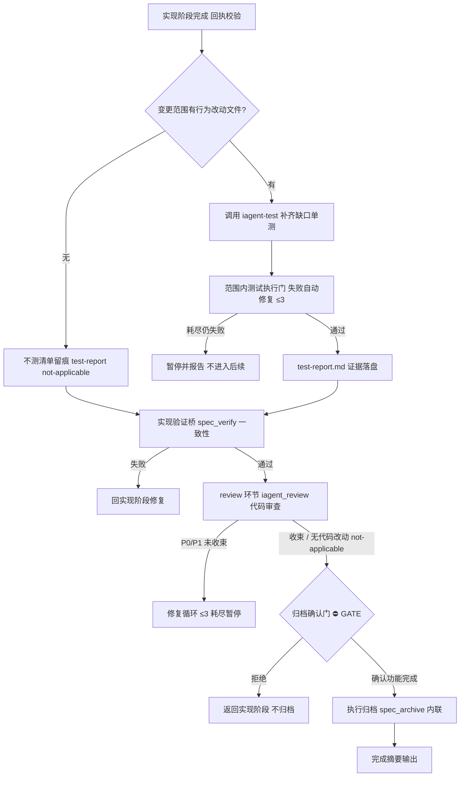

## Context

### 现状链路对比（引用 exploration.md §Analysis / §Architecture Flow，证据 `文件:行`）

| 技能 | 实现后测试环节 | 实现后 review 环节 | 归档环节 |
| :--- | :--- | :--- | :--- |
| `iagent_workflow` | spec-apply 承载：Step 8.11（spec-apply.ts:483-489，`iagent_test` 不可用仅 WARN）+ Step 9 测试执行门（spec-apply.ts:491）；父级条件委派测试（workflow.ts:596） | 4.3 实现验证桥 `spec_verify`（workflow.ts:372-376）；**无代码级 `iagent_review`** | **5.1 归档确认门（⛔ GATE）**（workflow.ts:383-389）→ 5.2 内联归档 |
| `iagent_auto_workflow` | Phase 4.3 测试执行门 + 自动单测补齐子阶段（§4.3）；`iagent_test` 不可用 → WARN + 记录（同 spec-apply 旧口径） | 4.4 实现验证桥（§4.4）；**无代码级 `iagent_review`** | **Phase 5 自动归档，无确认门**（§5.1「无额外用户确认」）——与其门白名单「归档桥 archive-confirmation（不可豁免）」自相矛盾 |
| `iagent_debug` | 4.2 强制回归测试（内联 `iagent_test`，debug.ts:467-486）+ 5.5 范围内测试（debug.ts:504-506） | 7.1 验证 + 7.3 `proposal_review` 深度复查（debug.ts:551-583）——提案级；**无代码级 `iagent_review`** | **不归档**——7.3 收束仅提示可归档（debug.ts:580-583），用户手工触发 |

### 架构影响（Phase 2.0 影响分析，CodeGraph blast radius）

- `getWorkflowSkillTemplate`（workflow.ts:133，HIGH）：5 callers（registry + 模板内部 command 派生）；tests: `test/stage-continuation.test.ts`。仅改 instructions 字符串与 `skillDelegation([...])` 参数 → 函数签名不变，调用方零接口影响。
- `getAutoWorkflowSkillTemplate`（auto-workflow.ts:16，HIGH）：registry 调用；生成快照与装机产物随 `pnpm generate:skills` 重建。
- `getDebugSkillTemplate`（debug.ts:204，HIGH）：6 callers；tests: `test/stage-continuation.test.ts` / `test/codegraph-protocol.test.ts`。同上。
- `renderGateWhitelistSection`（prompt-gate.ts:163，MEDIUM）：门白名单唯一源，`GATE_WHITELIST` 已含归档桥类别 → 预期不修改，仅核对锚点 id 引用一致。
- `getTestSkillTemplate`（test.ts:713，MEDIUM）：`iagent_test`「自动管线调用」条款（test.ts:729）已支持强制口径 → 预期不修改，仅核对口径一致。

### 功能流程基准（流程最终确认门已确认，2026-11-13；引用自 exploration.md §功能流程图，MUST NOT 重新发明）

节点语义（节点 / 操作 / 触发条件 / 证据位置 / 异常路径）以 exploration.md §功能流程图 的节点清单表为准（N1-N9 + 挂起态 H1-H4），本设计不另立节点表。debug 不适用 N7/N8（D3：收束提示后由用户手工归档）。

## Goals / Non-Goals

**Goals**:

- 三技能实现后链路统一为「显式强制子阶段」口径：测试调用强制化、降级路径收紧（strict 阻断 / 显式 degraded 二分，D4/D9）。
- 三技能实现验证桥后、归档门前插入 `iagent_review` 代码审查环节，报告落盘并纳入归档就绪检查（D2/D5）。
- auto-workflow Phase 5 归档前插入 ⛔ 归档确认门（复用 workflow 5.1 语义，D6/D8）。

**Non-Goals**:

- 不修改 `iagent_test`（test.ts）/ `iagent_review`（review.ts）技能本体。
- 不给 `iagent_debug` 加归档门（其流程不执行归档，维持 7.3 收束提示，D3）；不动 `iagent_workflow` 既有 5.1 门。
- 不修改运行时代码（`src/core/host-orchestration/`、CLI 命令行为）——纯技能模板层改动。
- 不修改 `prompt-gate.ts` / `test.ts`（除非实现时核对出锚点或口径缺失，届时在报告中说明）。

## Decisions

> 本文件 D 编号为设计决策局部编号；探索决策以 `(D<n>)` 标注对应 `exploration.md` §Decisions 的 id。

### D1: 统一口径承载于模板正文 + spec-apply Step 8.11 收紧

- **选择**: 三模板正文各自新增/收紧「实现后测试调用」表述；`spec-apply.ts` Step 8.11（483-489 行）的「`iagent_test` 不可用 → WARN 继续」收紧为「strict 阻断 / 显式 degraded + 透明留痕」(探索 D4/D9)。
- **理由**: 用户观察到的「实现后没有调用」根因即静默降级路径；apply 是测试子阶段的单一承载点，父级模板口径必须与其一致，否则出现第二真源。
- **备选**: 只改三个父模板不动 spec-apply —— 被否决：apply 内部仍是旧口径，父级强制形同虚设。

### D2: review 环节承载与报告落盘形态

- **选择**: 三模板在实现验证桥通过后新增 review 子阶段（主 agent 内联调用 `iagent_review`）；报告落盘 `.openspec-tmp/pipeline-<change>/review-report.md`，`**summary**:` 行 ∈ {pass, not-applicable} 放行、fail（P0/P1 未收束）阻断归档门，与既有证据三元组（compile/test/conformance）同模式，成为归档就绪检查的第四证据 (探索 D5)。
- **理由**: 复用既有「证据文件 summary 行判定」模式（exploration.md Pattern Matches），不发明新判定机制；auto-workflow §5.1 归档前置同步纳入该证据。
- **备选**: 不落盘仅口头报告 —— 被否决：归档就绪检查需要可审计证据，与 B-6「未收束不进归档门」无法对账。

### D3: auto-workflow 归档确认门形态

- **选择**: Phase 5 在「证据就绪检查」之后、「执行归档」之前插入 ⛔ GATE 段：呈现实现摘要 + 三类证据 + 测试结果 + review 结论，等待用户确认；拒绝/含糊 = 返回实现阶段（D8/B-5）；中断保持暂停（B-4）。门语义逐条对齐 workflow.ts:383-389 蓝本 (探索 D6)。
- **理由**: 消除 auto-workflow §5.1「无额外用户确认」与自身门白名单「归档桥不可豁免」的矛盾；门预算约束下归档阶段的唯一阻塞门即此门。
- **备选**: 沿用全自动直通 —— 被否决：用户诉求 3 明确要求暂停等确认。

### D4: 委派白名单经共享常量追加 review

- **选择**: 三模板 `skillDelegation([...])` 参数追加 review 委派条目（canonical id 由函数归一化），MUST NOT 手写字面量；`tool-whitelist.ts` 若无 review 委派共享常量则在该文件补一条共享条目 (探索 D2 / 项目护栏)。
- **理由**: 白名单三层组合规则要求委派条目走共享常量派生；`Skill(*)` 通配被禁。
- **备选**: 扩大既有条目为通配 —— 被否决：违反「禁用 Skill(*)」护栏。

### D5: review 失败分级与预算共用

- **选择**: P0/P1 回实现修复循环，与编译/测试共用既有 ≤3 预算；P2 记录不阻断；未收束不进归档门 (探索 D7)。
- **理由**: 与 debug / spec-apply 既有重试预算语义一致，避免多套预算并存。
- **备选**: review 单独立预算 —— 被否决：预算分裂会放大循环上限的不确定性。

### D6: description 与 Guardrails 同步微调

- **选择**: auto-workflow description 的「自动归档」表述改为如实呈现归档确认门（例：「归档前用户确认」）；其 Guardrails 中「实现完成后自动归档」条目同步修正；§4.3 的「`iagent_test` 不可用 → WARN」条目同步收紧。
- **理由**: description 与正文语义必须一致（技能路由依据）；L4 已确认两处待同步修改项。
- **备选**: 保持 description 不变 —— 被否决：与新增门语义矛盾，误导技能选择。

## Risks / Trade-offs

| 风险 | 缓解 |
|------|------|
| 生成后 SKILL.md 行数超 500 行预算（`test/skill-size-budget.test.ts`） | auto-workflow 现有源文件 281 行、生成产物有余量；新增段落措辞精简，生成后立即跑该测试核对 |
| 既有测试断言委派清单/正文内容（`test/stage-continuation.test.ts` / `test/codegraph-protocol.test.ts` / `test/allowed-tools.test.ts` / `test/skills-parity.test.ts`） | 实现时逐个核对断言并同步更新（仅断言扩展，不改测试语义）；`pnpm build && pnpm generate:skills` 后全量跑受影响测试 |
| 四类证据判定扩散（review-report 纳入归档就绪）与既有「三类证据」表述漂移 | 表述统一为「三类证据 + review 结论」，review 结论仅在存在代码改动时阻断；auto-workflow §5.1 同步改写 |
| 门白名单渲染变体（auto-workflow 用 `no-gate` variant）与新增门段的口径矛盾 | 门段文案明确引用门白名单「归档桥 archive-confirmation（不可豁免）」类别，不复述白名单全文（单一源不破坏） |
| derive-command 派生 command 版内容自动进入斜杠指令 | 无需手工同步；生成后核对 `skills/` 快照与 parity 测试 |
