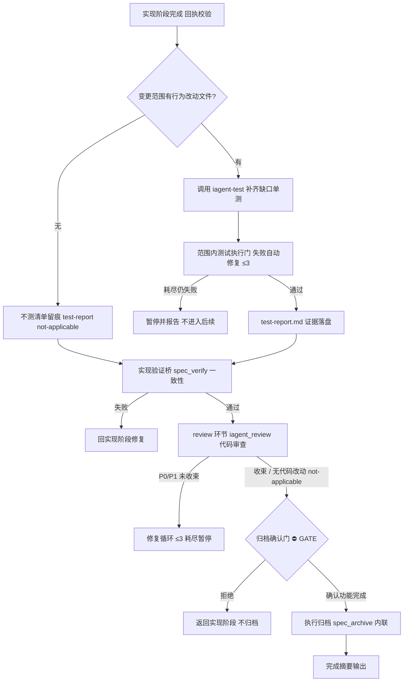

# 探索：优化 workflow / auto-workflow / debug 技能的「实现→测试→审查→归档」链路

> 文件：`openspec/explorations/optimize-workflow-skills-flow-explore-001.md`
> 创建：2026-11-13（iagent-auto-workflow Phase 1，mode=delegated）
> 状态：**已完成探索（功能流程最终确认门于 2026-11-13 经用户确认；paperTrailStatus=complete）**

## Background

**原始输入**（auto-workflow 入口参数）：优化 workflow\auto-workflow\debug 技能流程业务

1. 功能实现后增强单元测试能力，或者调用单元测试技能执行，当前存在实现后没有调用情况
2. 功能实现完成后，补充 review 能力，检查功能实现完整度
3. 功能实现后自动归档能力优化，增强确认门，当前流程实现测试完成后自动归档结束，这里需要暂停等用户完成功能确认后再结束

## 项目规则基线

**枚举命令**：`iagent rules --json`（2026-11-13）

| 源 | 存在 | 读取 | 关键约束摘要 |
| :--- | :--- | :--- | :--- |
| `.iagent/config.yaml` | 是 | 已读 | 技术栈 TS5.9 + Node≥20.19 ESM + Commander 14 + pnpm10；`rules: coding-rules/testing-rules/spec`；workflows 配置 7 项（workflow / auto-workflow / debug 不在其列——本次改动对象是模板层，非装机配置）；compileCheck 段缺省启用 |
| `.iagent/rules/coding-rules.md` | 是 | 已读 | 零猜测（未明确项标 [待确认]）；设计先行过确认门；技能模板正文唯一源、指令版由 derive-command.ts 派生禁手改；模板改动后 `pnpm build && pnpm generate:skills`；allowedTools 走 tool-whitelist.ts 共享常量禁逐模板手写；指令引用规范形 `/iagent:<id>`；委派精确到 canonical 技能 ID 禁通配 |
| `.iagent/rules/testing-rules.md` | 是 | 已读 | Vitest 3.2.6，用例 `test/**/*.test.ts`；主目录沙箱（setup-home-sandbox.ts）；CLI e2e 跑 `bin/iagent.js` → `dist/`（改 CLI 行为先 build）；模板改动不 build+generate:skills 则 test/skills-parity.test.ts 失败 |
| `.iagent/rules/spec.md` | 是 | 已读 | 变更真源 `openspec/changes/` Markdown；写入后 `iagent spec validate` 校验循环；评分门阈值 90%；handoff 包 propose 一次产出、跨阶段只读只追加结论；禁 JSON 制品 |
| `CLAUDE.md` | 否 | — | 不存在 |
| `AGENTS.md` | 是 | 已读（系统注入） | 修改守则：模板改动 → build+generate:skills → skills-parity；allowedTools 三层白名单；宿主编排协议（阶段回执 / 门白名单 / 内联执行 / 回执续跑）；版本等级随功能提交 |

## 项目技能基线

**枚举命令**：`iagent skills --json`（2026-11-13）；按 `phases ∈ {design, both}` 筛选进入设计约束

| 源 | 存在 | 读取 | 完整性 | 关键约束摘要 |
| :--- | :--- | :--- | :--- | :--- |
| `.iagent/skills/backend-design.md` | 是 | 已读 | ok | 三层架构（模板层→生成层→命令层）；单一真源优先、派生而非复制；宿主机制解耦（正文不硬编码宿主工具名）；委派 fail-safe（未声明默认 inline）；门承载收敛 `GATE_SKIP_IDS`；MUST NOT 编辑派生产物 / 手写 allowedTools / 全量通配委派 / 伪装本地降级为委派完成 |
| `.iagent/skills/backend-implement.md` | 是 | 已读（元数据） | ok | implement-only，不进入设计约束（实现阶段读取） |

## 提示词基线 (Prompt Baseline)

**原始提示词**: "优化workflow\auto-workflow\debug技能流程业务：1）功能实现后增强单元测试能力，或者调用单元测试技能执行，当前存在实现后没有调用情况 2）功能实现完成后，补充review能力，检查功能实现完整度 3）功能实现后自动归档能力优化，增强确认门，当前流程实现测试完成后自动归档结束，这里需要暂停等用户完成功能确认后再结束"

**校验结论**（1.1.2）：不明确（对象解析歧义 + review 技能映射未定）→ 触发提示词优化门 → **用户已确认（2026-11-13）**。

**确认后的提示词基线**：优化 `iagent_workflow` / `iagent_auto_workflow` / `iagent_debug` 三个技能模板的「实现 → 测试 → 审查 → 归档」链路（对象解析已确认为三技能）：

1. 实现阶段完成后 MUST 调用单元测试技能（`iagent-test`）执行测试补齐与执行，消除「实现完成后未调用测试」的情况；
2. 实现阶段完成后补充 review 环节，检查功能实现完整度（审查技能映射待 grill 确认）；
3. 实现与测试完成后不直接自动归档，MUST 暂停并等待用户确认功能完成后再执行归档（增强归档桥确认门）。

> 下游（提案 / 设计 / 规格 / 任务）以提示词基线为唯一语义来源；基线若变更 MUST 回到 1.1.2 重新确认。

## Analysis

### Deep Analysis Trigger
- Triggered: Yes
- Reason: 输入含「优化」→ 修改既有代码意图；CodeGraph 基础扫描确认三个既有模板符号（`getWorkflowSkillTemplate` / `getAutoWorkflowSkillTemplate` / `getDebugSkillTemplate`）
- Scope: 三个父编排模板的实现后链路 + 关联技能（spec-apply Step 8.11/9、iagent-test、iagent-review、spec-archive）

### Architecture Flow（三技能实现后链路现状对比，证据 `文件:行`）

| 技能 | 实现后测试环节 | 实现后 review 环节 | 归档环节 |
| :--- | :--- | :--- | :--- |
| `iagent_workflow` | spec-apply 承载：Step 8.11 自动单测补齐（调 `iagent_test`，spec-apply.ts:483-489）+ Step 9 测试执行门（spec-apply.ts:491）+ 9.7 一致性门；父级 4.1 只读证据（workflow.ts:358-362）；条件委派测试（workflow.ts:596，tasks 含 `[测试]` 时） | 4.3 实现验证桥 `iagent_spec_verify`（workflow.ts:372-376）——一致性验证；**无代码级 `iagent_review`** | **5.1 归档确认门（⛔ GATE 强制停止）**（workflow.ts:383-389）→ 5.2 内联 `iagent_spec_archive` |
| `iagent_auto_workflow` | Phase 4.3 测试执行门（自动通过）+ **自动单测补齐子阶段（内联 `iagent-test`）**（auto-workflow.ts 技能正文 §4.3；Gaterails「自动单测补齐不得跳过」） | 4.4 实现验证桥 `iagent_spec_verify`（内联）——一致性验证；**无代码级 `iagent_review`** | **Phase 5 自动归档，无用户确认门**（技能正文 §5.1「无额外用户确认」）——与其门白名单段「归档桥 archive-confirmation（不可豁免）」**自相矛盾** |
| `iagent_debug` | 4.2 强制回归测试（内联调 `iagent_test`，debug.ts:467-486）+ 5.5 范围内测试（debug.ts:504-506） | 7.1 `iagent_spec_verify_proposal` 内联验证 + 7.3 `iagent_proposal_review` 内联深度复查（debug.ts:551-583）——提案级复查；**无代码级 `iagent_review`** | **不归档**——7.3 收束仅提示「已可归档，运行 /iagent:spec-archive」（debug.ts:580-583），用户手工触发 |

### Business Flow（用户三点诉求 × 现状缺口）

1. **实现后测试调用**：三个技能的测试环节均有承载点位，但存在**静默降级/条件分支**路径——`testGate.autoGenerate=false` 跳过、`iagent_test` 不可用时 WARN 继续（spec-apply.ts:489；auto-workflow §4.3 同口径）、workflow 父级对 apply 内部测试不显式见证。用户观察的「实现后没有调用」需澄清具体现象。
2. **实现后 review**：三技能实现后链路一致缺失 `iagent_review`（代码级审查：质量维度 + 规范核对 + 分级报告，review.ts:9-10）——现有 `spec_verify` / `proposal_review` 分别是一致性验证与提案复查，非代码审查。
3. **归档确认门**：auto-workflow Phase 5 缺归档确认门（且与自身门白名单矛盾）；workflow 已有 5.1 门；debug 不执行归档。

### Identified Symbols
- `getWorkflowSkillTemplate` (`workflow.ts:133`)：归档确认门已有（基准参照）
- `getAutoWorkflowSkillTemplate` (`auto-workflow.ts:16`)：Phase 5 归档门缺口 + 测试/review 链路
- `getDebugSkillTemplate` (`debug.ts:204`)：收束不归档现状 + 测试/review 链路；6 callers（registry + stage-continuation/codegraph-protocol tests）
- `getTestSkillTemplate` (`test.ts:713`)：`iagent_test` 技能（测试规则唯一来源）；3 callers
- `renderGateWhitelistSection` (`prompt-gate.ts`)：门白名单渲染（归档桥语义）
- `GATE_SKIP_IDS` (`host-orchestration/delegation-contract.ts`)：门承载 id 集

### Capability Exploration Memory (injected)
- 无能力级探索记忆 — 全新探索（`openspec/specs/**/explorations.md` 不存在）
- CONTEXT.md 既有术语已载入（385+ 行）：沿用「门预算 / grill 批量确认 / 测试执行关卡 / 门白名单 / handoff 包 / 归档生成制品 / SKILL 调用桥接 / 直通句」等既有定义，不重新定义

## 功能流程图

<!-- 1.5.5 产出（2026-11-13）：优化后三技能统一的「实现→测试→review→归档」链路（流程基准候选，待流程最终确认门确认） -->

| 节点 | 操作 | 触发条件 | 证据位置 | 异常路径 |
| :--- | :--- | :--- | :--- | :--- |
| N1 | 实现阶段完成与回执校验 | 实现任务全部完成 | `workflow.ts:356` / auto-workflow 正文 §4.1 / `debug.ts:485` | 回执缺失 → 暂停 |
| N2 | 可测文件判定 | N1 通过 | `spec-apply.ts:483`（Step 8.11 既有） | 无行为改动文件 → N2A |
| N2A | 不测清单留痕 + not-applicable 证据 | N2 判定为无 | `spec-apply.ts:489`（证据形态）[调整：留痕强制化] | — |
| N3 | 调用 `iagent-test` 补齐缺口单测 | N2 判定为有 | `spec-apply.ts:483-489` / `debug.ts:477`（内联调用既有）/ auto-workflow §4.3 `[新建：三技能统一强制口径]` | 技能不可用 → strict 阻断（D9）；配置关闭 → degraded 留痕（B-2） |
| N4 | 范围内测试执行门 | N3 完成 | `spec-apply.ts:491`（Step 9）/ `debug.ts:504`（Phase 5.5） | 失败 → 自动修复 ≤3 → 耗尽暂停（H1） |
| N5 | 实现验证桥（`spec_verify` 一致性） | 测试门通过 | `workflow.ts:372-376`（4.3）/ auto-workflow §4.4 | 失败 → H2 回实现 |
| N6 | review 环节（`iagent_review` 代码审查） | N5 通过 | `[新建]` 三模板新增段落 + `skillDelegation` 追加 review（技能本体 `review.ts:9` 既有） | P0/P1 → 修复循环 ≤3（H3）；P2 记录；无代码改动 → not-applicable 留痕（B-3） |
| N7 | 归档确认门 ⛔ | N6 收束 | `workflow.ts:383-389`（5.1 语义蓝本，既有）/ `[新建]` auto-workflow Phase 5 门（预期产物：Phase 5 新增门段 + 门白名单一致化）；debug 不适用（D3 收束提示） | 拒绝 → H4（D8）；含糊回复按拒绝（B-5）；中断保持暂停（B-4） |
| N8 | 执行归档（`spec_archive` 内联） | N7 确认 | `workflow.ts:391-397`（5.2） | sync 冲突非阻断（WARN） |
| N9 | 完成摘要输出 | N8 完成 | 各模板 Output 段既有 | — |

## Codebase Findings (NEW)

### Discovered Files
- `src/core/templates/workflows/workflow.ts`（618 行）：引导工作流模板——归档确认门基准参照（workflow.ts:383-389）
- `src/core/templates/workflows/auto-workflow.ts`（282 行）：全自动工作流模板——Phase 5 自动归档无确认门（缺口）
- `src/core/templates/workflows/debug.ts`（696 行）：调试模板——7.3 收束不归档（debug.ts:580-583）
- `src/core/templates/workflows/spec-apply.ts`：Step 8.11 自动单测补齐 + Step 9 测试执行门 + 9.7 一致性门（spec-apply.ts:483/491/715）
- `src/core/templates/workflows/test.ts`（1001 行）：`iagent_test` 技能模板
- `src/core/templates/workflows/review.ts`：`iagent_review` 代码审查技能（review.ts:9-10）
- `src/core/templates/types.ts`：SkillTemplate / CommandTemplate 接口
- `src/core/templates/workflows/spec-bulk-archive.ts`：批量归档模板（对照参考）

### Pattern Matches
- 门白名单 5 类必留门模式（需求澄清 / 流程图 / 实现+测试桥 / 归档桥 / 破坏性确认）——auto-workflow 正文声明却未在 Phase 5 落实归档桥
- 证据三元组模式：`compile-report.md` / `test-report.md` / `conformance-report.md` 的 `**summary**:` 行判定
- 内联技能调用模式：`iagent-test` / `spec_verify` / `proposal_review` 均为主 agent 内联（`executionMode=inline`）

### Deep-Dive
- **门预算约束**（CONTEXT.md「门预算」条）：每阶段至多 1 个流程级阻塞确认门——归档阶段加 `archive-confirmation` 门符合预算（归档阶段的唯一门）
- **既有门语义基准**：workflow 5.1 归档确认门（就绪检查三类证据 + 呈现实现摘要 + 出口确认/拒绝）可直接作为 auto-workflow 归档门的语义蓝本
- **allowedTools 影响**：三个模板的 `skillDelegation([...])` 清单均不含 `review`——补 review 环节须同步白名单（tool-whitelist.ts 共享常量派生）
- **测试门预算**：编译/测试/修复共用 ≤3 重试预算（spec-apply / debug 既有约定）

## Questions

### 批量 1（L1-L3，2026-11-13 确认）

| # | 问题 | 回答/建议 | 状态 |
| :--- | :--- | :--- | :--- |
| Q1 | 「实现后没有调用测试」具体指哪种现象 | 降级/不可用路径被静默跳过（testGate.autoGenerate=false 直跳；iagent_test 不可用仅 WARN 继续——spec-apply.ts:489） | ✅ 按建议采纳 |
| Q2 | review 技能映射 | `iagent_review`（代码级审查：质量维度+规范核对+分级报告） | ✅ 按建议采纳 |
| Q3 | 归档门适用范围 | auto-workflow 加门；workflow 既有 5.1 门不动；debug 维持收束提示不加门 | ✅ 按建议采纳 |
| Q4 | 测试调用强制化口径 | 实现完成后测试调用为显式强制子阶段；不可用/关闭时阻断或显式 degraded + 透明留痕 | ✅ 按建议采纳 |
| Q5 | review 环节位置 | 实现验证桥通过后、归档门之前；报告落盘并入归档就绪检查 | ✅ 按建议采纳 |
| Q6 | 归档门形态 | 复用 workflow 5.1 语义（实现摘要+三类证据+测试结果，⛔ GATE） | ✅ 按建议采纳 |
| Q7 | review 失败处置 | P0/P1 回实现修复循环（共用 ≤3 预算），P2 记录不阻断；未收束不进归档门 | ✅ 按建议采纳 |
| Q8 | 归档门拒绝出口 | 拒绝=返回实现阶段不归档；无跳过归档选项 | ✅ 按建议采纳 |
| Q9 | 技能不可用处置 | strict 阻断并报告；仅显式 degraded 协商才降级并透明记录 | ✅ 按建议采纳 |

## 术语表 (NEW)

| 术语 | 定义 | 避免使用 |
|------|------|---------|
| 实现后测试调用 | 三技能（workflow/auto-workflow/debug）实现阶段完成后统一存在的显式强制测试子阶段——调用 `iagent-test` 技能执行补齐与执行，缺失即阻断（grill 批量 1 Q4 确认） | 隐式测试（易与 apply 内部承载混）、测试后置 |
| 实现后 review 环节 | 实现验证桥（spec_verify 一致性）通过后、归档门之前插入的 `iagent_review` 代码审查步骤，检查功能实现完整度（grill 批量 1 Q2/Q5 确认） | 提案复查（那是 proposal_review）、实现验证（那是 spec_verify） |
| 归档确认门（auto-workflow） | auto-workflow Phase 5 在自动归档执行前的 ⛔ GATE——呈现实现摘要+三类证据+测试结果，等待用户确认功能完成后再归档；语义复用 workflow 5.1（grill 批量 1 Q6 确认） | 归档桥（那是门白名单类别 id 的统称）、自动归档（旧语义） |

## 架构决策 (NEW)

<!-- ADR 三条件判定：本轮决策均为流程语义修订（可逆、不意外、非艰难权衡）——不满足「难以逆转」，不产出 ADR -->

无 ADR

## 边界场景 (NEW)

- [x] **B-1**（D4，批量 2 确认）：变更范围内无任何有行为改动的文件（纯文档/纯配置）→ 自动单测补齐判定「无可测文件」→ 不测清单留痕 + 测试门 `not-applicable` 放行（不阻断归档）
- [x] **B-2**（D4，批量 2 确认）：`testGate.autoGenerate=false`（项目配置显式关闭）→ 用户显式意愿视为显式 degraded：留痕 + WARN「自动补测已由项目配置关闭」，不阻断；仅「技能不可用/宿主不支持」走 strict 阻断
- [x] **B-3**（D5，批量 2 确认）：变更范围无代码改动（纯制品/文档）→ review 环节 `not-applicable` 留痕直通（不阻断）
- [x] **B-4**（D6，批量 2 确认）：归档确认门等待期间用户中断 → 保持暂停不归档（确认门无超时跳过；中断=暂停，resume 时重呈现门）
- [x] **B-5**（D6/D8，批量 2 确认）：用户在归档门回复含糊（如「再看看」未给具体项）→ 按拒绝出口处理（回实现阶段），MUST NOT 猜测意图为确认（fail-safe 取保守侧）
- [x] **B-6**（D7，批量 2 确认）：review P0 修复循环 3 次耗尽仍未收束 → 暂停并报告，MUST NOT 进入归档门（与编译/测试预算耗尽同口径）

## Decision Process (NEW)

### Decision: 实现后链路强制化（测试 / review / 归档门）
**Options Considered**:
- Option A: 维持各技能分散承载（apply 内部 / 条件分支），仅补缺口
- Option B: 三技能统一「显式强制子阶段」口径，收紧降级路径（strict 阻断 / 显式 degraded）

**Pros/Cons**:
- Option A: 改动小 vs 缺口不可见（用户观察到的「没调用」正是此形态）
- Option B: 调用可见、失败可审计 vs 需同步修改三模板与 spec-apply 既有条款

**Chosen**: Option B
**Rationale**: 用户诉求 1 的根因即静默降级路径；显式强制子阶段使「没调用」与「没评估过」可区分（与该不该测闸门同语义）

### Decision: review 环节引入
**Options Considered**:
- Option A: 复用 spec_verify（一致性）加深
- Option B: 引入 `iagent_review` 代码审查（质量+规范+分级报告）

**Chosen**: Option B
**Rationale**: spec_verify 验证的是实现与制品一致性，非代码质量；用户诉求 2 指向「功能实现完整度」的代码级检查

## Decisions

- **D1**: 「实现后没有调用测试」按降级/不可用路径静默跳过理解（testGate.autoGenerate=false 直跳；iagent_test 不可用仅 WARN——spec-apply.ts:489），修复方向为收紧为强制显式调用 — 确认于 2026-11-13
- **D2**: review 环节映射到 `iagent_review` 技能（代码级审查：质量维度 + 规范核对 + 分级报告）— 确认于 2026-11-13
- **D3**: 归档确认门适用范围：auto-workflow 增加归档确认门；workflow 既有 5.1 门不动；debug 维持收束提示不加门（其流程不执行归档）— 确认于 2026-11-13
- **D4**: 三技能统一口径：实现完成后测试调用为**显式强制子阶段**——`iagent_test` 不可用 / 配置关闭时 MUST 阻断或经显式 degraded 协商并透明留痕，MUST NOT 静默跳过、MUST NOT 表述为「已测试」— 确认于 2026-11-13
- **D5**: review 环节位置：实现验证桥（spec_verify 一致性）通过后、归档门之前执行 `iagent_review`；review 报告落盘并纳入归档就绪检查 — 确认于 2026-11-13
- **D6**: auto-workflow 归档确认门形态：复用 workflow 5.1 语义——呈现「实现摘要 + 三类证据（compile/test/conformance）+ 测试结果」，⛔ GATE 等待用户确认功能完成后才执行归档；位置在测试门 + 实现验证桥通过之后 — 确认于 2026-11-13
- **D7**: review 失败处置：P0/P1 问题回实现阶段修复循环（共用既有 ≤3 重试预算），P2 记录不阻断；review 未收束 MUST NOT 进入归档门 — 确认于 2026-11-13
- **D8**: 归档确认门拒绝出口：拒绝 = 返回实现阶段继续（不归档），与 workflow 5.1 出口一致；不提供「跳过归档」选项 — 确认于 2026-11-13
- **D9**: `iagent_test` / `iagent_review` 不可用（宿主不支持内联调用）：strict 阻断并报告（与 debug §4.2 能力缺失处置一致）；仅显式 degraded 协商才允许降级并透明记录「未发生内联技能调用」— 确认于 2026-11-13

## 硬约束 (NEW)

- 实现阶段完成后 MUST 调用 `iagent-test` 技能执行测试补齐与执行 — source: D1, D4
- `iagent_test` 不可用 / `testGate.autoGenerate=false` 时 MUST NOT 静默跳过，MUST NOT 表述为「已测试」（区分配置关闭=显式 degraded 与能力缺失=strict 阻断） — source: D4, D9
- auto-workflow 实现与测试完成后 MUST NOT 直接自动归档：MUST 暂停呈现归档确认门，等待用户确认功能完成后再归档 — source: D3, D6
- `iagent_review` 在实现验证桥通过后、归档门之前执行；review 报告落盘并纳入归档就绪检查 — source: D2, D5
- review 未收束（P0/P1 未修复）MUST NOT 进入归档门 — source: D7
- 归档确认门拒绝 = 返回实现阶段（不归档）；MUST NOT 提供「跳过归档」选项 — source: D8
- 三技能既有 allowedTools 的 `skillDelegation([...])` 清单 MUST 同步追加 review 委派条目 — source: D2

## Scope Changes (NEW)

| 变更时间 | 变更类型 | 变更描述 | 原因 |
|---------|---------|---------|------|

## Pending (enhanced)

### For Phase 2 Impact Analysis
- `getWorkflowSkillTemplate` (`src/core/templates/workflows/workflow.ts:133`) - Priority: HIGH
- `getAutoWorkflowSkillTemplate` (`src/core/templates/workflows/auto-workflow.ts:16`) - Priority: HIGH
- `getDebugSkillTemplate` (`src/core/templates/workflows/debug.ts:204`) - Priority: HIGH
- `renderGateWhitelistSection` (`src/core/templates/prompt-gate.ts`) - Priority: MEDIUM
- `getTestSkillTemplate` (`src/core/templates/workflows/test.ts:713`) - Priority: MEDIUM

### Security Concerns
（暂无——模板文本层改动，不涉及运行时安全面）

### Business Validation
- 「实现后没有调用测试」的具体现象归属：已解决（降级/不可用路径静默跳过，D1）
- review 技能映射：已解决（iagent_review，D2）
- 归档确认门适用范围：已解决（仅 auto-workflow 加门，D3）

### Unresolved Decisions
（全部消解：批量 1 九项 + 批量 2（L4 两处待同步修改项 + L5 边界场景 B-1~B-6）均确认于 2026-11-13）
