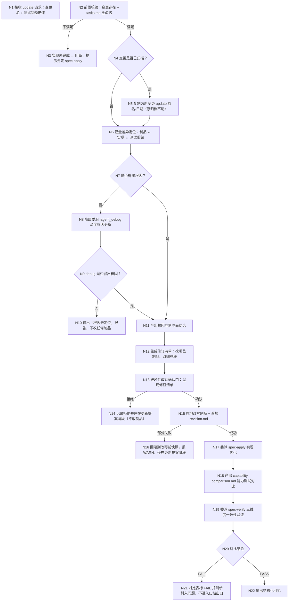

# 设计：新增 spec-update 能力（已实现变更的修订闭环）

> 本文件 D 编号为**设计决策局部编号**（形如 `D1`–`D13`），与 `exploration.md` §Decisions 的探索决策编号**不是同一组**；跨文档引用探索决策一律写作 `(探索 D<n>)`，引用设计决策写作 `(设计 D<n>)`。两者不得互相替代。

## Context

### 现状缺口（引用 exploration.md §Analysis / §Codebase Findings，证据 `文件:行`）

| 能力 | 起点 | 根因分析 | 提案处理 | 修复实现 | 验证 |
| :--- | :--- | :--- | :--- | :--- | :--- |
| `iagent_debug`（`src/core/templates/workflows/debug.ts:212`） | 孤立 bug 报告 | ✅ CodeGraph + 6 维根因 | 「**同步提案**」（修复后附属同步） | ✅ 带强制回归测试 | ✅ 委派 `spec-verify-proposal` |
| `iagent_spec_apply`（`src/core/templates/workflows/spec-apply.ts:271`） | 已有制品的变更 | — | — | ✅ 任务清单 + 编译 + 测试关卡 | — |
| `iagent_spec_verify`（`src/core/templates/workflows/spec-verify.ts:8`） | 已实现变更 | — | — | — | ✅ 三维度一致性（实现 vs 制品） |
| **`spec-update`（本次）** | **已实现 + 已测试后的问题** | ✅ 轻量默认 + 降级 debug（D4） | ✅ **原地改写既有制品 + revision.md（主体动作）** | ✅ 委派 apply | ✅ **修复前 vs 修复后能力对比（D5）** |

→ 职责边界已由 ADR-0003（`openspec/docs/adr/0003-spec-update-boundary-with-debug.md`）固化。

### Architecture Impact（Phase 2.0 影响分析，CodeGraph blast radius）

> 逐符号结果源自 `exploration.md` §影响分析（Phase 2.0 自动执行），此处只做制品化改写，**不改动其结论**。

- `WORKFLOW_PAIRS`（registry.ts:105，HIGH）：4 处同文件调用（`getSkillTemplates` / `getCommandTemplates` / `deriveCommandId` 派生链）；tests: `test/templates.test.ts` / `test/command-reference-refs.test.ts` / `test/project-skill-templates.test.ts` / `test/skills-parity.test.ts`。改动要求：新增 `spec-update` 技能对，必须同时提供 skill 版与 command 版模板；`deriveCommandId('iagent_spec_update')` ⇒ `spec-update`。
- `deriveCommandId`（registry.ts:83，HIGH）：9 处调用（registry.ts、`src/commands/update.ts`、`src/commands/init.ts`、`src/core/templates/index.ts`）；tests: `test/templates.test.ts`。新技能自动派生 `spec-update`，无需改动派生逻辑本身。
- `getWorkflowSkillTemplate` / `getWorkflowCommandTemplate`（workflow.ts:151 / :628）：5 / 2 处调用（registry.ts）；tests: `test/stage-continuation.test.ts` / `test/template-derivation.test.ts`。`spec-update` 为单体技能，不进入 `WORKFLOW_PROTOCOLS`（D6）。
- `DEFAULT_WORKFLOWS`（profiles.ts:17，HIGH）：3 处调用（`src/commands/onboarding.ts`、profiles.ts 自身）；tests: `test/profiles.test.ts`。是否纳入默认集**待提案阶段核准**（属破坏性面，须走破坏性确认门）。
- `DEPS`（profiles.ts:58，HIGH）：3 处调用（`resolveWorkflows` 不动点迭代，profiles.ts 自身）；tests: `test/profiles.test.ts` / `test/stage-continuation.test.ts`。`spec-update` ⇒ 实际委派清单对应的技能逐条核准后补全，死引用 MUST NOT 产生。
- `GATE_WHITELIST` / `GateWhitelistId`（protocol.ts:98 / :69，HIGH）：门校验链 `isWhitelistedGate` / `GATE_WHITELIST_ANCHORS`；下游 `evaluatePhaseTransition`、`gate-ledger.ts`（`isGateSkipId` 4 处、`renderGateLedgerEntry` 3 处、`resolveGateLedgerConfirmation` 2 处）；tests: `test/gate-ledger.test.ts` / `test/allowed-tools.test.ts` / `test/claude-host-adapter.test.ts` / `test/host-orchestration.test.ts`。正向枚举 5 类 MUST NOT 增删；新技能的门 MUST 归入既有类别（修订 / 破坏性 ⇒ `destructive-change`，不可豁免）。
- `skillDelegation`（tool-whitelist.ts:93，HIGH）：16 处调用（spec-propose / spec-apply / debug / workflow / auto-workflow 等模板）；tests: `test/tool-whitelist-constants.test.ts` / `test/workflow-implementation-chain.test.ts` / `test/allowed-tools.test.ts`。新技能正文里的委派条目 MUST 走 `skillDelegation([...])` 共享常量，MUST NOT 手写 `Skill(...)` 字面量、MUST NOT 用 `Skill(*)`。
- `normalizeDelegationSkillId`（tool-whitelist.ts:64，MEDIUM）：经 `skillDelegation` 间接调用；tests: `test/tool-whitelist-constants.test.ts`。入参裸名 `debug` / `spec_apply` / `spec_verify` 归一化为 `iagent-debug` / `iagent-spec-apply` / `iagent-spec-verify`。
- `getChangeStatus`（status.ts:156，MEDIUM）：4 处调用（`src/commands/spec.ts` 的 `runSpecStatus`）；tests: `test/spec-status.test.ts`。作为「任务已全部勾选」的**前置校验只读点**；`progress.remaining === 0` 为阻断条件。
- `SPEC_DRIVEN_SCHEMA`（schema.ts:47，MEDIUM）：12 处调用（`src/commands/spec.ts`）+ spec/archive.ts、spec/instructions.ts、spec/new-change.ts、spec/status.ts；tests: `test/markdown-spec-cli.test.ts` / `test/spec-instructions-apply.test.ts`。新增制品（`revision.md` / `capability-comparison.md`）**是否进 schema 登记**属提案阶段决策；不进 schema 则 MUST NOT 被主 spec 合并范围收录。
- `detectCompleted` / `parseTaskProgress`（status.ts，MEDIUM）：src/commands/spec.ts；tests: `test/spec-status.test.ts`。判定变更是否「已完成提案 + 实现」。
- `evaluatePhaseTransition` / `PhaseSpec`（transition.ts、protocol.ts，MEDIUM）：阶段迁移阻断判定；tests: `test/host-orchestration.test.ts`。`spec-update` 若自建阶段协议，MUST 与 `GATE_WHITELIST` 对齐（D6：优先不进协议表）。

### 功能流程基准（流程最终确认门已确认，2026-11-14；引用自 exploration.md §功能流程图，MUST NOT 重新发明）

节点语义（节点 / 操作 / 触发条件 / 证据位置 / 异常路径）以 exploration.md §功能流程图 的节点清单表为准（N1–N22），本设计不另立节点表。

## Goals / Non-Goals

**Goals**:

- 新增独立 spec 类技能 `iagent_spec_update`，承载四环节修复闭环且**环节顺序不可重排**（D3）。
- 提案修订走「同一变更身份内原地改写 + 修订痕迹追加」，保留单一变更身份与完整追溯链（D2 / D8）。
- 双轨根因定位：默认轻量差异定位，根因不明时降级委派 `iagent_debug`，两者皆无结论则不改任何制品（D4，ADR-0003）。
- 覆盖既有制品前设不可豁免的破坏性改动确认门，且**不新增第 6 类门**（D11）。
- 新增变更级制品（`revision.md` / `capability-comparison.md`）不进主 spec 合并范围，归档时随变更目录整体移动（D5）。
- 委派面与 `DEPS` 注入面逐条一致，MUST NOT 产生死引用（D6）。

**Non-Goals**:

- 不修改 `iagent_debug` / `iagent_spec_propose` / `iagent_spec_apply` / `iagent_spec_verify` 的既有行为与流程（D1）。
- 不把 `spec-update` 纳入 `DEFAULT_WORKFLOWS` 或 `WORKFLOW_PROTOCOLS`（D6）。
- 不新增第 6 类门白名单类别，不改 `GATE_WHITELIST` / `GateWhitelistId` / `PHASE_GATE_CATEGORY`（D11）。
- 不把 `revision.md` / `capability-comparison.md` 登记进 `SPEC_DRIVEN_SCHEMA`（不进 status / instructions / archive 的主 spec 合并源）。
- 不整体重写 `skill-profile` 主规格的「依赖注入」共享需求（该需求在本变更前即已与代码漂移，见 proposal.md §待用户确认项 Q2）。
- 不引入跨变更索引能力（ADR-0002 已退役）；「定位受影响变更」只依赖 `openspec/changes/` 目录遍历与 `iagent spec status`。
- 不在本变更内实现能力测试对比的自动化脚本 —— 对比结论由技能正文流程产出（制品化，不写运行时逻辑）。

## Decisions

### D1: 能力形态 —— 独立技能 + 指令成对注册

- **选择**：新建 `src/core/templates/workflows/spec-update.ts`，导出 `getSpecUpdateSkillTemplate()`（skill 版正文唯一源）与 `getSpecUpdateCommandTemplate()`（command 版由 `deriveCommandContent()` 派生），在 `WORKFLOW_PAIRS` 成对登记；内部名 `iagent_spec_update`，canonical workflowId / 指令 id `spec-update`，宿主技能 ID `iagent-spec-update`，type `spec`（探索 D1）。
- **理由**：修复闭环是多阶段编排（含实现与验证），与 propose / apply / explore 的既有定位不同层；独立技能便于门控与单独安装。沿用仓库既有「成对注册 + 正文唯一源 + 指令派生」三层模式。
- **备选**：扩展既有 `spec-propose` + `spec-apply` —— 被否决：「创建提案」与「修订提案」职责混合；扩展 `spec-explore` —— 被否决：探索模板已声明只读、不写制品。

### D2: `DEPS` 随装补全清单的逐条核准

- **选择**：`DEPS['spec-update'] = ['spec-apply', 'spec-verify', 'test', 'debug']`，与正文委派面逐条对应（探索 D6 硬约束）：
  | 依赖技能 | 正文委派节点 | 委派性质 |
  | :--- | :--- | :--- |
  | `spec-apply` | N17 再实现优化 | 无条件必需 |
  | `spec-verify` | N19 三维度一致性验证 | 无条件必需 |
  | `test` | N18 能力测试对比（对比用例生成与执行） | 无条件必需 |
  | `debug` | N8 降级深度根因分析 | 条件委派（轻量无结论时触发），但 MUST NOT 形成死引用 |
- **理由**：仓库既有约定（`spec-apply ⇒ test`）—— 被委派技能必须可得，否则缺技能即死引用；`skill-profile` 已有「委派面与依赖面一致」回归锁（`DEPS` 声明但正文从不委派的冗余项会被告警 / 失败）。故 `test` 必须由正文真实委派（能力测试对比环节），而非仅靠 `spec-apply` 传递注入。
- **备选**：只声明 `spec-apply` / `spec-verify` / `debug` —— 被否决：违反探索 D6 硬约束（`DEPS` MUST 含 `spec-update` ⇒ `spec-apply` / `spec-verify` / `test` / `debug`）。

### D3: `DEFAULT_WORKFLOWS` 不纳入 `spec-update`（破坏性面单列）

- **选择**：`DEFAULT_WORKFLOWS` 保持 8 项不变，`spec-update` 不纳入（探索 D6 硬约束）。纳入与否在 proposal.md §待用户确认项 Q1 单列为**破坏性面**，本提案默认不纳入（探索 D6）。
- **理由**：默认集膨胀会改变默认安装集规模与用户首装体验，属破坏性改动，须走破坏性改动确认门后单独决策；`spec-update` 是「已实现变更出问题后」才需要的按需能力。
- **备选**：直接纳入默认集 —— 被否决：属破坏性面且未获用户确认。

### D4: 门归属 —— 动作级破坏性改动确认门，不新增类别

- **选择**：原地改写既有制品前设**显式破坏性改动确认门**（N13），归入既有 `GATE_WHITELIST` 第 5 类 `destructive-change`（动作级、不可豁免）；**MUST NOT** 新增第 6 类，不改 `GATE_WHITELIST` / `GateWhitelistId` / `PHASE_GATE_CATEGORY`（探索 D11）。
- **理由**：`destructive-change` 类别的定义已含「覆盖既有制品」，语义完全吻合；该门是技能内动作级门（不是阶段门），`spec-update` 不进 `WORKFLOW_PROTOCOLS` 故无需 `PhaseSpec.gate` 映射。正文经 `renderGateWhitelistSection({ variant: 'full' })` 与 `GATE_PROTOCOL_PREAMBLE` 共享常量引用门白名单，不手写第二份。
- **备选**：新建第 6 类「提案修订确认」 —— 被否决：硬约束明令禁止；归入既有澄清类 —— 被否决：修订 / 覆盖既有制品属破坏性动作，语义上不等价。

### D5: 新增变更级制品不进 schema、不进主 spec 合并范围

- **选择**：`revision.md` 与 `capability-comparison.md` 落在变更目录内，**不登记**进 `SPEC_DRIVEN_SCHEMA.artifacts`；因此 `iagent spec status` / `instructions` / `archive` 的主 spec 合并范围不收录二者；归档时随变更目录整体移动（`executeArchive` 的整目录移动语义天然满足）（探索 D5 / 硬约束）。
- **理由**：二者是**变更过程留痕**（修订记录 + 能力对比），不是能力规格的增量来源；登记进 schema 会让归档技能把它们当作 delta spec 合并进主 spec，污染能力规格。
- **备选**：登记进 schema —— 被否决：进入主 spec 合并范围，与硬约束冲突；放在 `.openspec-tmp/` —— 被否决：`.openspec-tmp/` 为本机不入库产物，修订痕迹会随清理丢失，不可追溯。

### D6: 修订痕迹与能力对比的追加语义

- **选择**：
  - `revision.md`：**追加**写入，MUST NOT 覆盖历史修订记录（探索 D8 / BS6）。单条修订条目字段固定为：问题现象 → 根因 → 修订点（改哪些制品 / 改哪些段）→ 影响制品 → 来源（根因定位路径：轻量 / debug 降级）。
  - `capability-comparison.md`：**追加**对比行。表头固定为「能力 → 修复前表现 → 修复后表现 → 证据位置 → 结论」。
- **理由**：同一变更可连续多次 update（BS6），追加语义保证历史可追溯；固定表头让下游（用户裁决 / 归档摘要）可稳定解析。
- **备选**：每次覆盖 —— 被否决：丢失历史修订轨迹，违反硬约束。

### D7: 「修复前表现」基线的落盘位置与时点

- **选择**：能力测试对比的**修复前基线**在**轻量差异定位阶段（N6）**随用户测试现象落盘到 `capability-comparison.md`（首行基线块），**修复后表现**在 N17 委派 `spec-apply` 完成后由 N18 追加。基线因此不依赖 `.openspec-tmp/`（本机产物不入库），而是留在变更目录内随归档走（探索 §Implicit Assumptions）。
- **理由**：「修复前表现」在进入实现之前是唯一可得的观测值；越过 N6 才产生实现改动，基线必须先落盘。落在变更目录内保证归档后仍可审计。
- **备选**：把基线放进 `revision.md` —— 被否决：`revision.md` 是修订痕迹（问题 → 根因 → 修订点），语义上不承载能力表现对比，两类制品职责混淆。

### D8: 改写原子性与回滚机制

- **选择**：N15 改写采用「**写前内存副本 + 逐制品写入 + 失败整体回滚**」三段式：
  1. 改写前逐个读取目标制品原文存入内存副本（快照）；
  2. 按 `proposal.md` → `specs/**` → `design.md` → `tasks.md` 顺序逐个写入；
  3. 任一写入失败 → 用内存副本逐个还原已改写制品，报 WARN，停在「更新提案」阶段，MUST NOT 进入实现（探索 D10 / BS2）。
- **理由**：BS2 明确要求「回滚到改写前快照（写前内存副本）」；内存副本避免引入临时目录清理负担，且改写目标数量有限（4 类制品）。
- **备选**：先写临时文件再原子替换 —— 被否决：跨文件无法原子化，且引入临时文件清理面；不回滚只报错 —— 被否决：留下半改写状态，违反硬约束。

### D9: 已归档变更的复活复制

- **选择**：N4 判定变更已归档时，复制为新变更 `update-<原名>-<YYYYMMDD>`（`YYYYMMDD` 取执行当日）；复制用 `node -e "fs.cpSync(...)"` 递归复制（跨平台，MUST NOT 依赖 `cp -r` / `xcopy`）；**原归档目录保持不动**；复制失败 → 阻断并报 WARN，终止本轮（探索 D9 / BS1）。
- **理由**：归档目录是历史事实，既有归档护栏（spec-archive 归档只读）MUST NOT 被本能力触碰；跨平台复制需统一走 `node` 的 fs API（与 spec-archive 的 `Bash(node:*)` 清理路径同源）。
- **备选**：直接改归档目录内的制品 —— 被否决：违反归档只读护栏且不可逆。

### D10: 降级委派 `iagent_debug` 的诚实性约束

- **选择**：N8 降级委派 `iagent_debug` 时，MUST 在回执 / 报告中如实记录委派**是否真正发生**；委派未发生（宿主能力缺失）时 MUST NOT 表述为「委派完成」，MUST 按「根因未定位」处理（N10），不改任何制品（探索 D4 / 硬约束）。
- **理由**：ADR-0003 明确「降级路径是显式的，不会把本地执行伪装为委派完成」；`DEPS` 随装保证技能可得，但宿主能力缺失仍可能发生，故诚实性约束必须落在正文。
- **备选**：能力缺失时本地自行执行 6 维根因分析 —— 被否决：复制既有能力形成第二真相源，ADR-0003 已否决。

### D11: description 排歧与 `iagent_debug` 反向排歧

- **选择**：`spec-update` 的 description 含三向排歧 —— NOT for 新建变更提案（改用 `iagent_spec_propose`）、NOT for 实现未完成的变更（改用 `iagent_spec_apply`）、NOT for 孤立缺陷的根因排查（改用 `iagent_debug`）。`iagent_debug` description 补**反向**排歧句（NOT for 已实现变更的提案修订，改用 `iagent-spec-update`）—— ADR-0003 把它列为「可选后续 / 默认不动」，本变更**默认采纳**（仅改路由描述文本，不改行为），可在实现期按用户意见删除任务 2.3（proposal.md §待用户确认项 Q3）。
- **理由**：两个技能都声称覆盖「修 bug」，缺排歧会导致路由歧义；反向排歧只影响技能选择提示，不影响既有行为。
- **备选**：不动 `debug.ts` —— 备选成立（ADR-0003 默认路径），但会留下单向排歧的不对称。

### D12: `allowedTools` 构成与委派白名单派生

- **选择**：`spec-update` 的 `allowedTools` =
  `Read, Write, Edit, Glob, Grep, Bash(iagent:*), Bash(node:*)` + `${CODEGRAPH_CLI}` + `${CODEGRAPH_MCP}` + `${skillDelegation(['spec_apply', 'spec_verify', 'test', 'debug'])}`。
  - 读写类：`Write` / `Edit` 支撑 N15 原地改写与 `revision.md` / `capability-comparison.md` 追加；`Read` / `Glob` / `Grep` 支撑 N6 差异定位与只读扫描。
  - `Bash(iagent:*)`：运行 `iagent spec status` 等 CLI 只读命令。
  - `Bash(node:*)`：N5 递归复制（`fs.cpSync`）与跨平台文件操作。
  - `CODEGRAPH_MCP` + `CODEGRAPH_CLI` 双写：正文经 CodeGraph 探测顺序检索（MCP 双写规则要求同时持两者）。
  - 委派条目一律走 `skillDelegation([...])` 共享常量 → 归一化为 `Skill(iagent-spec-apply)` / `Skill(iagent-spec-verify)` / `Skill(iagent-test)` / `Skill(iagent-debug)`；MUST NOT 手写字面量、MUST NOT 使用 `Skill(*)`。
- **理由**：项目护栏「allowedTools 走共享常量」+「MCP 双写」；委派条目必须与正文实际委派面一致（否则宿主权限拦截或形成死条目）。
- **备选**：放宽为 `Bash(*)` —— 被否决：授权面过宽属安全问题。

### D13: 新增技能的旧标识映射表对齐（注册副作用）

- **选择**：新增 `spec-update` 技能时，在 `LEGACY_WORKFLOW_ID_MAP`（`src/core/legacy-migration.ts`）登记**同名透传**条目 `'spec-update': 'spec-update'`；同步更新 `test/legacy-migration.test.ts` 的三处计数断言（当前指令 id 数 `22 → 23`；映射表键数 `23 → 24`；映射目标去重数 `22 → 23`）。
- **理由**：`LEGACY_WORKFLOW_ID_MAP` 是「旧新标识映射表」的唯一真源，其**目标集合 MUST 等于注册表指令 id 集**（`test/legacy-migration.test.ts:211` 的 `toEqual` 断言 + `AGENTS.md` 明载「映射不可能静默漂移」）。既有「新增能力（无旧前身）」的登记先例即同名透传（`src/core/legacy-migration.ts:149-151` 的 `frontend-skill-gen` / `backend-skill-gen`）。
- **影响面（精确计数断言面）**：技能 / 指令计数断言实际分布在 **8 个测试文件、15 处**（`test/templates.test.ts:28`、`test/template-derivation.test.ts:21-22`、`test/template-consistency.test.ts:146`、`test/skills-parity.test.ts:123`、`test/commands.test.ts:151/162/601/615`、`test/config-command.test.ts:32`、`test/validate-update.test.ts:37/45/46`、`test/legacy-migration.test.ts:209/213`）；`legacy-migration.test.ts:210` 的映射表**键数**断言语义不同（`23 → 24`），MUST NOT 按「22 → 23」盲改。
- **备选**：改测试断言为子集比较 —— 被否决：`AGENTS.md` 明令映射目标集 MUST 与注册表一致，改断言即改语义（且违反任务「MUST NOT 改测试语义」）。

## Risks / Trade-offs

| 风险 | 缓解 |
|------|------|
| 新增技能使技能 / 指令总数 22 → 23，触发既有计数断言失败（`templates.test.ts` / `template-derivation.test.ts` / `skills-parity.test.ts` / `commands.test.ts` / `config-command.test.ts` / `legacy-migration.test.ts` / `template-consistency.test.ts` / `command-reference-refs.test.ts` / `generation.test.ts`） | 任务 4.2 逐个核对并只改计数断言（不改测试语义）；`pnpm test` 全量回归 |
| 生成后 SKILL.md 行数超 500 行预算（`test/skill-size-budget.test.ts`） | 细则（修订清单模板 / `revision.md` 条目模板 / `capability-comparison.md` 表格模板）下沉到 `references/update-protocol.md`，主文件保留骨架 + Read 指引；生成后立即跑该测试核对 |
| `skillDelegation` 委派条目与 `DEPS` 注入面不一致（死引用 / 多余安装） | 设计 D2 逐条对应表；任务 5.7 断言「正文委派集合 ⊆ DEPS 注入集合 且 无未委派注入项」 |
| 破坏性改动确认门被误实现为可豁免 / 新增第 6 类 | 设计 D4；任务 5.5 断言门段只引用既有 5 类白名单且破坏性门归 `destructive-change`；`test/host-orchestration.test.ts` 的 `auditGateWhitelistAlignment` 保持绿 |
| 原地改写留下半改写状态 | 设计 D8（写前内存副本 + 失败整体回滚）；任务 5.6 断言回滚语义与「停在更新提案阶段」 |
| 「能力测试对比」与 `spec-verify` 三维度口径混淆（两份真相源） | 设计 D6 + D5：对比制品独立、字段固定、不复用三维度口径；任务 5.7 断言两者口径互斥声明存在 |
| `revision.md` / `capability-comparison.md` 被误并入主 spec | 设计 D5；任务 5.7 断言二者未登记进 `SPEC_DRIVEN_SCHEMA` |
| `spec-update` 委派 `spec-apply` 后由 apply 自行归档，跳过对比门 | 正文明确「apply 收尾不自动归档」；对比结论 FAIL 时 MUST NOT 进入归档出口（D5 / BS5），任务 5.7 断言该出口禁令表述存在 |
| `DEFAULT_WORKFLOWS` 是否纳入的破坏性面被误当作已决 | proposal.md §待用户确认项 Q1 单列；实现期默认不纳入（D6） |
| `skill-profile` 主规格「依赖注入」需求与代码漂移未在本变更修正 | proposal.md §待用户确认项 Q2 单列；本变更以新能力 `spec-update` 承载 `spec-update` 注入规则，`src/core/profiles.ts` 为唯一实现真源 |
