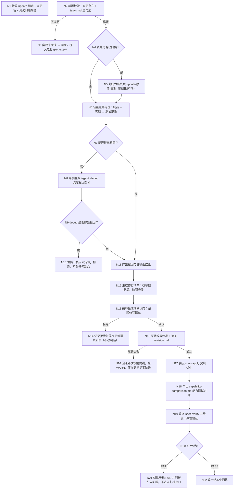

# 探索：新增 update 能力（修复闭环）

> 变更名：`2026-11-14-add-spec-update-capability`
> 阶段：Phase 1 — Exploration（delegated 模式，workflowId=`spec-explore`）
> 状态：探索完成 —— 流程基准已确认（2026-11-14）、纸迹完整、聚合一致性门通过

## Background

用户原始主题（提示词基线候选，见 `## 提示词基线`）：

> 新增 update 能力，用于对已经完成提案功能实现完成后，用户在测试完成后，出现问题时，通过 update 能力完成对测试发现问题进行探索分析，更新提案后，并对发现问题再进行实现优化，以及对完成修复后功能进行能力测试对比。

## 项目规则基线

<!-- 1.1.1 强制产出：规则源枚举 + 存在性 + 读取状态 + 关键约束摘要 -->
<!-- 枚举命令：iagent rules --json（2026-11-14 执行） -->

| 源 | 存在 | 读取 | 关键约束摘要 |
| :--- | :--- | :--- | :--- |
| `.iagent/config.yaml` | 是 | 已读 | 技术栈 TypeScript 5.9 + Node ≥20.19（ESM）+ Commander.js 14；分层「模板层 → 生成层 → 命令层」；单一真源（skill-id / command-references / command-artifacts / version-bump）；模板改动后须 `pnpm build && pnpm generate:skills` |
| `.iagent/rules/coding-rules.md` | 是 | 已读 | 零猜测（未明确项标 `[待确认]`）；设计先行 + 影响面 + 过确认门再改码；数据变更须明确字段/类型/约束；严格分层、禁止跨层调用；技能 ID 派生单一源；allowedTools 走共享常量；配置回写逐行段替换；改模板后 build + generate:skills |
| `.iagent/rules/testing-rules.md` | 是 | 已读 | Vitest 3.2.6，用例位于 `test/**/*.test.ts`；全局 setup 沙箱主目录；CLI 端到端用例改 CLI 行为后先 `pnpm build`；改模板须 build + generate:skills |
| `.iagent/rules/spec.md` | 是 | 已读 | 变更真源为 `openspec/changes/` 下的 Markdown 制品（proposal/design/specs/tasks）；MUST NOT 创建 change.json / tasks.json；提案实现前须过评分门（阈值 90%）；变更目录不存在时先 `iagent spec new`；handoff 包由 propose 一次性产出、跨阶段只读 |
| `CLAUDE.md` | 否 | — | 不存在（合法终态，不阻断） |
| `AGENTS.md` | 是 | 已读 | 技能 ID 双形态、类型体系 9 类、技能 description 结构、`SKILL.md` ≤500 行、模板单一真源（derive-command.ts）、门白名单 5 类、门预算、分级执行（默认主 agent 内联）、`openspec/changes/**` 提案制品纳管策略 |

## 项目技能基线

<!-- 1.1.1.5 强制产出：技能枚举 + 存在性 + 读取状态 + 完整性 + 关键约束摘要 -->
<!-- 枚举命令：iagent skills --json（2026-11-14 执行） -->
<!-- 阶段筛选：设计侧取 phases 含 design|both；实现侧取 implement|both -->

| 源 | 存在 | 读取 | 完整性 | 关键约束摘要 |
| :--- | :--- | :--- | :--- | :--- |
| `.iagent/skills/backend-design.md`（phases=design） | 是 | 已读 | ok | 三层架构（模板层 → 生成层 → 命令层）；单一真源优先、派生而非复制、扩展点接口化；宿主机制解耦（正文不硬编码宿主工具名，由生成期渲染）；委派执行 fail-safe 默认 inline；门承载收敛到 `GATE_SKIP_IDS`；配置写入非破坏；新增公共能力面同步版本判定信号 |
| `.iagent/skills/backend-implement.md`（phases=implement） | 是 | 已读 | ok | 每命令一文件放 `src/commands/` 并在 `src/cli/index.ts` 注册；新增模板成对注册进 `WORKFLOW_PAIRS`，指令版白名单由配对技能单点回填；生成产物须写 `generatedFingerprint`；外部进程统一 `spawnCommand`；归档类目录移动必须唯一化目标名绝不覆盖；新增 CLI 命令同步补全表 `IAGENT_COMMANDS` |

**阶段归属判定**：本次为**设计/探索阶段** → 设计约束基线 = `backend-design`（已加载）；`backend-implement` 为 implement 域，仅在实现阶段加载（记入 implementScope，不进入本次设计约束）。

**技能与规则冲突呈现**：`.iagent/rules/coding-rules.md` 常量域含「异常统一走 ErrorCode」「UI 组件须显式覆盖四状态」，当前代码无 ErrorCode 抽象、无 UI 层（证据：`src/core/project-config.ts:416` 仅为规则常量文本）→ 以代码事实为准，本次不采纳这两条（与 `backend-design.md` 冲突项声明一致）。

## 提示词基线 (Prompt Baseline)

**原始提示词**：

> 新增 update 能力，用于对已经完成提案功能实现完成后，用户在测试完成后，出现问题时，通过 update 能力完成对测试发现问题进行探索分析，更新提案后，并对发现问题再进行实现优化，以及对完成修复后功能进行能力测试对比。

**六维校验结论**（提示词校验门，2026-11-14）：目标 ✅ / 对象 ⚠️ 多义 / 范围 ❌ / 约束 ⚠️ / 验收 ❌ / 歧义 ❌ → **判定：不明确** → 已执行提示词优化并经用户确认。

**确认后的提示词基线**（用户 2026-11-14 确认「按优化版为基线」）：

> 在 iagent 技能体系中新增一个 **update 能力**（新增独立 spec 类技能，canonical workflowId `spec-update`，与既有 7 个 spec 技能并列），承载「变更已提案 → 已实现 → 用户已测试」之后**发现问题时**的完整修复闭环，四个环节：
> 1. **探索分析**：对用户在测试中发现的问题做探索分析，产出根因、影响面与修复方案（复用 `iagent-spec-explore` 的探索/流程图/术语/决策纪律与制品纪律）；
> 2. **更新提案**：以探索结论为输入更新既有变更的提案制品 —— **载体语义 = 原地改写既有变更 Markdown 制品（`proposal.md` / `specs/**` / `design.md` / `tasks.md`）+ 修订痕迹**（用户 2026-11-14 裁决）；
> 3. **再实现优化**：对更新后的问题再次实现优化（复用 `iagent-spec-apply` 的任务清单调度 + 编译检查 + 测试执行关卡）；
> 4. **能力测试对比**：对修复前后做能力层面的测试对比（对比口径见 D5）。
>
> **约束**：沿用既有工作流协议（`src/core/host-orchestration/` 阶段/回执/门控）与 Markdown-first 制品约束（MUST NOT 引入 change.json / tasks.json）；新能力以「技能模板 + 指令」配对注册进 `src/core/templates/registry.ts` 的 `WORKFLOW_PAIRS`，指令版由 `derive-command.ts` 派生；allowedTools 走 `tool-whitelist.ts` 共享常量；MUST NOT 破坏既有 7 个 spec 技能行为；改模板后执行 `pnpm build && pnpm generate:skills`。
>
> **验收**：用户可从「测试发现问题」一站式走到「修复完成 + 能力测试对比结论」，全程在既有 spec 制品体系内闭环，产物可追溯到 问题 → 根因 → 提案修订 → 实现任务 → 对比结论。

**门裁决记录（提示词校验门，2026-11-14）**：
- 出口 = **确认**（采纳优化版为基线）
- 能力形态 = **新增独立技能 `iagent-spec-update`**（用户裁决）
- 提案更新载体 = **原地改写既有变更 Markdown 制品 + 修订痕迹**（用户裁决）

> 下游（提案 / 设计 / 规格 / 任务）以提示词基线为唯一语义来源；基线若变更 MUST 回到 1.1.2 重新确认。

## 功能流程图

<!-- 1.5.5 强制产出：Mermaid flowchart TD + 节点清单表 -->
<!-- 节点 id N<序号> 在图与表中稳定一致；证据位置为 文件:行 或 类.方法；新建功能标 [新建] + 预期产物 -->

| 节点 | 操作 | 触发条件 | 证据位置 | 异常路径 |
| :--- | :--- | :--- | :--- | :--- |
| N1 | 接收 update 请求（变更名 + 测试问题描述） | 用户发起 update 能力 | [新建] `src/core/templates/workflows/spec-update.ts` 的 `getSpecUpdateSkillTemplate`（Step 0 输入契约） | 输入缺变更名 → 提示补齐后重入（N1） |
| N2 | 前置校验：变更存在 + `tasks.md` 全勾选 | N1 之后 | `src/core/spec/status.ts:156` `getChangeStatus`（`progress.remaining === 0`） | 不满足 → N3 |
| N3 | 阻断并提示先走 spec-apply | N2 不满足 | [新建] spec-update 模板阻断分支 | 阻断后终止本轮，无制品写入 |
| N4 | 判定变更是否已归档 | N2 满足 | `src/core/spec/archive.ts:83` `resolveTargetPath`（归档目录形态判定） | 活动变更 → N6；已归档 → N5 |
| N5 | 复制为新变更 `update-<原名>-<日期>`（原归档目录保持不动） | N4 = 已归档 | [新建] spec-update 模板复制分支；预期产物 `openspec/changes/update-<原名>-<日期>/` | 复制失败 → 阻断并报 WARN（终止） |
| N6 | 轻量差异定位：变更制品 ↔ 实际实现 ↔ 用户测试现象 | N4/N5 之后 | [新建] spec-update 模板「轻量差异定位」段 | 无结论 → N8 |
| N7 | 判定是否得出根因 | N6 完成 | [新建] spec-update 模板判定分支 | 有结论 → N11；无结论 → N8 |
| N8 | 降级委派 `iagent_debug` 做深度根因分析 | N7 = 无结论 | `src/core/templates/workflows/debug.ts:214` `getDebugSkillTemplate`（降级委派目标） | debug 仍无结论 → N10 |
| N9 | 判定 debug 是否得出根因 | N8 返回 | [新建] spec-update 模板判定分支 | 是 → N11；否 → N10 |
| N10 | 输出「根因未定位」报告，不改任何制品 | N9 = 无结论 | [新建] spec-update 模板未定位出口 | 停在探索阶段出口，不进入 N12 |
| N11 | 产出根因与影响面结论 | N7/N9 = 有结论 | [新建] spec-update 模板根因结论段（复用 explore 的术语/决策纪律） | — |
| N12 | 生成修订清单（改哪些制品、改哪些段） | N11 之后 | [新建] spec-update 模板修订清单生成段 | — |
| N13 | 破坏性改动确认门：呈现修订清单，等待确认 | N12 之后 | `src/core/host-orchestration/protocol.ts:131` `GATE_WHITELIST` 第 5 类 `destructive-change`（不可豁免） | 用户拒绝 → N14 |
| N14 | 记录拒绝并停在更新提案阶段（不改制品） | N13 = 拒绝 | [新建] spec-update 模板拒绝分支 | 终止本轮，不进入实现 |
| N15 | 原地改写制品（`proposal.md` / `specs/**` / `design.md` / `tasks.md`）+ 追加 `revision.md` | N13 = 确认 | `src/core/spec/schema.ts:47` `SPEC_DRIVEN_SCHEMA`（制品路径与依赖序）；[新建] 修订写入 | 部分失败 → N16 |
| N16 | 回滚到改写前快照，报 WARN，停在更新提案阶段 | N15 部分失败 | [新建] 改写前快照 / 回滚机制（skill 模板段） | 停在更新提案阶段，不进入实现 |
| N17 | 委派 `spec-apply` 实现优化（任务清单调度 + 编译检查 + 测试执行关卡） | N15 成功 | `src/core/templates/workflows/spec-apply.ts:271` `getSpecApplyChangeSkillTemplate` | 编译/测试失败 → 由 apply 自身关卡处置并回传 |
| N18 | 产出 `capability-comparison.md` 能力测试对比 | N17 之后 | [新建] 预期产物 `openspec/changes/<change>/capability-comparison.md` | — |
| N19 | 委派 `spec-verify` 三维度一致性验证 | N18 之后 | `src/core/templates/workflows/spec-verify.ts:10` `getSpecVerifyChangeSkillTemplate` | 校验失败 → 结论 FAIL（N21） |
| N20 | 对比结论判定 PASS / FAIL | N19 返回 | [新建] spec-update 模板结论判定分支 | FAIL → N21；PASS → N22 |
| N21 | 对比表标 FAIL 并列出新引入问题，不进入归档出口 | N20 = FAIL | [新建] spec-update 模板 FAIL 分支 | 停在修复后验证阶段，等待用户裁决 |
| N22 | 输出结构化回执 | N20 = PASS | `src/core/host-orchestration/receipt-store.ts`（阶段回执落盘单一源） | — |

> 确认后的流程图 = **流程基准**（独立于提案自身的交叉验证锚点）；未经用户确认的流程图 MUST NOT 作为提案的生成锚点。
> 提案 / 验证阶段发现遗漏节点 MUST 回到本节更新并重新确认，MUST NOT 在 tasks.md 中静默补节点。
>
> **确认状态**：✅ 已确认（2026-11-14，用户「确认流程图」）→ `flowBaselineConfirmed = true`，N1–N22 为下游 propose / verify 的流程基准。

## Analysis

### Deep Analysis Trigger

- Triggered: **Yes**
- Reason: 用户输入含「更新 / 优化 / 修改」类修改意图关键词（1.2.2 规则）；且基础扫描命中大量既有符号（registry / profiles / host-orchestration / spec 模块），属「修改既有代码 + 新增能力」混合
- Scope: `src/core/templates/registry.ts`、`src/core/templates/workflows/`、`src/core/profiles.ts`、`src/core/host-orchestration/`、`src/core/spec/`、`test/`

### Key Cross-Validation Finding（与既有能力的重叠）

| 既有能力 | 起点 | 根因分析 | 提案处理 | 修复实现 | 验证 |
| :--- | :--- | :--- | :--- | :--- | :--- |
| `iagent_debug`（src/core/templates/workflows/debug.ts:215） | 孤立 bug 报告 | ✅ CodeGraph + 6 维根因 | 「**同步提案**」（修复后附属同步） | ✅ 带强制回归测试 | ✅ 委派 `spec-verify-proposal` |
| `iagent_spec_apply`（src/core/templates/workflows/spec-apply.ts:272） | 已有制品的变更 | — | — | ✅ 任务清单 + 编译 + 测试关卡 | — |
| `iagent_spec_verify`（src/core/templates/workflows/spec-verify.ts:11） | 已实现变更 | — | — | — | ✅ 三维度一致性（实现 vs 制品） |
| **`spec-update`（本次）** | **已实现 + 已测试后的问题** | ✅ 轻量默认 + 降级 debug（D4） | ✅ **原地改写既有制品 + revision.md（主体动作）** | ✅ 委派 apply | ✅ **修复前 vs 修复后能力对比（D5）** |

→ 职责边界已由 ADR-0003 固化。

## Codebase Findings

### Discovered Files

- `src/core/templates/registry.ts` — 技能/指令成对注册单一真源；`WORKFLOW_PAIRS`（:105）含 7 个 spec 技能对（:127-133）；`deriveCommandId`（:83）；`getCommandTemplates`（:166）单点回填指令白名单；`getKnownCommandIds`（:191）→ **新增 `spec-update` 的必改锚点**
- `src/core/templates/workflows/spec-explore.ts` — `getSpecExploreSkillTemplate`（:1294）；提示词校验门 / 功能流程图门 / 强制检查点体系 / delegated 回执（:1317-1381）
- `src/core/templates/workflows/spec-propose.ts` — `getSpecProposeSkillTemplate`（:16）；Step 0 探索文件检测与迁移语义（:46-103）；规划边界（:24）
- `src/core/templates/workflows/spec-apply.ts` — `getSpecApplyChangeSkillTemplate`（:271）；编译检查 + 测试执行关卡
- `src/core/templates/workflows/spec-verify.ts` — `getSpecVerifyChangeSkillTemplate`（:10）；实现后 vs 制品三维度一致性检查
- `src/core/templates/workflows/spec-verify-proposal.ts` — `getSpecVerifyProposalSkillTemplate`（:211）；D1-D10 评分门（90% 阈值）+ 节点覆盖度维度
- `src/core/templates/workflows/spec-archive.ts` — `getSpecArchiveChangeSkillTemplate`（:19）
- `src/core/templates/workflows/spec-bulk-archive.ts` — `getSpecBulkArchiveSkillTemplate`（:19）
- `src/core/templates/workflows/debug.ts` — `getDebugSkillTemplate`（:214）；description 明示「复现→调查根因→变更关联→带强制回归测试的修复→编译检查→**同步提案**→验证」→ **与本次 update 能力重叠，边界见 ADR-0003**
- `src/core/templates/workflows/auto-workflow.ts` / `workflow.ts` — 父编排技能
- `src/core/profiles.ts` — `DEFAULT_WORKFLOWS`（:17，8 项）；`DEPS`（:58）；`resolveWorkflows`（:88）不动点迭代 → **新技能安装归属锚点**
- `src/core/host-orchestration/protocol.ts` — `GATE_WHITELIST`（:98，5 类正向枚举）；`GateWhitelistId`（:69）；`GateSpec`（:49）；`PhaseSpec`（:195）
- `src/core/host-orchestration/workflows.ts` — `EXPLORE_PHASE`（:28）；`PROPOSE_PHASE`（:41）；`VERIFY_PHASE`（:55）；`APPLY_PHASE`（:68）；`ARCHIVE_PHASE`（:82）；`AUTO_APPLY_PHASE`（:98）；`DEBUG_INVESTIGATE`（:128）；`DEBUG_FIX`（:141）；`WORKFLOW_PROTOCOLS`（:195，**仅登记编排型工作流 workflow / auto-workflow / debug / migration**）；`PHASE_GATE_CATEGORY`（:229）；`auditGateWhitelistAlignment`（:244）
- `src/core/host-orchestration/transition.ts` — `evaluatePhaseTransition`（:126）：能力 → 门 → 回执三段式迁移判定
- `src/core/host-orchestration/receipt-store.ts` — 阶段回执落盘单一源
- `src/core/spec/schema.ts` — `SPEC_DRIVEN_SCHEMA`（:47）：proposal（无依赖）→ specs/design（依赖 proposal）→ tasks（依赖 specs + design?）；apply requires=[tasks]
- `src/core/spec/status.ts` — `getChangeStatus`（:156）；`inspectArtifact`（:235）；`parseTaskProgress`
- `src/core/spec/archive.ts` — `previewArchive`（:38）/ `executeArchive`（:66）/ `resolveTargetPath`（:83）唯一化命名
- `src/core/spec/instructions.ts` — `TEMPLATES`（:55）：制品指导说明模板
- `src/core/spec/parser/*.ts` — `proposal-parser` / `spec-parser` / `design-parser` / `task-parser` / `markdown-parser` / `reference-resolver`
- `src/core/spec/validation/*.ts` — `artifact-validator` / `traceability`（Scenario→Task 追溯）/ `conformance`
- `src/core/spec/fingerprint.ts` — 变更制品内容指纹（`sourceFingerprint`）
- `src/core/templates/tool-whitelist.ts` — `skillDelegation`（:84-90）逐技能精确委派条目生成；禁 `Skill(*)`
- `src/core/templates/command-references.ts` — 指令引用单一源，规范形 `/iagent:<id>`
- `src/core/templates/derive-command.ts` — 指令版由技能正文裁剪派生（`<!-- CMD:SKIP -->`）

### Identified Symbols

- `WORKFLOW_PAIRS`（src/core/templates/registry.ts:105）— **Priority: HIGH**
- `deriveCommandId`（src/core/templates/registry.ts:83）— `iagent_spec_update` → `spec-update`
- `getCommandTemplates`（src/core/templates/registry.ts:166）— 指令白名单单点回填
- `getKnownCommandIds`（src/core/templates/registry.ts:191）— 指令引用合法性白名单
- `DEFAULT_WORKFLOWS`（src/core/profiles.ts:17）— **Priority: HIGH**
- `DEPS`（src/core/profiles.ts:58）— **Priority: HIGH**
- `resolveWorkflows`（src/core/profiles.ts:88）
- `GATE_WHITELIST`（src/core/host-orchestration/protocol.ts:98）— **Priority: HIGH**
- `GateWhitelistId`（src/core/host-orchestration/protocol.ts:69）— **Priority: HIGH**
- `PHASE_GATE_CATEGORY`（src/core/host-orchestration/workflows.ts:229）— 若新增阶段门 MUST 在此补映射
- `auditGateWhitelistAlignment`（src/core/host-orchestration/workflows.ts:244）
- `PhaseSpec`（src/core/host-orchestration/protocol.ts:195）
- `WORKFLOW_PROTOCOLS`（src/core/host-orchestration/workflows.ts:195）— `spec-update` 不入此表（D6）
- `evaluatePhaseTransition`（src/core/host-orchestration/transition.ts:126）
- `SPEC_DRIVEN_SCHEMA`（src/core/spec/schema.ts:47）— **Priority: MEDIUM**
- `getChangeStatus`（src/core/spec/status.ts:156）— **Priority: MEDIUM**
- `resolveTargetPath`（src/core/spec/archive.ts:83）
- `skillDelegation`（src/core/templates/tool-whitelist.ts:84）— **Priority: MEDIUM**

### Pattern Matches

- **成对注册模式**：`src/core/templates/workflows/<name>.ts` 导出 `getXxxSkillTemplate()` + `getXxxCommandTemplate()`，在 `WORKFLOW_PAIRS` 成对登记
- **正文唯一源 + 指令派生**：`spec-*.ts` 只维护 skill 版 `instructions`，command 版由 `derive-command.ts` 按 `<!-- CMD:SKIP -->` 裁剪派生
- **阶段协议模式**：`host-orchestration/workflows.ts` 每阶段一个 `PhaseSpec` 常量；**仅编排型工作流**进 `WORKFLOW_PROTOCOLS`
- **门白名单正向枚举**：`GATE_WHITELIST` 5 类；阶段门用 `GateSpec.id` 指向白名单锚点，`PHASE_GATE_CATEGORY` 补类别映射
- **依赖注入模式**：`profiles.ts` `DEPS` 表；父编排显式列出其阶段依赖技能

### Capability Exploration Memory (injected)

- **无能力级探索记忆 — 全新探索**：`openspec/specs/` 目录在本仓库不存在（Glob `openspec/specs/**/*.md` 无命中），故无 `openspec/specs/<capability>/explorations.md` 可注入。
- 参考性历史记忆：`openspec/docs/adr/0001-venus-spec-selfcontained.md`（spec 自包含边界）、`openspec/docs/adr/0002-retire-sqlite-cross-change-index.md`（跨变更索引退役）→ 「定位受影响变更」MUST NOT 依赖索引能力。

## Questions

### 提示词校验门（2026-11-14）

- Q：是否采纳【优化后提示词】为基线？→ A：**确认**
- Q：「update 能力」形态？→ A：**新增独立技能 `iagent-spec-update`**
- Q：「更新提案」载体语义？→ A：**原地改写既有变更 Markdown 制品 + 修订痕迹**

### Grill 批量 1（L1-L3，2026-11-14）

- Q L1.1 适用起点？→ A：**允许已归档变更**（自动复制为新变更后走流程）
- Q L1.2 与 `iagent_debug` 边界？→ A：**双轨 —— 轻量差异定位默认 + 根因不明降级委派 debug**
- Q L2.1 四环节编排形态？→ A：**单技能内联编排 + 委派 apply / verify**
- Q L2.2 修订痕迹载体？→ A：**变更目录内新增 `revision.md`**
- Q L2.3 能力测试对比口径与产物？→ A：**新增独立对比制品 `capability-comparison.md`**
- Q L2.4 阶段协议形态与安装归属？→ A：**独立技能 + 不入默认集 + DEPS 随装补全**
- Q L3.1 异常处置？→ A：**阻断 + 回滚快照**

### Grill 批量 2（L4-L5，2026-11-14）

- Q L4 硬冲突 C1（已归档：允许复制 vs 阻断）？→ A：**以 L1.1 为准 —— 允许复制**（L3.1 的「已归档阻断」条款相应豁免，其余异常仍阻断 + 回滚）
- Q L5 边界场景 BS1–BS6？→ A：**确认全部**
- Q 破坏性动作确认门落点？→ A：**显式破坏性改动确认门**（归入门白名单第 5 类）

## 术语表 (NEW)

<!-- 既有术语从 openspec/CONTEXT.md 注入（与本次探索直接相关者）；CONTEXT.md 全表为唯一真源 -->
<!-- 新增术语已同步写入 openspec/CONTEXT.md（2026-11-14 增补段） -->

### 既有术语（注入自 CONTEXT.md，不重新定义）

| 术语 | 定义 | 避免使用 |
| :--- | :--- | :--- |
| 变更（change） | `openspec/changes/<name>/` 下的规格驱动工作单元，含 proposal/design/specs/tasks 等 artifact | 任务、issue |
| artifact | 变更内的制品文件（proposal / specs / design / tasks），存在 requires 依赖顺序 | 文档、deliverable |
| delta spec | 变更内 `specs/<capability>/spec.md` 的增量规格（ADDED/MODIFIED/REMOVED/RENAMED 标注） | 增量文档 |
| 主 spec | `openspec/specs/<capability>/spec.md` 能力规格，delta spec 的合并目标 | 规格主文件 |
| 探索文件 | 探索期暂存记录；提案生成时移动（非复制）为变更目录的 `exploration.md` | 探索文档 |
| 提案制品 | `openspec/changes/<name>/**` 下的 proposal / design / specs / tasks / exploration / 需求文档 | 变更文件、提案文档包 |
| 提示词基线 | 经提示词校验门确认后的提示词版本，下游唯一语义来源 | 优化后提示词、需求基线 |
| 前置验证门 | `spec-verify-proposal` 的量化评分机制（D1-D5 核心 + D6-D10 条件，统一 90% 阈值） | verify-before-apply |
| 后置验证 | `spec-verify` 的 Completeness/Correctness/Coherence 三维度检查 | verify-change |
| 流程基准 | 经流程最终确认门确认的功能流程图制品，作为独立于提案自身的交叉验证锚点 | 基线、流程图基线 |
| 关键操作节点 | 功能流程图中的最小可验证操作单元，节点 id 形如 `N<序号>`，必须可追溯代码证据 | 步骤、任务 |
| 流程最终确认门 | 探索阶段末尾对功能流程图与节点清单的阻塞确认门 | 确认门、流程图门 |
| handoff 包 | 变更级上下文制品，`.openspec-tmp/pipeline-<change-name>/handoff-pack.md` | context-pack（apply 内旧名） |
| canonical workflowId | 工作流稳定标识，取既有指令 id 的 kebab-case 形式 | 技能名、workflow 编号 |
| 宿主技能 ID | 由 canonical workflowId 派生的宿主可见技能标识（`iagent-<workflowId>`） | 内部技能名、裸 workflowId |
| 门白名单 | 显式枚举「必须保留的阻塞确认门」的清单（5 类） | 取消确认、关闭门 |
| 门预算 | 每阶段至多 1 个流程级阻塞确认门 | 确认门数量、门上限 |
| 人工域标记 | `<!-- 人工域:开始 -->` / `<!-- 人工域:结束 -->` 成对注释，界定逐字保留段落 | 保护标记 |
| skip_specs | 变更在 `.openspec.yaml` 声明的可选布尔字段（缺省 false） | 跳过 specs、skip-specs |
| 能力探索记忆 | `openspec/specs/<capability>/explorations.md` 归档时累积的决策/术语/边界记忆 | 能力记忆 |
| 纸迹 | grill 会话落盘的可核对产物：CONTEXT.md 术语、ADR、探索文件的 Decisions / 边界场景 | 记录、笔记 |
| 硬约束 | 顺序保证、否定式需求、数值型默认值等不可被散文稀释的精确回答 | 细节、要求 |

### 本次新增术语（已写入 `openspec/CONTEXT.md` 2026-11-14 增补段）

| 术语 | 定义 | 避免使用 |
| :--- | :--- | :--- |
| update 能力（`spec-update`） | 新增独立 spec 类技能（`iagent_spec_update`，workflowId `spec-update`），承载「已实现 + 已测试后出问题」的修复闭环 | 更新技能、debug |
| 修复闭环（update 闭环） | `spec-update` 四环节顺序保证：探索分析 → 更新提案 → 再实现优化 → 能力测试对比 | 调试闭环、修复流程 |
| 提案修订（更新提案） | 对既有变更制品的原地改写动作；已归档变更先复制为新变更再修订，原归档不动 | 更新提案文档、变更重开 |
| 修订记录（`revision.md`） | 提案修订的痕迹载体，落变更目录内，记录 问题 → 根因 → 修订点 → 影响制品 → 来源 | 变更日志、修订说明 |
| 能力测试对比（`capability-comparison.md`） | 按能力列出「修复前表现 → 修复后表现 → 证据位置」的验证制品，与 `spec-verify` 三维度互补 | 一致性验证、覆盖率 |
| 轻量差异定位 | `spec-update` 默认根因路径：三方比对「变更制品 ↔ 实际实现 ↔ 用户测试现象」 | 快速排查、根因分析 |
| 降级根因定位 | 轻量定位无结论时委派 `iagent_debug` 做深度根因分析；仍无结论则不改任何制品 | 自动回退、debug 委派 |

## 架构决策 (NEW)

- ADR-0003: `spec-update` 与 `iagent_debug` 的职责边界（双轨根因定位）— 已接受，2026-11-14
  File: `openspec/docs/adr/0003-spec-update-boundary-with-debug.md`

## 边界场景 (NEW)

- [x] **BS1** 已归档变更发起 update → 复制为新变更 `update-<原名>-<YYYYMMDD>`，原归档目录**保持不动**（不可逆动作不触碰归档实体）。
- [x] **BS2** `proposal.md` 改写成功但 `tasks.md` 写失败 → 回滚到改写前快照（写前内存副本），报 WARN，停在「更新提案」阶段，不进入实现。
- [x] **BS3** 轻量差异定位无结论 → 降级委派 `iagent_debug`；仍无结论 → 输出「根因未定位」报告，**不改任何制品**，停在探索阶段出口。
- [x] **BS4** 变更 `tasks.md` 仍有未勾选任务（实现未完成）→ 阻断，提示先走 `spec-apply`。
- [x] **BS5** 能力测试对比时回归测试失败（修复引入新缺陷）→ 对比表标 FAIL 并列出新引入问题，不进入归档出口。
- [x] **BS6** 同一变更连续多次 update → `revision.md` **追加**修订条目，MUST NOT 覆盖历史修订记录。

## Decision Process (NEW)

### Decision: update 能力的形态（D1）
**Options Considered**:
- Option A：新增独立技能 `iagent-spec-update`
- Option B：扩展既有 `spec-propose` + `spec-apply`
- Option C：扩展既有 `spec-explore`

**Pros/Cons**:
- Option A：独立边界清晰、可单独安装与门控；代价 = 需新增模板 + 注册 + 默认集/依赖注入决策 + 与 debug 的边界必须写清
- Option B：无新技能，但 propose 语义被撑大（「创建提案」与「修订提案」职责混合）
- Option C：explore 定位为「思考伙伴」，写入制品非其主业（现模板已声明「绝不能写代码或实现功能」）

**Chosen**: Option A（用户 2026-11-14 裁决）
**Rationale**: 修复闭环是多阶段编排（含实现与验证），与 propose/apply/explore 的既有定位不同层；独立技能便于门控与单独安装。

### Decision: 提案更新载体（D2）
**Options Considered**: 原地改写既有制品 + 修订痕迹 / 新建子变更承载 / 双轨

**Chosen**: 原地改写既有制品 + 修订痕迹（用户 2026-11-14 裁决）
**Rationale**: 保留单一变更身份与「问题 → 根因 → 修订 → 任务 → 对比」追溯链；代价是需修订痕迹机制 + 破坏性确认门。

### Decision: 与 iagent_debug 的边界（D4）
详见 ADR-0003。**Chosen**: 双轨（轻量默认 + 降级委派 debug）

### Decision: 适用起点与已归档变更（D9 / C1 裁决）
**Chosen**: 允许已归档变更 —— 先复制为新变更再走流程；原归档目录不动。
**Rationale**: 用户裁决；且 ADR-0002 已退役跨变更索引，已归档变更的定位只依赖目录遍历与 `iagent spec status`。

### Decision: 阶段协议与安装归属（D6）
**Chosen**: 独立技能，不入 `WORKFLOW_PROTOCOLS`、不入 `DEFAULT_WORKFLOWS`；`DEPS` 中 `spec-update` ⇒ `spec-apply` / `spec-verify` / `test` 随装补全。
**Rationale**: 与 `spec-explore`/`propose`/`apply`/`verify`/`archive` 同层（均不在协议表内）；不进默认集避免默认集膨胀；随装补全避免死委派（与 `spec-apply ⇒ test` 同理）。

## Decisions

<!-- 每条决策带稳定 id D<n>；id 一经分配 MUST NOT 复用、重排或删除后重编号 -->

| id | 决策 | 来源 | 状态 |
| :--- | :--- | :--- | :--- |
| D1 | 新增独立技能 `iagent-spec-update`（canonical workflowId `spec-update`），与既有 7 个 spec 技能并列 | 提示词校验门裁决 | 已确认 |
| D2 | 「更新提案」载体 = 在**同一变更身份**内原地改写既有变更 Markdown 制品 + 修订痕迹，MUST NOT 把修订分叉到一条平行的新变更（已归档变更的「复活复制」是同一变更的延续，见 D9） | 提示词校验门裁决（措辞按聚合一致性门澄清，见该门记录） | 已确认 |
| D3 | 采用优化后提示词作为下游唯一语义来源（原始提示词保留供审计） | 提示词校验门裁决 | 已确认 |
| D4 | 与 `iagent_debug` 的边界 = 双轨：默认轻量差异定位，根因不明时降级委派 `iagent_debug`；两者皆无结论则不改任何制品 | Grill 批量 1 | 已确认（ADR-0003） |
| D5 | 「能力测试对比」= 变更目录内新增独立对比制品 `capability-comparison.md`（能力 → 修复前表现 → 修复后表现 → 证据位置），与 `spec-verify` 三维度互补 | Grill 批量 1 | 已确认 |
| D6 | 阶段协议形态与安装归属 = 独立技能，不入 `WORKFLOW_PROTOCOLS`、不入 `DEFAULT_WORKFLOWS`；`DEPS` 中 `spec-update` ⇒ `spec-apply` / `spec-verify` / `test` / `debug` 随装补全（`debug` 为按 D4 派生的补全项，避免降级委派形成死引用） | Grill 批量 1（`debug` 项由聚合一致性门按 D4 派生补入） | 已确认 |
| D7 | 四环节编排形态 = 单技能内联编排，实现委派 `spec-apply`、验证委派 `spec-verify` | Grill 批量 1 | 已确认 |
| D8 | 修订痕迹载体 = 变更目录内新增 `revision.md`（问题 → 根因 → 修订点 → 影响制品 → 来源） | Grill 批量 1 | 已确认 |
| D9 | 适用起点 = 允许已归档变更（自动复制为新变更后走流程，原归档目录不动） | Grill 批量 1 + C1 裁决 | 已确认 |
| D10 | 异常处置 = 阻断 + 回滚快照（改写部分失败 → 回滚并报 WARN，停在更新提案阶段） | Grill 批量 1 | 已确认 |
| D11 | 原地改写既有制品前设**显式破坏性改动确认门**，归入门白名单第 5 类（不可豁免） | Grill 批量 2 | 已确认 |
| D12 | 边界场景 BS1–BS6 全部采纳 | Grill 批量 2 | 已确认 |

## 硬约束 (NEW)

<!-- 每行一条不可改写片段（顺序保证 / 否定式需求 / 数值型默认值），带 source: D<n> -->

- 修复闭环四环节顺序保证：探索分析 → 更新提案 → 再实现优化 → 能力测试对比，MUST NOT 重排 — source: D3
- 「更新提案」必须在**同一变更身份**内原地改写既有变更的 Markdown 制品并留修订痕迹，MUST NOT 把修订分叉到一条平行的新变更（已归档变更的复活复制属同一变更延续，见 D9） — source: D2
- 已归档变更 MUST 先复制为新变更再修订，原归档目录 MUST 保持不动 — source: D9
- 变更制品 MUST NOT 引入 `change.json` / `tasks.json`（JSON 制品已弃用），Markdown 为唯一真源 — source: D2
- 新能力 MUST NOT 破坏既有 7 个 spec 技能行为 — source: D1
- 新能力 MUST 以「技能模板 + 指令」配对注册进 `WORKFLOW_PAIRS`，指令版由 `derive-command.ts` 派生，MUST NOT 手写派生产物 — source: D1
- allowedTools 条目 MUST 走 `tool-whitelist.ts` 共享常量，MUST NOT 手写字面量，MUST NOT 使用 `Skill(*)` — source: D1
- 改技能模板后 MUST 执行 `pnpm build && pnpm generate:skills` — source: D1
- `spec-update` MUST NOT 进入 `WORKFLOW_PROTOCOLS` 与 `DEFAULT_WORKFLOWS`；`DEPS` MUST 含 `spec-update` ⇒ `spec-apply` / `spec-verify` / `test` / `debug`（降级委派目标 MUST NOT 形成死引用） — source: D6
- 确认门 MUST NOT 自造第 6 类；破坏性改动确认门 MUST 归入 `GATE_WHITELIST` 第 5 类且不可豁免 — source: D11
- 改写既有制品前 MUST 呈现修订清单并经破坏性改动确认门确认 — source: D11
- 改写部分失败 MUST 回滚到改写前快照并报 WARN，MUST NOT 留下半改写状态 — source: D10
- `revision.md` MUST 追加写入，MUST NOT 覆盖历史修订记录 — source: D8
- 根因未定位时 MUST NOT 修改任何制品 — source: D4
- 降级委派 `iagent_debug` MUST NOT 被表述为委派完成（本地执行 ≠ 委派完成） — source: D4
- 能力测试对比 MUST NOT 替代或复用 `spec-verify` 的三维度口径 — source: D5
- 变更 `tasks.md` 仍有未勾选任务时 MUST 阻断 — source: D10
- 能力测试对比结论为 FAIL 时 MUST NOT 进入归档出口 — source: D5

## Scope Changes (NEW)

| 变更时间 | 变更类型 | 变更描述 | 原因 |
| :--- | :--- | :--- | :--- |
| 2026-11-14 | pivot | 「更新提案」从「新建变更承载」改为「原地改写既有变更制品」 | 提示词校验门用户裁决 |
| 2026-11-14 | expand | 适用起点从「未归档变更」扩大为「允许已归档变更（复制为新变更后走流程）」 | Grill 批量 1 用户裁决 + C1 冲突裁决 |

## 探索完成检测（1.6）

### 1.6.5 CONTEXT.md 检查点 — Phase 1 收尾

- `openspec/CONTEXT.md` 存在，已从磁盘重新读取校验。
- 探索文件 `## 术语表` 的**新增 7 条术语**已全部写入 CONTEXT.md（`openspec/CONTEXT.md:715-733`，2026-11-14 增补段）：update 能力 / 修复闭环 / 提案修订 / 修订记录 / 能力测试对比 / 轻量差异定位 / 降级根因定位。
- 探索文件 `## 术语表` 的**既有 21 条术语**均为从 CONTEXT.md 注入的原条目（不重新定义），天然一致。
- 裁决记录：CONTEXT.md 中「提案修订」条目已含「已归档变更先复制为新变更再修订，原归档目录保持不动」的例外说明，与 D2 / D9 一致，无同义重复条目。
- 结果：**CONTEXT.md 已校验 — 同步 7 个新增术语，0 个缺失，0 个定义冲突**。

### 1.6.6 聚合一致性门 — Phase 1 收尾

扫描 **12 个决策（D1–D12）**，逐对检查三类硬冲突（技术选型冲突 / 依赖方向冲突 / 约束互斥）：

| 冲突对 | 检查结论 |
| :--- | :--- |
| D1 × D6 | 一致 —— 独立技能不入 `WORKFLOW_PROTOCOLS`（与 `spec-explore`/`propose`/`apply`/`verify`/`archive` 同层，该层均不在协议表内） |
| D1 × D7 | 一致 —— 单技能内联编排 + 委派 apply/verify 与「独立技能」形态不矛盾 |
| D7 × D6 | 一致 —— 委派 `spec-apply`/`spec-verify` 目标由 `DEPS` 随装补全，无死引用 |
| D4 × D2 | 一致 —— 降级 debug 只影响根因定位路径，不改变修订载体 |
| D2 × D9 | **措辞张力（已澄清，非实质硬冲突）** —— D2 原措辞「MUST NOT 以新建变更方式承载修订」与 D9「已归档变更先复制为新变更」在字面上可被误读为矛盾。裁决：D9 是**已确认的更具体决策**（用户在 C1 冲突中显式选择「允许复制」），D2 治理的是「修订不得分叉到平行变更」；复制是同一变更的复活延续，非分叉。→ 已按此**澄清 D2 措辞**并同步更新 `## 硬约束` 对应行（措辞澄清，非新决策，无新增需求） |
| D4 × D6 | **派生补全（非冲突）** —— D4 确认降级委派 `iagent_debug`，按仓库既有约定（`spec-apply ⇒ test`，缺技能即形成死引用）`DEPS` MUST 含 `debug`；D6 原列举遗漏该项 → 已**派生补入** `debug`，并在 D6 行标注来源 |
| D8 × D2 | 一致 —— `revision.md` 为修订痕迹，落在同一变更目录内 |
| D8 × D10 | 一致 —— 追加语义与「部分失败回滚」互不冲突（回滚作用于制品改写，修订记录按追加写） |
| D5 × D19 | 一致 —— 能力测试对比制品与 `spec-verify` 三维度互补，不复用其口径 |
| D11 × D10 | 一致 —— 破坏性确认门（覆盖既有制品）先于改写；改写失败按回滚处置 |
| D3 × N15→N22 | 一致 —— 四环节顺序与流程图节点序一致 |
| D9 × D10/BS4 | 一致 —— 复制的变更其 tasks 已全勾选，通过 BS4 前置校验 |

结果：**聚合一致性门通过 — 扫描 12 个决策，0 个硬冲突**（2 处澄清/派生补全已落盘并留痕）。

### 探索完成检测

- Pending 段：技术决策类 Pending 已清空（`### Unresolved Decisions` = 无未决决策）；剩余 3 条属 **Phase 2 关注项**（能力对比基线快照位置、新增制品与归档的交互、DEPS 补全清单最终核准），不构成探索阻塞。
- 门已确认：提示词校验门 ✅（确认）、grill 批量 1 ✅、grill 批量 2 ✅（含 C1 冲突裁决）、流程最终确认门 ✅（确认，流程基准成立）。
- 纸迹状态：`complete`（Decisions 非空 / 术语表非空 / ADR-0003 已落盘 / 硬约束 18 条）。
- 流程基准：**已确认**（N1–N22）。

## Pending (enhanced)

### For Phase 2 Impact Analysis

- `WORKFLOW_PAIRS`（src/core/templates/registry.ts:105）— Priority: HIGH
- `DEFAULT_WORKFLOWS`（src/core/profiles.ts:17）— Priority: HIGH
- `DEPS`（src/core/profiles.ts:58）— Priority: HIGH
- `GATE_WHITELIST` / `GateWhitelistId`（src/core/host-orchestration/protocol.ts:98/69）— Priority: HIGH
- `skillDelegation`（src/core/templates/tool-whitelist.ts:84）— Priority: HIGH（新增 `Skill(iagent-spec-debug)` / `Skill(iagent-spec-apply)` / `Skill(iagent-spec-verify)` 条目）
- `getChangeStatus`（src/core/spec/status.ts:156）— Priority: MEDIUM（前置校验读取点）
- `SPEC_DRIVEN_SCHEMA`（src/core/spec/schema.ts:47）— Priority: MEDIUM
- `src/core/templates/workflows/spec-explore.ts` / `spec-propose.ts` / `spec-apply.ts` / `spec-verify.ts`（正文可复用段）— Priority: MEDIUM
- `src/core/templates/workflows/debug.ts`（降级委派目标 + 排歧对向）— Priority: MEDIUM
- `src/core/templates/derive-command.ts`（指令派生）— Priority: MEDIUM
- 新增文件：`src/core/templates/workflows/spec-update.ts` — Priority: HIGH
- 测试面：`test/skills-parity.test.ts`、`test/command-reference-refs.test.ts`、`test/templates.test.ts`、`test/allowed-tools.test.ts`、`test/skill-size-budget.test.ts`、`test/host-orchestration.test.ts` — Priority: MEDIUM

### Security Concerns

- 无（本地 CLI，无网络 / 无凭据面；`backend-implement.md` 明示 MUST NOT 引入凭据写入或网络请求）

### Business Validation

- 「能力测试对比」的「修复前表现」基线来源：变更目录内对比制品首次生成时以「修复前实现状态」为基线，修订时追加对比行 —— 需在提案阶段明确基线快照的持久化位置。
- 修订痕迹与归档的交互：`revision.md` / `capability-comparison.md` 是新增制品，需确认归档时随变更目录整体移动（现有归档语义为整目录移动，故天然满足），且不进入主 spec 合并范围。
- `DEPS` 随装补全的确切清单（`spec-apply` / `spec-verify` / `test` 是否全部必要）需在提案阶段按实际委派清单核准。

### Unresolved Decisions

- 无未决决策（D1–D12 全部确认；C1 冲突已裁决）

## Implementation Deep-Dive

### Design Rationale

- `spec-*.ts` 采用「skill 版正文唯一源 + command 版裁剪派生」：`AGENTS.md` 修改守则第 7 条 + `derive-command.ts` 的 fail-safe 裁剪语义 → 新技能 MUST 沿用。
- `host-orchestration/` 采用「共享工作流协议 + 宿主适配器分离」：让技能正文不硬编码 Claude 专属委派机制词 → 新技能的委派描述 MUST 经 `renderDelegate` / `adaptSkillContentForHost` 渲染。
- `WORKFLOW_PROTOCOLS` 只收编排型工作流 → 独立技能不必进协议表，避免为单体技能引入阶段迁移判定负担（D6）。

### Constraints

- `GATE_WHITELIST`（src/core/host-orchestration/protocol.ts:98）为**正向枚举 5 类**，新增门 MUST 归入既有类别。
- `PROMPT_GATE` / `FLOWCHART` 等正文常量在构建期内联进技能正文（`src/core/templates/prompt-gate.ts`、`flowchart-gate.ts`），新技能引用须走同一共享常量。
- `getCommandTemplates()`（src/core/templates/registry.ts:166）单点回填指令白名单 → 新技能对的 command 模板 `allowedTools` MUST 与配对技能完全一致。
- `skills-parity.test.ts` 要求模板改动后 `pnpm build && pnpm generate:skills`。

### Trade-offs

- 独立技能 vs 扩展既有技能：独立带来注册 / 默认集 / 依赖注入 / 边界文档的维护成本，收益是阶段门控与职责清晰。
- 「原地改写」vs「新建变更」：原地改写保留单一变更身份与制品追溯链，代价是需修订痕迹机制 + 破坏性确认门。
- 轻量默认 vs 全量 debug：轻量控制常见场景耗时，降级路径保证疑难场景质量（ADR-0003）。

### Pattern Usage

- 成对注册（模板层）→ 派生（生成层）→ 注册（命令层）三层模式。
- `PhaseSpec` + `GATE_WHITELIST` + `PHASE_GATE_CATEGORY` + `evaluatePhaseTransition` 的协议组合模式。

### Historical Context

- `openspec/docs/adr/0001-venus-spec-selfcontained.md` — spec 域自包含边界（CLI 只做确定性操作，AI 语义合并归技能）。
- `openspec/docs/adr/0002-retire-sqlite-cross-change-index.md` — 跨变更索引能力整体退役 → 「定位受影响变更 / 检索历史变更」MUST NOT 依赖索引能力。
- `openspec/docs/adr/0003-spec-update-boundary-with-debug.md` — 本次新增。

### Implicit Assumptions

- 「用户测试完成」= 变更 `tasks.md` 已全部勾选（`getChangeStatus` 的 `progress.remaining === 0`）→ 由 D10/BS4 固化为阻断条件。
- 「能力测试对比」的「修复前表现」可在变更目录内留痕 → 落在 `capability-comparison.md`（D5），不依赖 `.openspec-tmp/`（本机产物不入库）。

## 影响分析（Phase 2.0 自动执行）

工具：CodeGraph `codegraph_explore`（上游影响面 = blast radius）。以下逐符号结果 MUST 写入
`proposal.md` 的 `## Impact: Impact Analysis` 段与 `design.md` 的 `## Context: Architecture Impact` 段。

| 符号 | 位置 | 直接上游影响（调用方 / 依赖方） | 波及的测试面 | 改动要求 |
|---|---|---|---|---|
| `WORKFLOW_PAIRS` | src/core/templates/registry.ts:105 | 4 处同文件调用（`getSkillTemplates` / `getCommandTemplates` / `deriveCommandId` 派生链） | test/templates.test.ts、test/command-reference-refs.test.ts、test/project-skill-templates.test.ts、test/skills-parity.test.ts | 新增 `spec-update` 技能对，**必须**同时提供 skill 版与 command 版模板；`deriveCommandId('iagent_spec_update')` ⇒ `spec-update` |
| `deriveCommandId` | src/core/templates/registry.ts:83 | 9 处调用（registry.ts、src/commands/update.ts、src/commands/init.ts、src/core/templates/index.ts） | test/templates.test.ts | 新技能自动派生 `spec-update`，无需改动派生逻辑本身 |
| `getWorkflowSkillTemplate` / `getWorkflowCommandTemplate` | src/core/templates/workflows/workflow.ts:151 / :628 | 5 / 2 处调用（registry.ts） | test/stage-continuation.test.ts、test/template-derivation.test.ts | 编排型工作流协议表；`spec-update` 为单体技能，**不进入** `WORKFLOW_PROTOCOLS`（D6） |
| `DEFAULT_WORKFLOWS` | src/core/profiles.ts:17 | 3 处调用（src/commands/onboarding.ts、profiles.ts 自身） | test/profiles.test.ts | 是否纳入默认集 **待提案阶段核准**（新增默认技能会改变默认安装集规模 → 属破坏性面，须走破坏性确认门） |
| `DEPS` | src/core/profiles.ts:58 | 3 处调用（`resolveWorkflows` 不动点迭代，profiles.ts 自身） | test/profiles.test.ts、test/stage-continuation.test.ts | `spec-update` ⇒ 实际委派清单对应的技能（`spec-apply` / `spec-verify` / `test` / `debug`）**逐条核准**后补全；死引用 MUST NOT 产生 |
| `GATE_WHITELIST` / `GateWhitelistId` | src/core/host-orchestration/protocol.ts:98 / :69 | 门校验链：`isWhitelistedGate` / `GATE_WHITELIST_ANCHORS`；下游 `evaluatePhaseTransition`、`gate-ledger.ts`（`isGateSkipId` 4 处调用、`renderGateLedgerEntry` 3 处、`resolveGateLedgerConfirmation` 2 处） | test/gate-ledger.test.ts、test/allowed-tools.test.ts、test/claude-host-adapter.test.ts、test/host-orchestration.test.ts | 正向枚举 **5 类 MUST NOT 增删**；新技能的门 MUST 归入既有类别（修订/破坏性 ⇒ `destructive-change`，不可豁免） |
| `skillDelegation` | src/core/templates/tool-whitelist.ts:93 | 16 处调用（spec-propose / spec-apply / debug / workflow / auto-workflow 等模板） | test/tool-whitelist-constants.test.ts、test/workflow-implementation-chain.test.ts、test/allowed-tools.test.ts | 新技能正文里的委派条目 MUST 走 `skillDelegation([...])` 共享常量；**MUST NOT** 手写 `Skill(...)` 字面量、**MUST NOT** 用 `Skill(*)` |
| `normalizeDelegationSkillId` | src/core/templates/tool-whitelist.ts:64 | 经 `skillDelegation` 间接调用 | test/tool-whitelist-constants.test.ts | 入参裸名 `debug` / `spec_apply` / `spec_verify` 归一化为 `iagent-debug` / `iagent-spec-apply` / `iagent-spec-verify` |
| `getChangeStatus` | src/core/spec/status.ts:156 | 4 处调用（src/commands/spec.ts 的 `runSpecStatus`） | test/spec-status.test.ts | 作为「任务已全部勾选」的**前置校验只读点**；`progress.remaining === 0` 为阻断条件 |
| `SPEC_DRIVEN_SCHEMA` | src/core/spec/schema.ts:47 | 12 处调用（src/commands/spec.ts）+ spec/archive.ts、spec/instructions.ts、spec/new-change.ts、spec/status.ts | test/markdown-spec-cli.test.ts、test/spec-instructions-apply.test.ts | 新增制品（`revision.md` / `capability-comparison.md`）**是否进 schema 登记**属提案阶段决策；不进 schema 则 MUST NOT 被主 spec 合并范围收录 |
| `detectCompleted` / `parseTaskProgress` | src/core/spec/status.ts | src/commands/spec.ts | test/spec-status.test.ts | 判定变更是否「已完成提案 + 实现」 |
| `evaluatePhaseTransition` / `PhaseSpec` | src/core/host-orchestration/transition.ts、protocol.ts | 阶段迁移阻断判定 | test/host-orchestration.test.ts | `spec-update` 若自建阶段协议，MUST 与 `GATE_WHITELIST` 对齐（D6：优先不进协议表） |

### 影响面小结

- **新增为主**：主体是新增 `src/core/templates/workflows/spec-update.ts`（skill 正文唯一源 + command 版由 `derive-command.ts` 派生）、新增变更级制品（`revision.md` / `capability-comparison.md`）、新增 `openspec/docs/adr/0003`（已在探索阶段落盘）。
- **改动为辅**：`registry.ts` 成对注册、`profiles.ts` 的 `DEPS`（+ `DEFAULT_WORKFLOWS` 待核准）、`debug.ts` 的 description 排歧与降级委派目标、`host-orchestration/protocol.ts` 的门归属（**不新增类别**）。
- **回归高危面**：技能/指令白名单派生链（`skillDelegation` + `getCommandTemplates()` 单点回填）、`skills-parity` 快照一致性、门账本与 `GATE_SKIP_IDS` 交互。
- **边界约束**：所有门 MUST 归入既有 5 类白名单；`capability-comparison.md` 与 `revision.md` MUST NOT 进入主 spec 合并范围（归档时随变更目录整体移动）。
