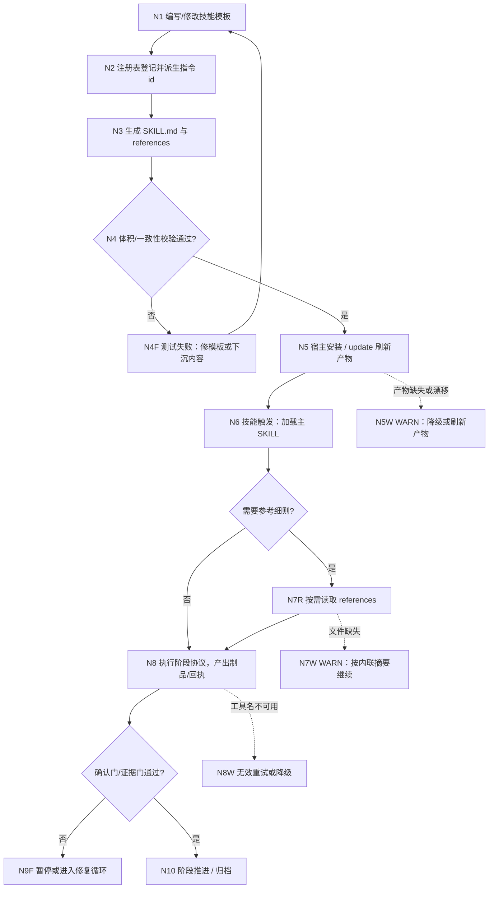

## Context

本变更作用于技能模板层（`src/core/templates/workflows/*.ts`）、生成层（`renderHostTokens` / `generateSkillContent`）、体积预算测试与项目文档。当前链路：

| 节点 | 操作 | 触发条件 | 证据位置 | 异常路径 |
| :--- | :--- | :--- | :--- | :--- |
| N1 | 编写/修改技能模板正文 | 技能行为或协议需要变更 | `src/core/templates/workflows/*.ts`（23 个模板，如 `auto-workflow.ts:16`） | 语法/类型错误 → N4F |
| N2 | 注册表登记配对并派生指令 id | 新增/改名模板 | `registry.ts:109-139`、`registry.ts:87-92` | 未登记 → 不生成 → N4F |
| N3 | 生成 SKILL.md、frontmatter 与 references | `pnpm build && pnpm generate:skills` / `iagent update` | `generator.ts:79-122`、`scripts/generate-skills.mjs` | 生成失败 → 保留旧快照并报告 |
| N4 | 体积预算 + 快照一致性校验 | CI / `pnpm test` | `test/skill-size-budget.test.ts:15-57`、`test/skills-parity.test.ts` | 超预算/漂移 → N4F |
| N5 | 宿主安装或 update 刷新产物 | `iagent init` / `iagent update` | `src/commands/init.ts`、`update.ts`、`command-artifacts.ts` | 刷新失败 → N5W：WARN + 旧产物 |
| N6 | 技能触发，加载主 SKILL | 用户调用或编排委派 | `skills/<id>/SKILL.md`、`.opencode/skills/<id>/SKILL.md` | 产物漂移 → 旧语义执行（F4）→ N5W |
| N7 | 判断是否需要 references | 门触发/复杂分支/细则需求 | `spec-apply.ts:432,444` | 文件缺失 → N7W：按内联摘要继续 |
| N7R | 按需读取 references | N7=是 | `skills/iagent-spec-explore/references/exploration-protocol.md:1-619`、`skills/iagent-spec-apply/references/*.md` | 整文件读取放大 token（F9）→ 本次改为锚点/分节读取 |
| N8 | 执行阶段协议，产出制品/回执 | 阶段开始 | `auto-workflow.ts:119-244`、`spec-apply.ts:269-750`、`spec-archive.ts:16-285` | 工具名不可用 → N8W：无效重试/降级（F3） |
| N9 | 确认门/证据门判定 | 阶段收束或归档前 | `protocol.ts:98-136`、`workflows.ts:195-214` | 未通过 → N9F：暂停或修复循环（≤3） |
| N10 | 阶段推进/归档 | N9=是 | `src/core/spec/archive.ts`、`iagent-spec-archive` 协议 | 归档目标已存在 → 报错并建议改名 |

> 本流程图来自探索阶段已确认的 `## 功能流程图` 段（流程基准，`flowBaselineConfirmed=true`），设计不重新发明流程。

### Architecture Impact

- 模板模板函数（`getAutoWorkflowSkillTemplate` / `getSpecApplyChangeSkillTemplate` / `getWorkflowSkillTemplate` / `getSpecBulkArchiveSkillTemplate` / `getDebugSkillTemplate`）的返回文本变化会经 `registry.ts` 影响全部生成产物与 `stage-continuation` / `skills-parity` / `template-language` / `allowed-tools` 等测试。
- `generateSkillContent` 的调用方（`init` / `update` / `generate` / `scripts/generate-skills.mjs`）无需改签名；字符预算在测试侧度量生成结果。
- `renderHostTokens` 当前只替换 `{{ASK_USER}}`；本变更不扩张该函数，改用宿主中立工具名 + 回归锁，避免影响四宿主令牌契约。
- `WORKFLOW_PROTOCOLS` / `AUTO_ARCHIVE_PHASE` 仅修正注释，门定义本身不改；但需同步修正 `workflow-suite-skills` 中「归档阶段无阻塞门」的过时规格（与 4.13.0 已落地的归档确认门对齐）。

## Goals / Non-Goals

**Goals**:

- 主 SKILL 双重预算：≤500 行且 ≤20,000 字符，超限技能收敛至预算内。
- 删除 `auto-workflow` 对子技能协议的重复声明与重复 Guardrails，恢复单一源。
- 将 `TodoWrite` / `mcp__codegraph__*` / `mcp__plugin_semgrep_*` 从模板正文移除或中立化，消除无效工具调用。
- 同步 22→23 文档计数、归档门注释、提示词门注释与重复分隔线。
- 刷新本机 `.opencode` dogfood 产物（不提交），使本机加载行为与源码一致。

**Non-Goals**:

- 不新增/删除确认门、不改变门白名单、阶段顺序、`allowedTools` 与技能职责边界。
- 不新增 CLI 命令，不修改运行时业务逻辑与公开 API。
- 不手改 `skills/` 快照或 `.opencode/` 产物（必须由生成器 / update 重新生成）。
- 不在本变更中全量重写 references 加载机制（仅对超限技能按需下沉）。

## Decisions

### DD1: 双重体积预算（500 行 + 20,000 字符）

- **选择**: 在既有 500 行预算之外新增 20,000 字符预算（`fileContent.length`，含 frontmatter），两者并行、取更严格者。
- **理由**: 中文长段落使行数与 token 脱钩；字符预算是 token 的稳定代理，能覆盖当前 5 个超限技能；实现只在测试侧增加断言，成本低。
- **备选**: 仅保留 500 行（无法阻止 token 回归）；按字节预算（UTF-8 中文 3 字节，跨语言不稳定）；按实际 tokenizer（引入依赖且随模型变化）。

### DD2: 控制流留主文件、参考性内容下沉

- **选择**: 触发条件、阶段骨架、确认门、阶段顺序、委派清单、Guardrails 与 CLI 契约留主文件；评分矩阵、示例、检查点日志、字段级表格、子技能协议下沉 references 或删除重复。
- **理由**: 与既有 `progressive-disclosure` 决策一致；避免把每次执行都需要的控制流移出主文件导致额外读取。
- **备选**: 全量下沉（主文件过薄、执行者需要更多次 Read）；全量保留（无法满足预算）。

### DD3: 宿主工具词中立化而不扩张渲染层

- **选择**: 模板正文使用 `codegraph_explore` / `codegraph_impact` / `semgrep_scan` 等中立名与「宿主待办工具（可用时）」表述；新增回归测试禁止 `TodoWrite` / `mcp__*` 字面量（白名单常量除外）。
- **理由**: `renderHostTokens` 目前只处理 `{{ASK_USER}}`；为工具名新增一套令牌会扩大生成期契约与测试面。中立名 + 宿主暴露时使用已足以跨宿主，且与 `codegraph-protocol.ts` 既有口径一致。
- **备选**: 新增 `{{CODEGRAPH_TOOL:impact}}` 令牌（需要改四宿主渲染与全部模板，收益与风险不匹配）。

### DD4: auto-workflow 子协议单一源

- **选择**: 删除 `auto-workflow` 中对测试门、一致性门、review、归档索引/清理协议的复述，只保留阶段顺序、门承载、回执字段、证据就绪判定与失败处置；Guardrails 合并为跨阶段不可违反的约束。
- **理由**: 现有正文自相矛盾（声明不复述却复述），且与子技能形成第二份真源；删除后主文件自然降至 20,000 字符内。
- **备选**: 下沉为 `references/auto-workflow-protocol.md`（仍是第二份真源，只是位置变化；不采纳）。

### DD5: 同步修正「归档阶段无阻塞门」的过时规格

- **选择**: 把 `workflow-suite-skills` 与 `workflows.ts` 注释中的「验证 / 实现 / 归档均无阻塞门」改为「验证 / 实现无阻塞门；归档阶段声明 `archive-confirmation`」，与 4.13.0 已落地的 `AUTO_ARCHIVE_PHASE` 对齐。
- **理由**: 当前规格与实现矛盾，是 `.opencode` 旧产物与注释漂移的根因之一；必须显式修正，不能只改注释。
- **备选**: 只改注释（规格仍矛盾，下一次生成会再次漂移）。

### DD6: 本机 dogfood 产物刷新不提交

- **选择**: 实现完成后运行 `iagent update`（或等价生成）刷新 `.opencode/skills`，失败仅 WARN；`.opencode/` 已被 `.gitignore` 排除，不进入提交面。
- **理由**: 当前 `.opencode` 缺归档门与 `spec-update`，本机加载的是旧语义；刷新使本机与源码一致，但不改变仓库交付物。
- **备选**: 不刷新（本机继续加载旧语义）；把 `.opencode` 纳入版本库（与项目约定冲突，不采纳）。

## Risks / Trade-offs

| 风险 | 缓解 |
|------|------|
| 拆分/压缩导致控制流缺失或行为变化 | 仅移动参考性内容；`skills-parity`、`stage-continuation`、`allowed-tools`、`template-language` 回归；逐技能核对确认门/阶段/委派面不变 |
| 20,000 字符预算导致大技能反复返工 | 优先删除重复协议与压缩 Guardrails，再下沉细则；预算测试失败时先修内容，不回退阈值 |
| `TodoWrite` 中立化后宿主待办能力下降 | 保留「可用时使用」表述；不提供待办工具的宿主以文字清单跟踪，不阻断 |
| `mcp__*` 中立化导致 Claude 无法解析工具 | `allowedTools` 仍保留 MCP 白名单条目；正文使用 `codegraph_*` 与「宿主暴露时使用」，Claude 可按 MCP 工具发现解析 |
| `.opencode` 刷新覆盖用户手改 | `.opencode/` 为纯生成物、gitignored；刷新失败仅 WARN；不触碰用户自建非 `iagent-` 文件 |
| 文档计数再次漂移 | 在 `workflow-suite-skills` 增加计数要求与回归场景；实现时以 `src/core/templates/workflows/*.ts` 与 `WORKFLOW_PAIRS` 实测为准 |
