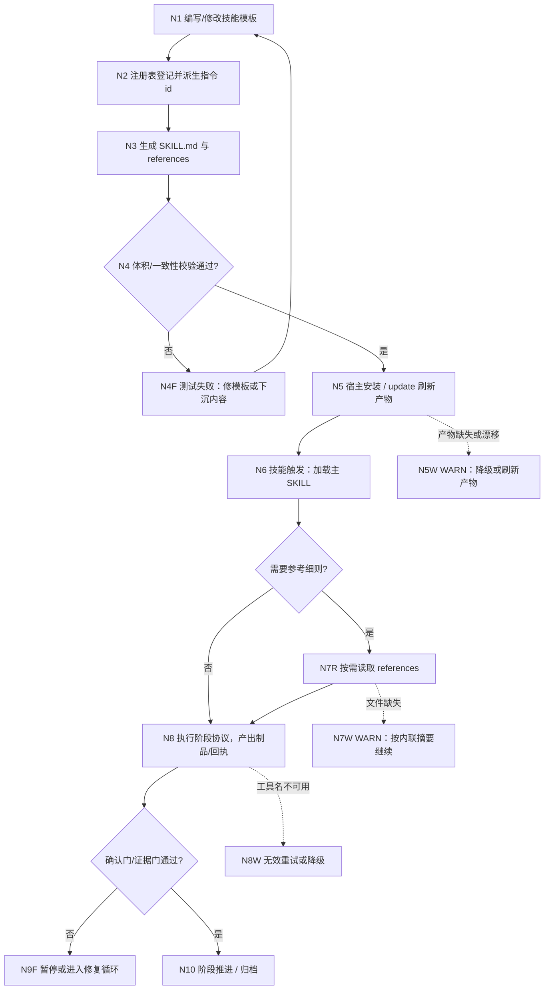

# 技能体系全量审计与 Token 异常治理 — 探索记录

> 探索类型：设计审计（prompt-driven），非单一业务功能流程探索
> 探索对象：MiAgentTools 技能模板层 / 生成层 / 宿主编排 / 技能正文 / 业务流程
> 状态：进行中（2026-11-15）

---

## Background

用户原始诉求（原文）：

> 全量扫描分析项目技能，技能框架设计、技能设计、技能实现、技能业务处理等流程，分析是否存在不合理、需要调整的点；同时分析哪些设计不合合理，会影响token异常情况等，对存在问题就行修复优化

**问题起点**：仓库在 2026-10 已完成两轮技能体系审计（`skill-system-review-explore-001`、`skill-orchestration-audit-explore-001`），并落地了单一源、渐进披露、门预算、handoff 包等改造。本轮在**当前代码事实**上重新全量核对，重点回答两类问题：

1. 历史问题哪些已闭环、哪些回归或新引入；
2. 哪些设计仍在制造 token 异常（主 SKILL 体积、重复协议、宿主工具词导致的无效重试、生成产物漂移等）。

---

## 项目规则基线

| 源 | 存在 | 读取 | 关键约束摘要 |
| :--- | :--- | :--- | :--- |
| `.iagent/config.yaml` | 是 | 已读 | TypeScript 5.9 + Node ≥20.19 + Commander 14；三层架构；单一真源；改模板后 `pnpm build && pnpm generate:skills` |
| `.iagent/rules/coding-rules.md` | 是 | 已读 | 零猜测标 [待确认]；设计先行过确认门；严格分层；技能 ID 派生走 `skill-id.ts`；模板正文唯一源；allowedTools 走共享常量；配置逐行段替换；改模板后 build + generate:skills |
| `.iagent/rules/spec.md` | 是 | 已读 | 变更真源为 `openspec/changes/**` Markdown；不重建 JSON；提案评分门 90%；handoff 包一次性产出跨阶段只读 |
| `.iagent/rules/testing-rules.md` | 是 | 已读 | Vitest 3.2.6；主目录沙箱；改 CLI 行为先 `pnpm build`；改模板后 build + generate:skills 否则 skills-parity 失败 |
| `AGENTS.md` | 是 | 已读（宿主注入） | 模板改动后 build + generate:skills；allowedTools 三层组合；SKILL.md ≤500 行；单一源派生；描述结构中文用途 + 触发词 + NOT for；版本与变更日志随功能提交 |
| `CLAUDE.md` | 否 | — | 不存在（合法终态） |

---

## 项目技能基线

| 源 | 存在 | 读取 | 完整性 | 关键约束摘要 |
| :--- | :--- | :--- | :--- | :--- |
| `.iagent/skills/backend-design.md` | 是 | 已读 | ok | 单一真源优先；派生而非复制；扩展点接口化；宿主机制解耦；委派 fail-safe 默认 inline；门承载仅接受 `GATE_SKIP_IDS`；配置写入非破坏；失败非阻断；MUST NOT 手改派生产物 / 手写 allowedTools / 重新序列化 YAML / 硬编码宿主机制词 / 全量通配委派 / 伪装降级 |
| `.iagent/skills/backend-implement.md` | 是 | 未读（phases=implement，进入实现阶段前读取） | ok | — |

> 技能配置非空；`backend-implement` 为 implement-only，按阶段筛选未纳入本次设计约束，实现阶段开始前补读。

---

## 提示词基线 (Prompt Baseline)

**原始提示词**:

> 全量扫描分析项目技能，技能框架设计、技能设计、技能实现、技能业务处理等流程，分析是否存在不合理、需要调整的点；同时分析哪些设计不合合理，会影响token异常情况等，对存在问题就行修复优化

**确认后的提示词基线**（2026-11-15 用户确认）:

> 对 MiAgentTools **全仓技能资产**做全量设计审计并按优先级修复，覆盖四层：技能框架设计（模板层 / 注册表 / 生成层 / 适配器 / references / 白名单 / 门与回执协议）、技能设计（职责边界 / 编排拓扑 / 门预算 / 渐进披露 / description / 体积）、技能实现（apply / verify / archive / test / migration / debug 执行链路与宿主适配）、技能业务流程（explore→propose→verify→apply→archive 及各编排业务流）。
> 重点识别不合理、冗余、自相矛盾、职责重叠、失效路径，以及造成 **token 异常** 的设计（上下文膨胀、重复蒸馏、协议正文双写、references 未按需加载、单技能超预算、跨阶段全文重读）；确认后直接修复并验证。
> **Token 口径**：静态（SKILL/正文行数与字节、超预算、章节重复）+ 运行期（主 SKILL + references + 制品读取链路、跨阶段重复蒸馏与全文重读）双口径。
> 约束：遵循 AGENTS.md 修改守则与 `.iagent/rules/*.md`；生成产物必须由源重新生成（`pnpm build && pnpm generate:skills`）；破坏性改动单独确认。
> 验收：问题清单（严重度 + `文件:行` 证据 + 根因 + 修复方案）+ 修复验证（build / test / 生成一致性）+ token 前后量化对比。

---

## 功能流程图

> 状态：**已确认（2026-11-15 用户确认）**。本流程描述「技能模板 → 生成 → 宿主加载 → 阶段执行」的业务链路，节点证据均来自当前仓库；本节即 propose / verify 的**流程基准**，`flowBaselineConfirmed=true`。提案 / 验证阶段发现遗漏节点 MUST 回到本节更新并重新确认。

| 节点 | 操作 | 触发条件 | 证据位置 | 异常路径 |
| :--- | :--- | :--- | :--- | :--- |
| N1 | 编写/修改技能模板正文 | 技能行为或协议需要变更 | `src/core/templates/workflows/*.ts`（23 个模板；如 `auto-workflow.ts:16`） | 模板语法/类型错误 → 构建失败 → N4F |
| N2 | 注册表登记配对并派生指令 id | 新增/改名模板 | `src/core/templates/registry.ts:109-139`、`deriveCommandId` (`registry.ts:87-92`) | 未登记 → 技能不生成 → N4F |
| N3 | 生成 SKILL.md、frontmatter 与 references | `pnpm build && pnpm generate:skills` 或 `iagent update` | `src/core/command-generation/generator.ts:79-122`、`scripts/generate-skills.mjs` | 生成失败 → 保留旧快照并报告 |
| N4 | 体积预算 + 快照一致性校验 | CI / `pnpm test` | `test/skill-size-budget.test.ts:15-57`、`test/skills-parity.test.ts` | 超预算/漂移 → N4F：修模板或下沉 references |
| N5 | 宿主安装或 update 刷新产物 | `iagent init` / `iagent update` | `src/commands/init.ts`、`src/commands/update.ts`、`src/core/command-artifacts.ts` | 刷新失败/产物缺失 → N5W：WARN + 本机使用旧产物 |
| N6 | 技能触发，加载主 SKILL | 用户调用或编排委派阶段 | `skills/<id>/SKILL.md`、`.opencode/skills/<id>/SKILL.md` | 产物漂移 → 旧语义执行（当前 F4 实例）→ N5W |
| N7 | 判断是否需要 references | 门触发、复杂分支或细则需求 | `spec-apply.ts:432,444`（Step 6/8 前先读） | 文件缺失 → N7W：按内联摘要继续并记 WARN |
| N7R | 按需读取 references | N7=是 | `skills/iagent-spec-explore/references/exploration-protocol.md:1-619`、`skills/iagent-spec-apply/references/*.md` | 整文件读取导致 token 放大（F9）→ 本次改为锚点/分节读取 |
| N8 | 执行阶段协议，产出制品与回执 | 阶段开始 | `auto-workflow.ts:119-244`、`spec-apply.ts:269-750`、`spec-archive.ts:16-285` | 工具名不可用 → N8W：无效重试/降级（F3） |
| N9 | 确认门 / 证据门判定 | 阶段收束或归档前 | `host-orchestration/protocol.ts:98-136`、`workflows.ts:195-214` | 未通过 → N9F：暂停或修复循环（≤3） |
| N10 | 阶段推进 / 归档 | N9=是 | `src/core/spec/archive.ts`、`iagent-spec-archive` 协议 | 归档目标已存在 → 报错并建议改名 |

---

## Analysis

### Deep Analysis Trigger

- **Triggered**: Yes
- **Reason**: 输入含「分析 / 调整 / 修复优化」等修改意图，且已命中全部既有模板 / 生成器 / 测试 / 文档符号，属修改既有代码。
- **Scope**: 模板层（23 个 `src/core/templates/workflows/*.ts`）、生成层（`registry.ts` / `command-generation`）、宿主编排（`host-orchestration`）、技能体积预算测试、文档计数、本机 dogfood 产物。

### 1. 静态体积基线（主 SKILL 字符数，非字节）

| 技能 | 主 SKILL 字符 | 行数 | references 字符 | 备注 |
| :--- | ---: | ---: | ---: | :--- |
| `iagent-debug` | 27,018 | 500 | 13,275 | 行数已顶到 500 预算上限 |
| `iagent-spec-apply` | 23,186 | 493 | 11,865 | 接近行数上限 |
| `iagent-workflow` | 22,235 | 499 | 5,136 | 接近行数上限 |
| `iagent-spec-bulk-archive` | 20,713 | 497 | 0 | 无 references |
| `iagent-auto-workflow` | 20,112 | 306 | 0 | Guardrails 与子协议重复 |
| `iagent-spec-archive` | 18,407 | 421 | 0 | 无 references |
| `iagent-spec-propose` | 17,752 | 351 | 0 | 无 references |
| 其余 16 个 | ≤13,494 | ≤486 | — | — |

> 全量主 SKILL 合计 **286,012 字符**，references 合计 **107,469 字符**。按中文近 1 字符 ≈ 1 token 粗估，单次全链路加载（auto-workflow + explore + propose + verify + apply + verify + archive）可超过 **18 万字符**（约 9 万 token），尚未计入制品与工具输出。

### 2. 关键发现

#### F1（P0，token）行数预算不能约束 token 体积

- 证据：`test/skill-size-budget.test.ts:15`（`const BUDGET = 500`）、`:20-29` 只断言行数；`AGENTS.md:227` 只规定「≤500 行」。
- 事实：`debug` 500 行 / 27,018 字符、`spec-apply` 493 行 / 23,186 字符、`workflow` 499 行 / 22,235 字符、`bulk-archive` 497 行 / 20,713 字符——全部在行数预算内或临界，但字符体积差异大。中文长段落使「行数」与 token 脱钩。
- 根因：预算单位选错（行 vs 字符/token），且无总字数回归锁。
- 影响：技能可继续变长而不触发测试；单次加载占用上下文过高，诱发截断、遗忘与重复读取。

#### F2（P0，token + 单一源）auto-workflow 重复声明子技能协议

- 证据：`src/core/templates/workflows/auto-workflow.ts:141` 明确「MUST NOT 重复声明或内联 apply 协议正文」，但 `:153-190` 复述测试门 / 一致性门 / review 门，`:198-232` 复述归档协议，`:261-304` 的 Guardrails 43 条大量复述 Phase 1-5 内容；生成产物 `skills/iagent-auto-workflow/SKILL.md:192-304` 约 5K 字符。
- 根因：编排层把「阶段协议」与「子技能协议」同时写进主文件；历史改造只删了部分段落。
- 影响：auto-workflow 单文件 20K 字符；且与 `iagent-spec-apply` / `iagent-spec-archive` 形成第二份真源，行为漂移风险 + token 双写。

#### F3（P0，宿主可移植性）模板正文硬编码宿主专属工具词

- 证据：
  - `TodoWrite`：`spec-explore.ts:39,82`、`debug.ts:268,279`、`migration-check.ts:101`、`spec-propose.ts:173,196`、`workflow.ts:43,193,336`。
  - `mcp__codegraph__*` / `mcp__plugin_semgrep_*`：`spec-explore.ts:850-874`、`workflow.ts:271`、`auto-workflow.ts:61`。
  - `actions.ts:60-75` 的宿主令牌替换只覆盖 `{{ASK_USER}}`，不覆盖工具名。
- 事实：当前宿主（OpenCode）不提供 `TodoWrite`，CodeGraph 工具以 `codegraph_*` 暴露而非 `mcp__codegraph__*`；这些指令会触发不存在的工具调用或无效重试。
- 根因：宿主编排适配只渲染「委派 / 提问」机制，未把工具名纳入同一适配层；历史模板直接沿用 Claude 工具名。
- 影响：无效工具调用、重试与报错往返，直接放大 token 与回合数；与 AGENTS.md「技能正文 MUST NOT 硬编码宿主专属机制词」冲突。

#### F4（P1，一致性）生成产物漂移且无新鲜度守卫

- 证据：`.opencode/skills/iagent-auto-workflow/SKILL.md:202-204` 仍是「Phase 5 无额外用户确认」的旧语义；`skills/iagent-auto-workflow/SKILL.md:203-232` 已含归档确认门。`.opencode/skills` 缺 `iagent-spec-update`（22 vs 23），22 个 SKILL.md 哈希全部与 `skills/` 不同。
- 事实：`.opencode/` 是 gitignored 的本机 dogfood 产物；无测试或命令检查其与源模板的一致性。当前会话加载的正是这份旧产物，导致「门白名单要求归档桥」与「Phase 5 无确认自动归档」自相矛盾。
- 根因：生成产物只保证 `skills/` 快照与模板一致（`test/skills-parity.test.ts`），未覆盖 `.opencode/` / `.claude/` 等宿主产物。
- 影响：本机运行行为与源码不一致；token 不是主因，但会造成错误流程与返工。

#### F5（P1，一致性）技能数量文档漂移（22 vs 23）

- 证据：`AGENTS.md:44`、`docs/project/architecture/技术框架.md:98`、`docs/project/modules/模块与功能点.md:11,22,62` 均写 22 个模板；实际 `src/core/templates/workflows/*.ts` 为 23 个（含 `spec-update.ts`）。`CHANGELOG.md` 已记录 22→23。
- 影响：文档与仓库地图失真，影响后续审计与新人判断；不直接产生 token，但会诱发重复排查。

#### F6（P2，一致性）协议注释与门定义矛盾

- 证据：`src/core/host-orchestration/workflows.ts:203` 注释「VERIFY / APPLY / ARCHIVE 均无阻塞门」，但 `:110-120` 的 `AUTO_ARCHIVE_PHASE` 定义了 `archive-confirmation` 阻塞门。
- 影响：协议注释误导实现与验证；属低风险但应修正。

#### F7（P2，文档）提示词门注释的技能数过时

- 证据：`src/core/templates/prompt-gate.ts:4-6` 注释称「4 个工作流技能」，实际 `GATE_PROTOCOL_PREAMBLE` 已被 `debug` / `migration` / `spec-explore` / `spec-update` / `workflow` 5 个模板使用。
- 影响：注释与实现不一致，维护者易误判影响面。

#### F8（P2，展示）spec-explore 快照重复分隔线

- 证据：`skills/iagent-spec-explore/SKILL.md:73-75` 出现连续两条 `---`（模板 `spec-explore.ts` 相邻段落各带分隔线）。
- 影响：仅展示冗余，无行为影响；可随模板整理顺手修复。

#### F9（P1，token 运行期）references 只支持整文件读取

- 证据：`spec-apply.ts:432`（「执行 Step 6 前 MUST 先 Read 该文件」）、`:444`（「执行前 MUST 先 Read references/compile-check.md」）；`skills/iagent-spec-explore/references/exploration-protocol.md:1-619` 为 19,109 字符整文件；`skills/iagent-test/references/schema-java.md` 13,846 字符。
- 事实：references 已按主题拆分，但消费指令只给文件级路径，没有章节锚点或「只读相关节」的约束；复杂阶段会把整份参考一次性注入。
- 影响：渐进披露的收益被「整文件读取」抵消；单次读取可达 1-2 万字符。

### 3. 已有机制的有效性核对

| 机制 | 结论 | 证据 |
| :--- | :--- | :--- |
| 模板单一源 / 指令派生 | 有效 | `registry.ts:109-139`、`derive-command.ts`；测试覆盖 `test/template-derivation.test.ts` |
| references 下沉 | 部分有效 | 主文件与 references 的重复段落仅约 0-2.5%（见下），说明内容未双写；问题在「整文件读取」与主文件仍过大 |
| 门白名单 / 回执 / 门账本 | 有效 | `protocol.ts:98-136`、`workflows.ts:229-237`；但注释与产物存在漂移（F4/F6） |
| 行数预算 | 部分有效 | `test/skill-size-budget.test.ts` 只锁行数，未锁字符/token（F1） |
| 宿主适配 | 部分有效 | `actions.ts` 渲染委派/提问；工具名未纳入（F3） |

> references 重复度实测（主文件 vs 其 references）：`spec-explore` 2.5%，其余均为 0%；因此本轮不应再重复「把主文件内容搬到 references」的空转，而应优先压缩主文件中的**重复协议**与**过细的参考性内容**。

---

## Codebase Findings

### Discovered Files

- `src/core/templates/workflows/`（23 个模板）: 技能正文唯一源
- `src/core/templates/registry.ts`: 工作流配对与 commandId 派生
- `src/core/templates/prompt-gate.ts`: 门协议 / 白名单 / 提示词门文本单一源
- `src/core/templates/codegraph-protocol.ts`: CodeGraph 探测 / 锁阶梯 / 调用纪律单一源
- `src/core/templates/tool-whitelist.ts`: allowedTools 单一源
- `src/core/host-orchestration/actions.ts`: 宿主机制渲染（委派 / 提问）
- `src/core/host-orchestration/workflows.ts`: 阶段协议与门声明
- `src/core/command-generation/generator.ts`: SKILL 生成与指纹
- `scripts/generate-skills.mjs`: `skills/` 快照生成
- `test/skill-size-budget.test.ts`: 现有体积预算
- `skills/`（23 个技能目录）: 快照（生成产物）
- `.opencode/skills/`（22 个技能目录）: 本机 dogfood 产物（gitignored，已漂移）

### Identified Symbols

- `getAutoWorkflowSkillTemplate`（`src/core/templates/workflows/auto-workflow.ts:16`）
- `getSpecApplyChangeSkillTemplate`（`.../spec-apply.ts:269`）
- `getSpecVerifyChangeSkillTemplate`（`.../spec-verify.ts:8`）
- `getSpecArchiveChangeSkillTemplate`（`.../spec-archive.ts:16`）
- `getSpecBulkArchiveSkillTemplate`（`.../spec-bulk-archive.ts:16`）
- `getSpecProposeSkillTemplate`（`.../spec-propose.ts`）
- `getWorkflowSkillTemplate`（`.../workflow.ts`）
- `renderGateWhitelistSection`（`prompt-gate.ts:163`）
- `GATE_PROTOCOL_PREAMBLE`（`prompt-gate.ts:117`）
- `renderHostTokens`（`host-orchestration/actions.ts:82`）
- `getSkillTemplates` / `getCommandTemplates`（`registry.ts:147,171`）
- `generateSkillContent`（`command-generation/generator.ts:79`）
- `WORKFLOW_PROTOCOLS` / `AUTO_ARCHIVE_PHASE`（`host-orchestration/workflows.ts:195,110`）

### Pattern Matches

- 历史审计：`openspec/explorations/skill-system-review-explore-001.md`、`skill-orchestration-audit-explore-001.md`
- 渐进披露与预算：`openspec/explorations/progressive-disclosure-explore-001.md:68-93`（D1 选 500 行；字节预算列为待确认）
- 效率与上下文共享：`openspec/explorations/iagent-workflow-efficiency-upgrade-explore-001.md`
- 类型与描述：`openspec/explorations/type-and-description-explore-001.md`

---

## Questions

### Grill 批量 1（L1-L3，2026-11-15 用户确认）

- **L1 意图**：本轮修复以「降低 token 异常 + 消除宿主专属硬编码 + 同步文档/产物」为目标，保持技能行为、确认门、allowedTools 语义不变。→ **已确认**
- **L2 方案**：新增主 SKILL 字符预算 20,000 字符；对超限技能按「控制流留主文件、细则下沉 references」拆分；auto-workflow 删除重复子协议并压缩 Guardrails；`TodoWrite` / `mcp__*` 改为宿主中立表述；更新文档计数；重新生成本机 dogfood 产物。→ **已确认**
- **L3 异常**：拆分后行为不变；`pnpm build && pnpm generate:skills` + `pnpm test` 验证；预算测试失败则先修内容不回退阈值；不删除任何门/白名单；`.opencode` 刷新仅影响本机生成产物，失败记 WARN 不阻断。→ **已确认**

---

## 术语表 (NEW)

| 术语 | 定义 | 避免使用 |
|------|------|---------|
| Token 异常 | 由技能/协议/制品设计导致的上下文注入量异常放大：主 SKILL 超预算、重复协议、references 整文件读取、宿主工具名无效重试、跨阶段全文重读 | token 爆炸（口语） |
| 主 SKILL 字符预算 | 以生成后 `SKILL.md` 正文字符数为单位的体积上限，用于补足行数预算对中文长段落的失真 | 行数预算（仅指旧口径） |
| 宿主专属工具词 | 只在某一宿主存在的工具名/机制名（如 `TodoWrite`、`mcp__codegraph__*`），跨宿主正文不得硬编码 | 工具名（过于宽泛） |
| 生成产物漂移 | `skills/` / `.opencode/` / `.claude/` 等生成产物与模板源不一致，且无新鲜度守卫 | 缓存过期（语义不同） |

---

## 架构决策 (NEW)

无 ADR

---

## 边界场景 (NEW)

- [ ] 单技能字符预算与行数预算同时生效时，以更严格者为准；超限技能拆分后主文件保留控制流，references 保留细则。
- [ ] 拆分 references 后，原有 `Read references/...` 指令仍可解析；缺失文件由既有测试拦截。
- [ ] `TodoWrite` 替换为中立表述后，宿主提供待办工具时仍可使用；不提供时以文字清单跟踪，不阻断。
- [ ] `mcp__codegraph__*` 替换为中性工具名后，Claude 宿主仍可通过 allowedTools 的 MCP 条目解析；OpenCode 使用 `codegraph_*`。
- [ ] `.opencode` 刷新失败（如 CLI 不可用）时仅 WARN，不改变源码与 `skills/` 快照。
- [ ] 文档计数修正不改变任何行为；`22→23` 仅同步事实。

---

## Decision Process (NEW)

### Decision: 主 SKILL 体积预算单位

**Options Considered**:
- Option A: 保持 500 行，仅修已知超限技能。
- Option B: 新增 20,000 字符预算（推荐）。
- Option C: 新增 16,000 字符预算（更激进）。

**Pros/Cons**:
- A: 改动最小；但无法阻止中文长段落继续膨胀，token 异常会回归。
- B: 覆盖当前 5 个超限技能，改动可控；字符与 token 相关性明显优于行数。
- C: 更接近理想上下文占用；但需要重写/下沉更多内容，回归风险与工作量更高。

**Chosen**: Option B —— 20,000 字符（2026-11-15 用户确认）。

---

## Decisions

- **D1**：新增主 SKILL 字符预算 **20,000 字符**（生成后正文 `string.length`），与既有 500 行预算并行，以更严格者为准。
- **D2**：超限技能的处置采用「控制流留主文件、参考性细则下沉 references」；不改变任何技能行为、阶段顺序、确认门与 allowedTools 语义。
- **D3**：宿主专属工具词中立化——`TodoWrite` 改为「宿主待办工具（可用时）」的中性表述；`mcp__codegraph__*` / `mcp__plugin_semgrep_*` 改为宿主中立的工具名表述，由宿主实际暴露名解析。
- **D4**：`auto-workflow` 删除重复的子技能协议与重复 Guardrails；子技能协议以 `iagent-spec-apply` / `iagent-spec-archive` / `iagent-spec-verify` / `iagent-review` 为唯一源。
- **D5**：同步修正文档技能计数 22→23 与过时注释（`workflows.ts` / `prompt-gate.ts`）。
- **D6**：实现完成后刷新本机 `.opencode` dogfood 产物（gitignored、不提交）；刷新失败仅 WARN，不阻断源码交付。

---

## 硬约束 (NEW)

- 主 SKILL 正文 ≤ 20,000 字符，且 ≤ 500 行 — source: D1
- 不改变任何确认门、门白名单、阶段顺序与 allowedTools 语义 — source: D2
- 子技能协议单一源留在 `iagent-spec-apply` / `iagent-spec-archive` / `iagent-spec-verify` / `iagent-review` — source: D4
- 生成产物必须由 `pnpm build && pnpm generate:skills` 重新生成，MUST NOT 手改快照 — source: D2
- `.opencode` 刷新产物 MUST NOT 进入提交面 — source: D6

---

## Scope Changes (NEW)

| 变更时间 | 变更类型 | 变更描述 | 原因 |
|---------|---------|---------|------|
| — | — | — | — |

---

## Pending (enhanced)

### For Phase 2 Impact Analysis

- `getAutoWorkflowSkillTemplate` (`src/core/templates/workflows/auto-workflow.ts:16`) - Priority: HIGH
- `getSpecApplyChangeSkillTemplate` (`.../spec-apply.ts:269`) - Priority: HIGH
- `getWorkflowSkillTemplate` (`.../workflow.ts`) - Priority: HIGH
- `getSpecBulkArchiveSkillTemplate` (`.../spec-bulk-archive.ts:16`) - Priority: HIGH
- `getDebugSkillTemplate` (`.../debug.ts`) - Priority: HIGH
- `renderGateWhitelistSection` (`prompt-gate.ts:163`) - Priority: MEDIUM
- `renderHostTokens` (`host-orchestration/actions.ts:82`) - Priority: HIGH
- `generateSkillContent` (`command-generation/generator.ts:79`) - Priority: MEDIUM
- `WORKFLOW_PROTOCOLS` / `AUTO_ARCHIVE_PHASE` (`host-orchestration/workflows.ts:195,110`) - Priority: LOW

### Security Concerns

- 无新增攻击面；本轮为模板文本、测试与文档变更，不触及运行时命令执行。

### Business Validation

- 主 SKILL 字符预算阈值待确认（20K / 16K / 仅修已知超限）。
- 是否允许刷新 `.opencode` 本机 dogfood 产物（不提交）。

### Unresolved Decisions

- 无（字符预算、修复范围与 `.opencode` 刷新均已确认）。

### 1.6 探索完成检测

- `1.6.5` CONTEXT.md 已校验 — 同步 4 个术语（主 SKILL 字符预算 / Token 异常 / 宿主专属工具词 / 生成产物漂移）。
- `1.6.6` 聚合一致性门通过 — 扫描 D1-D6，0 个硬冲突（D1 预算与 D2 行为不变互补；D3 工具词中立化不改变门语义；D4 去重与 D5/D6 无依赖冲突）。
- Pending 中仅保留 Phase 2 影响分析符号；无未决需求问题。

---

## Implementation Deep-Dive

### Design Rationale

- 历史上选择 500 行预算，是因为它贴近 Agent Skills 实践且实现简单；但本仓库正文以中文长段落为主，行数与 token 的相关性弱。字符预算能更直接反映上下文占用，且实现成本低（读取生成结果即可）。
- auto-workflow 的重复段落并非有意冗余，而是「编排层需要让执行者不读子技能也能推进」的防御性写作；在子技能已强制加载的前提下，这份防御变成双写。

### Constraints

- 不改变任何确认门、门白名单、allowedTools 语义与阶段顺序。
- 生成产物必须由源重新生成；`skills/` 快照与模板的字节级一致性由 `test/skills-parity.test.ts` 守护。
- `.opencode/` 与 `.iagent/` 为 gitignored 本机产物，刷新不进入提交面。

### Trade-offs

- 拆分 references 会降低主文件体积，但增加一次按需读取；对只在少数分支使用的细则（如归档冲突处理、编译命令矩阵）净收益为正，对每次都会用到的控制流不应下沉。
- 工具名中立化会略微降低对 Claude 的精确提示，但可通过 allowedTools 与「宿主暴露时使用」表述补足；跨宿主收益更大。

### Pattern Usage

- 既有模式：`references/prompt-gate.md` / `flowchart-gate.md` 的 compact + full 双层；`compile-check.md` / `batch-scheduling.md` 的按需读取；`renderHostTokens` 的宿主令牌替换。本轮复用这些模式，不新造机制。

### Historical Context

- `progressive-disclosure-explore-001.md:68-93` 曾把「字节预算（20 KB）」列为待确认，最终选择 500 行；本轮以实测数据重新打开该决策。
- `skill-system-review-explore-001` / `skill-orchestration-audit-explore-001` 已修复大量单一源与编排问题；本轮发现的主要是**体积单位、宿主工具词、生成产物漂移**三类残留。

### Implicit Assumptions

- 当前宿主（OpenCode）不提供 `TodoWrite`；若未来提供，中立表述仍兼容。
- 字符数按 JS `string.length` 计（UTF-16 code units），中文与英文均按 1 计；与实际 token 非严格线性，但作为预算代理足够稳定。
- `.opencode` 产物的刷新由 `iagent update` 承担；本轮不新增 CLI 命令。
