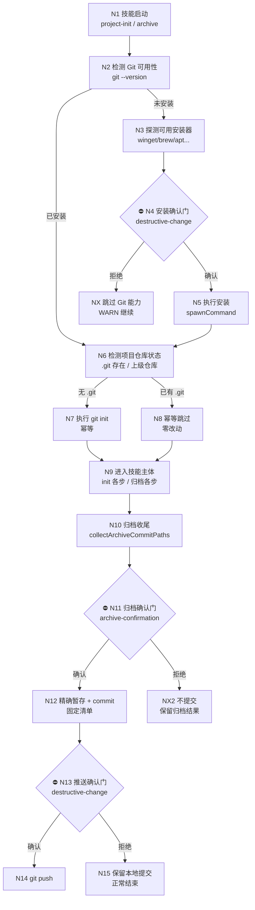

# 探索：Git 能力集成（project-init 安装/初始化 + 归档自动提交）

> 状态：**探索中**（Phase 1）。本文件是提案阶段的唯一语义来源（提示词基线）+ 流程基准承载者。
>
> **流程基准状态**：`flowBaselineConfirmed = true`（用户已确认流程最终确认门）；`paperTrailStatus = complete`

## Background

用户原始诉求：

> 优化 project-init 初始化流程，增加 git 安装和项目 git 初始化检查，如果本地没有安装推荐自动安装 git，但需要用户确认；本地 git 正常，在初始化时项目自动 git 初始化；归档 archive、bulk-archive 时，自动跳跃 commit 提交本地 Git，是否推送远程需要用户确认。

需求拆为三段：
1. **project-init**：检测 Git 是否安装 → 未安装时**推荐安装但需用户确认** → 已安装则**自动 `git init`**
2. **spec-archive**：归档后**自动本地 commit**
3. **spec-bulk-archive**：批量归档后**自动本地 commit**
4. 三条都需要：**是否推送远程 = 用户确认**

## 项目规则基线

| 源 | 存在 | 读取 | 关键约束摘要 |
| :--- | :--- | :--- | :--- |
| `.iagent/config.yaml` | 是 | 已读 | 13 命令本地 CLI；单一真源纪律；依赖注入 fail-safe |
| `.iagent/rules/coding-rules.md` | 是 | 已读 | 零猜测；设计先行；破坏性改动先暂停并确认；外部进程走 `child-process.ts`；模板改动后 build + generate:skills |
| `.iagent/rules/spec.md` | 是 | 已读 | Markdown 唯一真源；验证锚点单一源；终检顺序；**规则三层加载**（本变更需按 impl 类型读 coding-rules） |
| `.iagent/rules/testing-rules.md` | 是 | 已读 | Vitest；主目录沙箱；改模板后 build + generate:skills |
| `CLAUDE.md` | 否 | — | 不存在（合法终态） |
| `AGENTS.md` | 是 | 已读 | 三层白名单；**用户会话级权限载体**；提交信息规范；本机产物不入库 |

## 项目技能基线

| 源 | 存在 | 读取 | 完整性 | 关键约束摘要 |
| :--- | :--- | :--- | :--- | :--- |
| `.iagent/skills/backend-design.md` | 是 | 已读 | ok | 单一真源 / 派生而非复制 / 扩展点接口化 / **委派执行 fail-safe（默认 inline）** / 配置写入非破坏 / **失败非阻断** |
| `.iagent/skills/backend-implement.md` | 是 | 已读 | ok | `phases: implement`；实现期约定（本探索为 design 阶段，仅记录） |

## 提示词基线 (Prompt Baseline)

**原始提示词**（逐字）：

> 优化project-init初始化流程，增加git安装和项目git初始化检查，如果本地没有安装推荐自动安装git，但需要用户确认；本地git正常，在初始化时项目自动git初始化；归档archive、bulk-archive时，自动跳跃commit提交本地Git，是否推送远程需要用户确认

**确认后的提示词基线**：**待本轮门确认**（见下）。

| 维度 | 判定 | 说明 |
| :--- | :--- | :--- |
| 目标 Goal | ✅ | 把 Git 生命周期（安装 / 初始化 / 提交 / 推送确认）接入 init 与归档 |
| 对象 Object | ✅ | `project-init`、`spec-archive`、`spec-bulk-archive` |
| 范围 Scope | ✅ | 三段 Git 能力；不含 SVN |
| 约束 Constraints | ⚠️ | 未说明**自动 commit 的暂存范围**（全部改动 vs 仅本次变更相关文件）—— **待裁决** |
| 验收 Acceptance | ⚠️ | 未量化；建议：init 幂等不覆盖既有仓库；归档 commit 失败不阻断归档；推送必须显式确认 |
| 歧义 Ambiguity | ⚠️ | ① 自动安装 Git 的具体方式（系统包管理器 / 官方安装包 / 仅提示）；② 归档 commit 是否含 `openspec` 制品 —— **待裁决** |

> 三条 ⚠️ 属实质性（影响安全边界与实现面），并入本轮 grill 批量 1。

## 能力探索记忆注入

注入能力：`init-project-scan`、`commit-push-skill`、`spec-bulk-archive-skill`、`rule-baseline`。

| 能力 | 记忆要点 |
| :--- | :--- |
| `commit-push-skill` | 既有 Git/SVN 提交技能；**`offerArtifacts` 已有提案制品精确暂存清单**（proposal/design/tasks/exploration/.openspec.yaml/specs，排除 attachments 与需求文档）；提交信息尾行 `提案: <change-name>`；约束「首次执行前展示将提交的文件与信息，确认后再执行」 |
| `init-project-scan` | project-init 的扫描协议非阻断；第 10/11 步为规则与技能蒸馏 |
| `spec-bulk-archive-skill` | 批量归档三阶段分层并行；索引与 CodeGraph 由主代理单点执行 |
| `rule-baseline` | 规则源枚举与三层读取（本轮新机制） |

## Codebase Findings

### 现有 Git 相关能力

| 位置 | 现有能力 | 缺口 |
| :--- | :--- | :--- |
| `src/commands/init.ts:176-200` `resolveChangeArtifactsHint` | 检测 `.git/` 是否存在 + `.gitignore` 是否放行 `!openspec/changes/` | **只提示，不 init，不检测 git 是否安装** |
| `src/core/templates/workflows/commit.ts` | 完整 Git 提交协议（状态检查 / diff 核对 / 提案制品精确暂存 / Conventional Commits / 尾行 `提案:`） | 需**人工触发**；`allowedTools` 已有 `Bash(git status/diff/add/commit/log:*)` |
| `src/core/dependencies.ts` | `ensureDependencies` + `CommandRunner` 注入 + `DepItemState`（ok/installed/failed/skipped）+ 失败仅警告 | 只覆盖 codegraph；**无 git** |
| `src/core/child-process.ts` | `spawnCommand`（Windows shell 兼容 + DEP0190 规避） | 可直接复用 |
| `src/core/templates/workflows/spec-archive.ts` | 10 步归档协议（Step 5 目录移动、Step 7 索引、Step 9 清理、Step 10 护栏自检） | **无 commit 步骤** |
| `src/core/templates/workflows/spec-bulk-archive.ts` | 11 步批量归档（Step 8 分层并行、Step 10 索引、Step 11 CodeGraph） | **无 commit 步骤** |
| `src/core/templates/workflows/project-init.ts` | 11 步（1 读基线 → 11 技能蒸馏）；`allowedTools` 无 `Bash(git:*)` | **无 Git 检查 / init** |

### 关键既有机制（可复用）

| 机制 | 位置 | 复用方式 |
| :--- | :--- | :--- |
| **依赖检测与注入式 runner** | `dependencies.ts`（`CommandRunner` / `DepItemState` / 失败仅警告） | Git 安装检测沿用同一模式，新增 `git` 项 |
| **提案制品精确暂存清单** | `commit.ts` §2.5 | 归档自动 commit 的暂存范围可直接复用（MUST NOT `git add -A`） |
| **提交信息规范** | `commit.ts` §3（Conventional Commits 中文一行式 + 尾行 `提案:`） | 归档 commit 沿用同格式 |
| **门白名单第 5 类** | `protocol.ts:130-135` `destructive-change` | 安装软件 / 推送远程归入该类别（不可豁免） |
| **门承载 fail-safe** | `delegation-contract.ts:26` `GATE_SKIP_IDS`（当前仅 `design-confirmation`） | 本变更**不新增** skip id，推送确认门不可被 skip |
| **非破坏配置写入** | `project-config.ts` | init 只在无 `.git/` 时执行 `git init`，已有仓库不覆盖 |

## 根因分析（R1-R7）

| # | 现状缺口 | 证据 | 后果 |
| :--- | :--- | :--- | :--- |
| **R1** | project-init 无 Git 安装检测 | `project-init.ts` 无 `git --version` 相关步骤；`dependencies.ts` 仅 codegraph | 无 Git 环境下后续归档 commit 必然失败，且发现时机太晚 |
| **R2** | project-init 不执行 `git init` | `init.ts:183` 仅在**已存在** `.git/` 时给提示，不做初始化 | 新项目需用户手工初始化；`.gitignore` 提示也因无仓库而被跳过 |
| **R3** | 归档协议无 commit 步骤 | `spec-archive.ts` 1-10 步无 git 操作；`spec-bulk-archive.ts` 1-11 步同 | 归档成品需人工再跑 `/iagent:commit`，与本工具"一站式"定位不符 |
| **R4** | 归档自动提交的安全契约缺位 | `commit.ts` 明确「MUST NOT 自动 commit」「首次执行前确认」 | 归档侧若直接加 commit，会与既有约束冲突，必须先定义边界 |
| **R5** | 无推送能力与确认机制 | 全仓库无 `git push` 引用 | 用户要求「推送需确认」，但当前连推送动作都不存在 |
| **R6** | project-init 的 `allowedTools` 无 `Bash(git:*)` | `project-init.ts:166-174` 白名单仅 `Bash(ls/pwd)` + CodeGraph + 委派 | 即使正文加了 git 步骤，也会被权限拦截 |
| **R7** | 归档 `allowedTools` 无 `Bash(git:*)` | `spec-archive.ts:21`、`spec-bulk-archive.ts:21` 仅 `Bash(iagent:*)` + CodeGraph + `Bash(node:*)` | 同上 |

**主因**：R1+R2（init 侧缺位）+ R3（归档侧缺位）构成能力空白；R4/R5（安全契约缺位）决定实现必须带门；R6/R7（白名单缺位）是实现的前置修复项。

## Decision Process（候选方案）

### 方案 A —— 仅在技能正文加步骤（最小）

- **风险**：无确定性检测（git 是否存在靠模型跑命令猜）、无安装指引、失败处置不统一

### 方案 B —— 新增 `git-capability.ts` 内核 + 三段接入（推荐底座）

新增 `src/core/git-capability.ts`（纯函数 + 注入式 runner）：
- `detectGit()`：`git --version` → 是否安装 + 版本
- `isGitRepository(cwd)`：`.git/` 存在性
- `probeInstallers()`：按平台探测可用包管理器（winget/choco/scoop；brew；apt/dnf/pacman）
- `collectArchiveCommitPaths(changeRoot)`：复用 commit.ts 的固定清单
- `buildArchiveCommitMessage(...)`：Conventional Commits + 尾行 `提案:`

命令层：`iagent git status` / `iagent git init`（可选，供技能调用）

- **优点**：确定性可复现；测试可注入 runner 不触真实进程
- **风险**：新增 CLI 面

### 方案 C —— B + 三段技能正文接入 + 推送确认门（推荐主体）

在 B 之上：
1. `project-init` 新增「Step 0 前置环境检查」：git 检测 → 未装则走安装确认门 → 已装则 `git init`（幂等）
2. `spec-archive` 在 Step 7 之后新增「Step 7.5 自动 commit」（本地）；push 走确认门
3. `spec-bulk-archive` 在 Step 10 之后新增「Step 10.5 自动 commit」（整批一次提交）

- **优点**：能力完整且带门
- **风险**：三处都要改白名单与正文

### 方案 D —— 只做 init 侧，归档侧交给用户手动 commit

- **优点**：改动最小，不触碰「MUST NOT 自动 commit」约束
- **风险**：不满足用户诉求第 2 条

### AI 建议

取 **C**。理由：B 提供了确定性底座（无它则改动不可测），C 才完整覆盖三段诉求；D 明确不满足需求。

**必须解决的设计矛盾**：`commit.ts` 写明「MUST NOT 自动 commit」。归档自动 commit 需要把这个约束**收窄为「仅限归档收尾的自动提交，且必须带 push 确认门」**，而不是整体推翻。

## Decisions

- **D1 改动边界 = 三层**：技能模板正文 + 新增 `src/core/git-capability.ts` 确定性内核 + 可选 CLI 命令（`iagent git status|init`）。用户裁决 Q1=C。
- **D2 归档 commit 暂存范围 = 本次变更相关文件**：代码改动 + 该变更制品固定清单（复用 `commit.ts` §2.5 的精确清单），MUST NOT `git add -A`。用户裁决 Q2=B。
- **D3 安全契约收窄**：`commit.ts` 的「MUST NOT 自动 commit」收窄为**交互式场景约束**；归档自动 commit 走独立窄通道（固定清单 + 推送确认门）。用户裁决 Q3=A。
- **D4 安装方式 = 探测 + 展示 + 确认后执行**：探测可用包管理器（winget/choco/scoop、brew、apt/dnf/pacman）→ 展示将执行的命令 → 用户确认后由工具执行；无可用安装器时只给建议命令。用户裁决 Q4=B。
- **D5 验收口径**：① `git init` 幂等（已有仓库零改动）；② 未装 Git 且用户拒绝 → init/归档照常完成并 WARN；③ 归档 commit 只碰固定清单；④ 推送必须过确认门且不可 skip；⑤ 所有失败路径不阻断归档。用户裁决 Q5 认可。
- **D6 检测与执行分离**：`git-capability.ts` 的检测函数为**纯只读**（`git --version` / `.git/` 存在性 / 上级仓库探测 / 安装器探测），执行函数（init / add / commit / push）接受注入的 `CommandRunner`，测试不产生真实进程。
- **D7 归档 commit 独立性**：`spec-archive` 与 `spec-bulk-archive` 各自承载自己的 commit 步骤；批量归档**整批一次提交**（不逐变更提交），提交信息汇总各变更名。
- **D8 推送确认门不可豁免**：归入门白名单第 5 类 `destructive-change`（动作级），MUST NOT 新增 `GATE_SKIP_IDS` 条目，MUST NOT 被 `gate-skip` 跳过。
- **D9 安装确认门同样不可豁免**：归 `destructive-change`（安装软件属不可逆动作），未确认则跳过 Git 能力并 WARN。
- **D10 白名单补齐为前置修复**：`project-init` / `spec-archive` / `spec-bulk-archive` 的 `allowedTools` MUST 补齐所需 `Bash(git:*)` 子命令，经 `tool-whitelist.ts` 共享常量构造，MUST NOT 逐模板手写。

## 未决项（Pending）

（无 —— 全部歧义已于本轮合并门消解；实现细节按 D1-D10 约束执行）

### 实施约束（探索已确定）

- 外部进程 MUST 走 `src/core/child-process.ts` 的 `spawnCommand`（不直接 `shell:true`）
- `CommandRunner` MUST 可注入（测试不产生真实进程/网络副作用）
- 安装/推送 MUST 归门白名单第 5 类 `destructive-change`（不可豁免，MUST NOT 自造第 6 类）
- `GATE_SKIP_IDS` MUST NOT 新增推送相关 skip id
- 归档 commit 失败 MUST NOT 阻断归档（沿用 fail-safe 非阻断语义）
- 三个技能的 `allowedTools` MUST 补齐 `Bash(git:*)` 子命令（经 `tool-whitelist.ts` 共享常量）
- 改模板后 MUST `pnpm build && pnpm generate:skills`

### 受影响测试（预估）

`test/project-init-scan.test.ts`、`test/allowed-tools.test.ts`、`test/skill-size-budget.test.ts`、`test/skills-parity.test.ts`、`test/child-process.test.ts`、`test/dependencies.test.ts`、`test/gate-ledger.test.ts`

## Questions

**批次 1（L1-L3，用户已确认）**
- Q1 改动边界 → **C**：正文 + 内核 + 可选 CLI（→ D1）
- Q2 暂存范围 → **B**：本次变更相关文件，复用固定清单（→ D2）
- Q3 安全契约 → **A**：收窄 `commit.ts` 约束，归档走窄通道（→ D3）
- Q4 安装方式 → **B**：探测 + 展示命令 + 确认后执行（→ D4）
- Q5 验收口径 → **认可**（→ D5）

**批次 2（L4-L5，用户已确认）**
- Q6（L4 一致性）跨决策扫描：D2（固定清单）/ D3（窄通道）/ D8（推送门不可 skip）三者自洽 —— 窄通道的边界正是「只碰固定清单」，而推送门是窄通道的出口守门；与既有硬约束（不 `git add -A`、外部进程走 child-process、门白名单 5 类、失败非阻断、build + generate:skills）**无矛盾**，自动标一致（非阻断）。
- Q6 补充冲突识别：`commit.ts` 的「MUST NOT 自动 commit」为**既有明文约束**，D3 对其做**限定性收窄**（限定作用域为交互式调用），MUST 在提案中以 MODIFIED Requirement 显式改写并写明收窄边界，MUST NOT 让两条相反表述并存。
- Q7（L5 边界）BS1-BS9 处置：
  - BS1 Git 未装且用户拒绝 → 跳过 Git 能力 + WARN，init/归档照常
  - BS2 已是 Git 仓库 → `git init` 幂等跳过，零改动
  - BS3 嵌套仓库（上级有 `.git/`）→ 检测到即跳过 init + 提示
  - BS4 工作区有无关改动 → 只暂存固定清单，其余不动
  - BS5 detached HEAD / 冲突中 → 跳过 commit + WARN，不阻断归档
  - BS6 commit 失败 → WARN + 建议，不阻断归档
  - BS7 批量归档部分失败 → 只对成功归档者提交，失败另行报告
  - BS8 推送门拒绝 → 保留本地提交，不推送，正常结束
  - BS9 Git 版本过低 → WARN 不阻断

## 术语表

| 术语 | 定义 | 避免使用 |
| --- | --- | --- |
| Git 能力层（git capability） | 封装检测 / 初始化 / 暂存 / 提交 / 推送的确定性内核，注入式 runner 便于测试 | git 工具 |
| 安装确认门（install-confirmation） | 未检测到 Git 时，推荐安装方案并等待用户确认的动作级门（归 `destructive-change`） | 安装提示 |
| 归档自动提交（archive auto-commit） | 归档收尾由工具自动执行的本地 commit，仅限固定清单暂存 | 自动提交 |
| 推送确认门（push-confirmation） | 自动提交后是否推送远程的显式确认门（不可豁免、不可 skip） | 推送提示 |

> 本轮新增术语将在 Phase 2 统一写入 `openspec/CONTEXT.md`。

## 架构决策

无 ADR（当前方案未同时满足「难以逆转 + 脱离上下文意外 + 真实权衡」；若安装方式最终选择自动执行系统包管理器命令，Phase 2 再评估）。

## 边界场景

- [x] BS1：Git 未安装且用户拒绝安装 → 跳过 Git 能力，init 与归档照常完成（记 WARN）（D9）
- [x] BS2：项目已是 Git 仓库（`.git/` 存在）→ `git init` 幂等跳过，不覆盖不重置（D5）
- [x] BS3：该目录属于其他仓库的子目录（嵌套仓库）→ 检测到上级仓库时提示并跳过 init
- [x] BS4：归档时工作区有与本次变更无关的改动 → 只暂存固定清单，不触碰其余文件（D2）
- [x] BS5：归档时处于 detached HEAD / 有未合并冲突 → 跳过 commit 并 WARN，不阻断归档
- [x] BS6：归档 commit 失败（钩子拒绝 / 权限 / 用户身份未配置）→ WARN 并给出建议，不阻断归档
- [x] BS7：批量归档部分失败 → 仅对成功归档的变更提交，失败的另行报告（D7）
- [x] BS8：推送确认门被拒绝 → 保留本地提交，不推送，流程正常结束（D8）
- [x] BS9：Git 已安装但版本过低（如 < 2.0）→ 记 WARN 但不阻断

## 硬约束

- 外部进程 MUST 走 `child-process.ts` 的 `spawnCommand`，MUST NOT 直接 `shell:true` — source: 规则基线（coding-rules.md）
- 安装软件与推送远程 MUST 归门白名单第 5 类 `destructive-change`，MUST NOT 自造第 6 类门 — source: 规则基线（门白名单 5 类）+ spec-update 先例
- `GATE_SKIP_IDS` MUST NOT 新增推送 / 安装相关 id（不可被 skip）— source: D8 / D9
- 安装与推送确认门 MUST 归 `destructive-change`，MUST NOT 自造第 6 类门 — source: D8 / D9
- 归档 commit MUST NOT 阻断归档（失败只 WARN），批量归档 MUST 整批一次提交 — source: D7
- 归档 commit MUST 只暂存固定清单，MUST NOT `git add -A` / `git add openspec` — source: 规则基线（commit.ts 约束）
- `git init` MUST 幂等，已有仓库 MUST NOT 覆盖 / 重置 — source: 规则基线（配置非破坏 + BS2）
- 归档 commit 失败 MUST NOT 阻断归档 — source: 规则基线（失败非阻断）
- 改模板后 MUST 依次 `pnpm build && pnpm generate:skills` — source: 规则基线（AGENTS.md）
- 新增 CLI 命令 MUST 同步 `completion.ts` 的 `IAGENT_COMMANDS` 表 — source: 规则基线（AGENTS.md 守则 3）

## 功能流程图

> **状态：已确认**（用户已确认流程最终确认门）。本节即 propose / verify 的**流程基准**。

| 节点 | 操作 | 触发条件 | 证据位置 | 异常路径 |
| :--- | :--- | :--- | :--- | :--- |
| N1 | 技能启动（project-init 或 spec-archive / bulk-archive） | 用户调用 / 父编排委派 | `project-init.ts:163`、`spec-archive.ts:21`、`spec-bulk-archive.ts:21` | — |
| N2 | 检测 Git 可用性（`git --version`） | N1 完成 | `[新建]` `src/core/git-capability.ts` `detectGit()`；runner 注入（`dependencies.ts:33` 先例） | 命令不存在 → 判未安装 → N3；版本过低 → WARN 继续 → N6（BS9） |
| N3 | 探测可用安装器（按平台） | N2 判未安装 | `[新建]` `probeInstallers()`：Windows `winget/choco/scoop`、macOS `brew`、Linux `apt/dnf/pacman` | 全部不可用 → 只给建议命令，不执行 → NX |
| N4 | **⛔ 安装确认门**（`destructive-change`） | N3 找到安装器 | 门白名单 `protocol.ts:130-135`；展示「将执行的命令」 | 拒绝 → NX（跳过 Git 能力 + WARN） |
| N5 | 执行安装命令 | N4 确认 | `[新建]` `installGit()`，经 `spawnCommand`（`child-process.ts:87`） | 安装失败 → WARN 并降级 → NX |
| N6 | 检测项目仓库状态 | N2 已安装 / N5 装好 | `[新建]` `isGitRepository()` + `findParentRepository()` | 上级有仓库 → 提示并跳过 init → N9（BS3） |
| N7 | 执行 `git init`（幂等） | N6 无 `.git` 且无上级仓库 | `[新建]` `initRepository()` | 失败 → WARN 继续 → N9 |
| N8 | 幂等跳过 | N6 已有 `.git` | 同上 | 零改动，MUST NOT 重置/覆盖（BS2） |
| N9 | 进入技能主体 | N7 / N8 完成 | `project-init.ts:184-312`（11 步）、`spec-archive.ts:37-330`（10 步） | 未装 Git 且拒绝 → NX 后直接 N9 |
| N10 | 收集待提交路径 | 归档协议收尾 | `[新建]` `collectArchiveCommitPaths()` 复用 `commit.ts` §2.5 固定清单 | 路径为空 → 无改动可提交 → 跳过 commit + 一行说明 |
| N11 | **⛔ 归档确认门**（`archive-confirmation`，既有） | 归档制品就绪 | `spec-archive.ts:29`（`standalone-archive` 变体） | 拒绝 → NX2（不提交，归档结果不变） |
| N12 | 精确暂存 + 本地 commit | N11 确认 | `[新建]` `stagePathsAndCommit()`；提交信息复用 `commit.ts` §3 规范 + 尾行 `提案:` | 失败（钩子 / 权限 / 身份未配）→ WARN + 建议，不阻断（BS6）；detached HEAD / 冲突 → 跳过 + WARN（BS5） |
| N13 | **⛔ 推送确认门**（`destructive-change`） | N12 提交成功 | 门白名单第 5 类；`GATE_SKIP_IDS` MUST NOT 含推送 id | 拒绝 → N15（保留本地提交） |
| N14 | `git push` | N13 确认 | `[新建]` `push()` | 无 remote / 推送失败 → WARN + 保留本地提交 |
| N15 | 正常结束 | N13 拒绝或 N14 完成 | — | — |

> **回改规则**：提案 / 验证阶段发现遗漏节点时 MUST 回到本节更新并重新经用户确认，MUST NOT 在 `tasks.md` 静默补节点。
