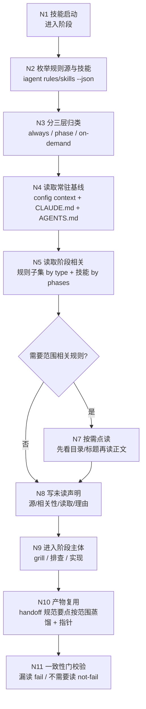

# 探索：规则与技能的动态加载（rules / skills 按需读取）

> 状态：**探索中**（Phase 1）。本文件是提案阶段的唯一语义来源（提示词基线）+ 流程基准承载者。
>
> **流程基准状态**：`flowBaselineConfirmed = true`（用户已确认流程最终确认门）；`paperTrailStatus = complete`

## Background

用户原始诉求：

> 分析项目 explore、auto-workflow、workflow、debug、update 以及其他技能流程时，读取 `.iagent` 下 rules / skills 规则。当前技能使用时会全部加载 rules / skills，应该根据实际情况动态加载，不在开始时全部读取。

现象复述：技能在启动阶段一律「枚举 + 读取全部 `exists=true` 的规则源与技能」，与本次变更的分析范围无关的规则也进入上下文，占用 token 且稀释注意力。

## 项目规则基线

| 源 | 存在 | 读取 | 关键约束摘要 |
| :--- | :--- | :--- | :--- |
| `.iagent/config.yaml` | 是 | 已读 | 13 命令本地 CLI；`rules:` 列表显式 include（coding-rules / testing-rules / spec）；单一真源纪律 |
| `.iagent/rules/coding-rules.md` | 是 | 已读 | 零猜测；设计先行；严格分层；模板唯一源；白名单共享常量；改模板后 build + generate:skills |
| `.iagent/rules/spec.md` | 是 | 已读 | Markdown 唯一真源；写入后 `validate` 循环；新增「验证锚点」「终检顺序（partial → ready → strict → handoff）」 |
| `.iagent/rules/testing-rules.md` | 是 | 已读 | Vitest 3.2.6；主目录沙箱；改模板后须 build + generate:skills |
| `CLAUDE.md` | 否 | 未读 | 不存在（合法终态） |
| `AGENTS.md` | 是 | 已读 | 三层白名单、单一源纪律、变更制品纳管策略 |

## 项目技能基线

| 源 | 存在 | 读取 | 完整性 | 关键约束摘要 |
| :--- | :--- | :--- | :--- | :--- |
| `.iagent/skills/backend-design.md` | 是 | 已读 | ok | `phases: design`、`scope: backend`、`frameworks: [Commander.js]`；单一真源 / 派生 / 扩展点 / fail-safe / 门收敛 / 非破坏写入 |
| `.iagent/skills/backend-implement.md` | 是 | 已读 | ok | `phases: implement`、`scope: backend`；实现期约定（本探索按 design 阶段消费，仅记录不外引） |

## 提示词基线 (Prompt Baseline)

**原始提示词**（逐字）：

> 分析项目explore、auto-workflow、workflow、debug、update已经其他技能流程时，读取.agent下 rules\skills规则，当前技能使用时会全部加载rules\skills，应该根据实际情况动态加载，不在一开始时全部读取

**确认后的提示词基线**：**待本轮门确认**（见下）。

| 维度 | 判定 | 说明 |
| :--- | :--- | :--- |
| 目标 Goal | ✅ | 降低启动期上下文成本：rules / skills 按实际情况动态加载 |
| 对象 Object | ✅ | explore / auto-workflow / workflow / debug / update 及其他技能的规则读取 |
| 范围 Scope | ✅ | 技能模板正文的读取策略（不含规则文件自身的格式变更） |
| 约束 Constraints | ⚠️ | 未说明是否允许改 CLI（`iagent rules` / `iagent skills` 是否新增筛选参数）—— **待裁决** |
| 验收 Acceptance | ⚠️ | 未量化；建议口径：全量读取点 0 处；每次技能调用实际读取的规则行数 ≤ 相关规则行数 + 常驻基线；未读项必须有显式声明与降级路径 |
| 歧义 Ambiguity | ⚠️ | 「全部加载」是否含 `AGENTS.md` / `CLAUDE.md` 这类根级常驻文件 —— **待裁决** |

> 三条 ⚠️ 均属实质性（影响改动边界与验收），并入本轮 grill 批量 1 一次性确认。

## 能力探索记忆注入

注入能力：`rule-baseline`、`project-skill-consumption`、`spec-workflow-skills`、`workflow-suite-skills`。

| 能力 | 记忆要点（待本次会话读取确认） |
| :--- | :--- |
| `rule-baseline` | `iagent rules --json` 为规则源枚举单一源；规则源缺失记「不存在」不阻断 |
| `project-skill-consumption` | 按 `phases` 筛选（design / implement）是既有机制；`skills-not-read` / `skills-incomplete` 有既定口径 |
| 其余 | 编排阶段内联、handoff 包里已有 `## 规范要点` 蒸馏段 |

## Codebase Findings

### 全量读取点（现状：启动期一次性枚举 + 全读）

| # | 位置 | 现行为 | 规模影响 |
| :--- | :--- | :--- | :--- |
| L1 | `spec-explore.ts:95-113`（1.1.1 项目规则基线） | `iagent rules --json` 后「读取全部 `exists=true` 的源」 | 4 源 / 47 行，其中 testing-rules 与本阶段无关 |
| L2 | `spec-explore.ts:115-131`（1.1.1.5 项目技能基线） | `iagent skills --json` 按 `phases` 含 design/both 筛选后「读取全部」 | 已按阶段筛选（**半动态**），但无范围筛选 |
| L3 | `debug.ts:180-188`（2.1.6 规则基线） | 同 L1「读取全部」 | 同上 |
| L4 | `debug.ts:190-199`（2.1.7 技能基线） | 同 L2 | 同上 |
| L5 | `spec-propose.ts:235`（handoff `## 规范要点`） | 由**全部存在**的规则源蒸馏 | 显式要求「MUST NOT 只蒸馏 coding-rules.md」 |
| L6 | `spec-propose.ts:236`（技能要点子节） | 取探索 `## 项目技能基线` 中 design/both 全部 | 依赖 L2 的已读集合 |
| L7 | `spec-apply.ts:275`（实现前基线） | 「先读取项目规则基线：…`rules/*.md`…」+ implement/both 技能全部 | 未按任务范围筛选 |
| L8 | `spec-apply.ts:28`（handoff 规范要点） | 「**全部存在规则源**的关键护栏」 | 依赖 L5，同源 |
| L9 | `spec-verify.ts:25`（规则基线） | 「读取 `.iagent/rules/*.md`…」全部 | 验证阶段与实现阶段规则集可能不同，但当前同集 |
| L10 | `review.ts:17` | 「读取全部 `exists=true` 的规则源」 | 审查阶段无差别全读 |
| L11 | `test.ts:727` | 只读 `testing-rules.md`（**已是最佳实践**，可作为范式） | — |
| L12 | `proposal-review.ts:585` | 读 `config.yaml` context + `rules/*.md`（按类型规则，措辞较模糊） | — |

### 可复用的既有机制

| 机制 | 位置 | 可复用点 |
| :--- | :--- | :--- |
| **渐进披露 references** | 各技能 `references/*.md` | 主文件只留指针，明细按需 `Read` —— 与「规则按需读取」同一思路，已有先例 |
| **`phases` 字段** | `project-skills.ts:65` | 技能按 design / implement 阶段筛选已实现（半动态） |
| **`scope` 字段** | `project-skills.ts:66` | 目前已解析但**未被读取侧消费**（`scope: backend`），是天然的「范围筛选」抓手 |
| **handoff `## 规范要点`** | `spec-propose.ts:235` | 跨阶段只读复用，避免每阶段重复蒸馏 —— 但当前内容来自全量规则 |
| **`rules --json` 的 `rules` 列表** | `rules.ts` (`RuleSource.rules`) | `config.yaml` 的 `rules:` 是显式 include 列表，本身有序且有类型语义 |
| **`RULE_FILE_NAMES` 类型→语义名映射** | `project-config.ts:396` | 规则文件与 `SKILL_TYPES` 的 9 类有确定映射 —— 可按类型筛选 |
| **`test.ts` 只读 testing-rules** | `test.ts:727` | 已存在的「只读相关规则」范式，可作为统一策略的样板 |

### 关键事实（支撑动态加载可行性）

- `.iagent/rules/` 当前 3 个文件总计 47 行；`.iagent/skills/` 2 个文件 131 行 —— 当前规模小，**但这是模板策略问题，不是当下代价问题**（在规则多的大项目里代价线性放大）。
- 规则文件**无 frontmatter**，类型只能从文件名（`RULE_FILE_NAMES` 映射）或 `config.yaml` 的 `rules:` 列表推断 —— 动态筛选的类型来源必须走单一源。
- `iagent rules --json` 与 `iagent skills --json` **当前都不支持筛选参数**（仅 `--json`），筛选完全靠模型自行判断。
- 技能 `type` 字段（9 类）与规则 `RULE_FILE_NAMES` 的键高度重合（impl→coding-rules / test→testing-rules / spec→spec.md / review / commit / docs / init）—— 这是「技能类型 → 规则子集」映射的天然依据。

## 根因分析（R1-R6，均带证据）

| # | 根因 | 证据 | 后果 |
| :--- | :--- | :--- | :--- |
| **R1** | **读取策略是「枚举即全读」**：`rules --json` 返回什么就读什么，没有「先判断相关性再读」的步骤 | `spec-explore.ts:100`、`debug.ts:185`、`review.ts:17`、`spec-apply.ts:275`、`spec-verify.ts:25` | 无关规则进入上下文；在规则多的项目里线性膨胀 |
| **R2** | **规则与技能之间没有类型映射**：技能的 `type`（impl/test/spec/...）没有用来筛选规则文件 | `spec-explore.ts:99-113`（全读）对照 `project-config.ts:396`（已有 `RULE_FILE_NAMES` 映射但未被读取侧使用） | 唯一可用的筛选维度（类型）被闲置 |
| **R3** | **`scope` 字段被解析但不被消费** | `project-skills.ts:66` 解析 `scope`；`spec-explore.ts:119` 只按 `phases` 筛，未用 `scope` | 前端/后端技能无法按变更范围过滤 |
| **R4** | **propose 强制全源蒸馏**：`MUST NOT 只蒸馏 coding-rules.md` 把「全量」写成了硬要求 | `spec-propose.ts:235` | 即使变更只涉模板层，testing-rules 也要蒸馏进 handoff 包并跨阶段传递 |
| **R5** | **CLI 无筛选能力**：`rules --json` / `skills --json` 只有 `--json`，筛选责任全在模型 | `rules.ts:148`、`skills.ts:20` | 每次都要模型读全量再自行判断，判定不可复现 |
| **R6** | **缺少「未读项显式声明」契约**（除 spec-apply 的 `skillsIncomplete` 外） | `spec-apply.ts:275` 有 `skillsIncomplete`；其余读取点无等价字段 | 无法区分「不需要读」与「漏读」—— 这正是「全读」成为安全默认的原因 |

**主因**：R1（枚举即全读）+ R5（CLI 无筛选）+ R2（类型映射闲置）构成「只能全读」的结构闭环；R3/R4/R6 是放大器。

## Decision Process（候选方案）

### 方案 A —— 只改模板措辞（最小）

各技能正文改为「按相关性挑选读取」，不提供确定性依据。
- **优点**：零代码改动
- **风险**：完全依赖模型判断，不可复现；「相关性」无判据时仍会退化为全读

### 方案 B —— CLI 增加类型/阶段筛选参数（推荐底座）

`iagent rules --json --type <id,...>` / `--for-change <name>`；`iagent skills --json --phase <design|implement> --scope <backend|frontend>`。
- 类型来源走 `RULE_FILE_NAMES`（单一源），阶段/范围走 `phases` / `scope`
- **优点**：筛选确定性可复现；模板只需调用带参命令
- **风险**：CLI 面扩大（需同步 `completion.ts`）

### 方案 C —— B + 分级读取契约（推荐主体）

在 B 之上定义三层读取策略：

| 层级 | 内容 | 时机 |
| :--- | :--- | :--- |
| **常驻基线**（always） | `config.yaml` 的 context + 项目的「元规则」（零猜测 / 设计先行等跨阶段必需项） | 每次调用 |
| **阶段相关**（phase） | 按技能 `metadata.type` 映射的规则子集 + `phases` 匹配的技能 | 进入该阶段时 |
| **按需点读**（on-demand） | 与本次变更/任务范围相关的其余规则，读前先看目录与标题 | 用到时 |

并强制「**未读声明**」：产物中记录 `| 源 | 相关性判定 | 读取 | 理由 |`，区分「不需要读」与「漏读」。
- **优点**：确定性 + 节省上下文 + 可审计
- **风险**：需要三处同时改（CLI / 模板 / 产物契约）

### 方案 D —— C + handoff 规范要点按范围蒸馏

handoff `## 规范要点` 改为只蒸馏「本次变更相关」的规则子集，其余以指针 + 摘要保留。
- **优点**：跨阶段传递的 token 也降下来
- **风险**：下游遗漏规则的代价由「指针可回读」对冲，需要明确的回读契约

### AI 建议

取 **C + D**：先落 B 的筛选参数（确定性底座），再落 C 的三层策略与未读声明，最后落 D 的 handoff 按范围蒸馏。若需控制改动面，可先 B + C 的常驻/阶段两层，按需点读作为第二阶段。

## Decisions

- **D1 改动边界 = 三层（模板 + CLI + 读取契约）**：允许改 ① 技能模板正文；② CLI 筛选参数（`rules --json --type`、`skills --json --phase/--scope`）；③ 产物读取契约（未读声明）。用户裁决 Q1=C。
- **D2 handoff 规范要点按范围蒸馏**：`## 规范要点` 只蒸馏「本次变更相关」子集，其余以「指针 + 一行摘要」保留并可回读；MUST NOT 静默丢弃。用户裁决 Q2=B。
- **D3 常驻基线 = 根级元规则**：`.iagent/config.yaml` 的 context、`CLAUDE.md`、`AGENTS.md` 视为**常驻基线**，每次调用均读；其余 `.iagent/rules/<type>.md` 参与动态筛选。用户裁决 Q3=A。
- **D4 验收口径**：① 全量读取点归零（常驻基线除外）；② 实际读取行数 ≤ 阶段相关子集 + 常驻基线；③ 未读项 MUST 有 `| 源 | 相关性 | 读取 | 理由 |` 声明；④ 无参 CLI 调用行为不变（向后兼容）。用户裁决 Q4 认可。
- **D5 三层读取策略**：`always`（常驻基线）/ `phase`（按技能 `metadata.type` → `RULE_FILE_NAMES` 映射的规则子集 + `phases` 匹配的技能）/ `on-demand`（按范围点读，带未读声明）。
- **D6 类型映射单一源**：技能类型 → 规则文件名的映射 MUST 复用 `project-config.ts` 的 `RULE_FILE_NAMES` / `ruleFileNameFor`，MUST NOT 在 CLI 或模板中另立第二份。
- **D7 CLI 筛选为确定性底座**：筛选 MUST 由 CLI 计算（纯函数），MUST NOT 交由模型自行判断「相关性」；无匹配时返回空集并 WARN，MUST NOT 回退为全量。
- **D8 未读声明为强制契约**：每个读取点产物 MUST 逐源记录相关性判定与读取状态，使「不需要读」与「漏读」可区分；漏读（声明为需读但未读）计 `rules-not-read` fail，不需要读不 fail。
- **D9 向后兼容优先**：新增参数为加法；既有 `rules --json` / `skills --json` 无参输出 MUST 逐字段不变；存量技能无 `scope` 字段时按 `null` 处理不参与筛选。
- **D10 预算不受损**：技能主 SKILL.md 行数 ≤ 500、字符 ≤ 20000 约束继续生效；新增读取策略正文在超预算时下沉 references。

## 未决项（Pending）

（无 —— 全部歧义已于本轮合并门消解；实现细节按 D1-D10 约束执行）

### 实施约束（探索已确定，不需裁决）

- 改模板后必须 `pnpm build && pnpm generate:skills`
- 新增 CLI 参数须同步 `src/commands/completion.ts` 的 `IAGENT_COMMANDS` 表（AGENTS.md 规则第 3 条）
- 规则类型 → 文件名的映射 MUST 走 `project-config.ts` 的 `RULE_FILE_NAMES`（单一源）
- 存量技能与既有产物向后兼容：新增筛选参数 MUST NOT 改变无参调用的行为
- 技能主文件行数 / 字符预算仍受 `test/skill-size-budget.test.ts` 约束

### 受影响测试（预估）

`test/skills-command.test.ts`、`test/rules-command.test.ts`、`test/project-skills.test.ts`、`test/skill-size-budget.test.ts`、`test/skills-parity.test.ts`、`test/completion-config.test.ts`

## Questions

**批次 1（L1-L3，用户已确认）**
- Q1 改动边界 → **C**：模板 + CLI 筛选参数 + 分级读取契约（→ D1）
- Q2 handoff 规范要点 → **B**：按范围蒸馏 + 指针回读（→ D2）
- Q3 常驻范围 → **A**：`config.yaml` context / `CLAUDE.md` / `AGENTS.md` 恒读（→ D3）
- Q4 验收口径 → **认可**（→ D4）

**批次 2（L4-L5，用户已确认）**
- Q5（L4 一致性）跨决策矛盾扫描：D5（三层）/ D6（映射单一源）/ D7（CLI 确定性）/ D8（未读声明）四者互补无冲突 —— 三层决定"读什么"，CLI 决定"谁判定"，未读声明决定"如何审计"；与既有硬约束（`RULE_FILE_NAMES` 单一源、`completion.ts` 同步、build + generate:skills、技能尺寸预算）**无矛盾**，自动标一致（非阻断）。
- Q5 补充冲突识别：本变更与 `rule-baseline` 能力的既有 Requirement「handoff 多源规范要点」**存在语义变更**（全源 → 按范围 + 指针），需以 MODIFIED Requirement 显式改写，MUST NOT 并存两条冲突条款 —— 已在本门呈现。
- Q6（L5 边界）BS1-BS7 处置：
  - BS1 规则源全缺失 → 「无规则源」合法终态继续（既有）
  - BS2 技能全缺失 / 配置空 → 「无技能配置」继续（既有）
  - BS3 类型筛选后子集为空 → 回退常驻基线 + WARN，不阻断（D7）
  - BS4 `config.yaml` 的 `rules:` 与磁盘不一致 → 以枚举为准 + WARN
  - BS5 存量技能无 `scope` → 视为 `null`，不参与范围筛选（D9）
  - BS6 按需点读误判漏读 → 未读声明 + 指针回读对冲（D8）
  - BS7 `AGENTS.md` / `CLAUDE.md` → 常驻基线，不参与筛选（D3）

## 术语表

| 术语 | 定义 | 避免使用 |
| --- | --- | --- |
| 动态加载（dynamic loading） | 按阶段 / 范围 / 相关性决定读取哪些规则与技能，而非启动期全量读取 | 懒加载、按需读取（后者仅指第三层） |
| 读取层级（read tier） | 常驻基线 / 阶段相关 / 按需点读三层读取策略 | — |
| 未读声明（unread declaration） | 产物中逐源记录相关性判定与读取状态，区分「不需要」与「漏读」 | 读取完整性 |
| 范围筛选（scope filter） | 依据技能的 `scope` 字段（backend/frontend）过滤技能与规则 | — |

> 本轮新增术语将在 Phase 2 统一写入 `openspec/CONTEXT.md`。

## 架构决策

无 ADR（当前方案未同时满足「难以逆转 + 脱离上下文意外 + 真实权衡」；若最终选择新增 CLI 参数面并改变读取契约，Phase 2 再评估是否需要 ADR）。

## 边界场景

- [x] BS1：规则源全部缺失 → 记「无规则源」继续（既有合法终态）
- [x] BS2：技能全部缺失 / 配置为空 → 记「无技能配置」继续
- [x] BS3：按类型筛选后子集为空（如 commit 技能无对应规则文件）→ 回退到常驻基线 + WARN，不阻断（D7）
- [x] BS4：`config.yaml` 的 `rules:` 列表与磁盘文件不一致 → 以枚举结果为准并 WARN
- [x] BS5：存量技能（无 `scope` 字段）→ 视为 `null`，不参与范围筛选（D9）
- [x] BS6：按需点读时模型判断错误漏读关键规则 → 「未读声明 + 指针回读」对冲（D8）
- [x] BS7：`AGENTS.md` / `CLAUDE.md` → 常驻基线，不参与筛选（D3）

## 硬约束

- 常驻基线（config.yaml context / CLAUDE.md / AGENTS.md）MUST 每次调用均读，MUST NOT 参与动态筛选 — source: D3
- 技能类型→规则文件名映射 MUST 复用 `RULE_FILE_NAMES`，MUST NOT 另立第二份 — source: D6
- 筛选 MUST 由 CLI 确定性计算，MUST NOT 交由模型自行判断相关性 — source: D7
- 未读项 MUST 有 `| 源 | 相关性 | 读取 | 理由 |` 声明；漏读计 fail、不需要读不 fail — source: D8
- 既有 `rules --json` / `skills --json` 无参输出 MUST 保持不变 — source: D9
- handoff `## 规范要点` 按范围蒸馏时 MUST 保留指针可回读，MUST NOT 静默丢弃 — source: D2
- 改模板后 MUST 依次 `pnpm build && pnpm generate:skills` — source: 规则基线（AGENTS.md / testing-rules.md）
- 规则类型 → 文件名映射 MUST 走 `project-config.ts` 的 `RULE_FILE_NAMES`，MUST NOT 在模板中另立映射 — source: 规则基线（coding-rules.md 单一真源）
- 新增 CLI 命令/参数 MUST 同步 `completion.ts` 的 `IAGENT_COMMANDS` 表 — source: 规则基线（AGENTS.md 修改守则 3）
- 无参调用行为 MUST NOT 改变（向后兼容）— source: 探索推断（待 Q1 确认）
- 技能主 SKILL.md 行数 ≤ 500、字符 ≤ 20000 — source: 规则基线（skill-size-budget）

## 功能流程图

> **状态：已确认**（用户已确认流程最终确认门）。本节即 propose / verify 的**流程基准**。

| 节点 | 操作 | 触发条件 | 证据位置 | 异常路径 |
| :--- | :--- | :--- | :--- | :--- |
| N1 | 技能启动，进入某个阶段（探索 / 排查 / 实现 / 验证 / 审查） | 用户调用或父编排委派 | 各技能 `instructions` 首段；`workflows.ts:24-75`（阶段协议） | 阶段未定义 → 阻断并报告 |
| N2 | 枚举规则源与技能 | N1 完成 | `src/commands/rules.ts:47`（`collectRuleSources`）、`src/commands/skills.ts:16`（`collectProjectSkills`） | 枚举失败 → WARN，按空集继续（BS1/BS2） |
| N3 | 分三层归类（`always` / `phase` / `on-demand`） | N2 完成 | `[新建]` `src/core/rule-selection.ts`：`classifyRuleSources()` | 无法归类 → 归入 `on-demand` 并 WARN |
| N4 | 读取常驻基线 | N3 完成 | `[新建]` 同上：`always` 集 = `config.yaml` context + `CLAUDE.md` + `AGENTS.md` | 缺失 → 记「不存在」（合法终态） |
| N5 | 读取阶段相关子集 | N4 完成 | `[新建]` `phase` 集：技能 `metadata.type` → `RULE_FILE_NAMES`（`project-config.ts:396`）；技能按 `phases` 筛选（`project-skills.ts:208`） | 子集为空 → 回退常驻基线 + WARN（BS3/D7） |
| N6 | 判断是否需要范围相关规则 | N5 完成、进入具体操作 | 技能正文的阶段主体（如 grill / 排查 / 实现任务） | 判定不确定 → 按需读并记录理由 |
| N7 | 按需点读 | N6 为是 | `[新建]` `on-demand` 读取引导（先目录 / 标题，再正文） | 读取失败 → WARN + 计入未读 |
| N8 | 写未读声明 | N7 完成或 N6 为否 | `[新建]` 产物段 `\| 源 \| 相关性 \| 读取 \| 理由 \|` | 声明缺失 → 对应读取点视为漏读 |
| N9 | 进入阶段主体 | N8 完成 | 既有各技能阶段正文 | — |
| N10 | 产物复用：handoff 规范要点按范围蒸馏 + 指针 | N9 完成（propose 定稿时） | `spec-propose.ts:235`（改造）+ `[新建]` 指针格式 | 蒸馏失败 → WARN，保留全量指针 |
| N11 | 一致性门校验漏读 | N10 完成（apply 收尾时） | `conformance.ts:171-182`（`rules-not-read`）+ 新增「声明为不需要读」豁免 | 漏读 → fail；不需要读 → not-fail（D8） |

> **回改规则**：提案 / 验证阶段发现遗漏节点时 MUST 回到本节更新并重新经用户确认，MUST NOT 在 `tasks.md` 静默补节点。
