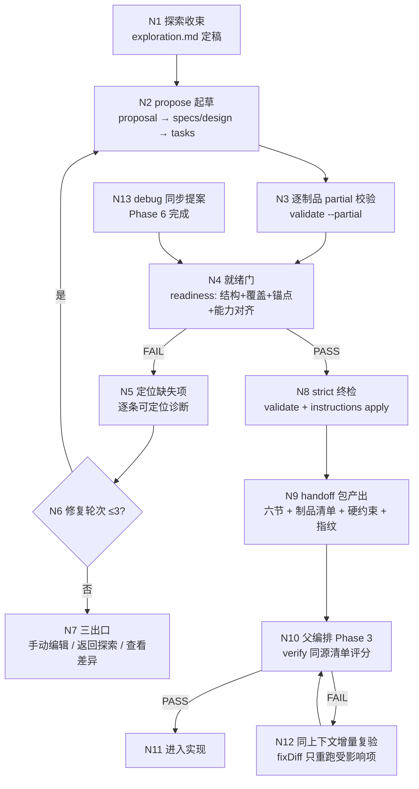

# 探索：提案生成一次完成度（proposal / auto-workflow / workflow / debug）

> 状态：**探索中**（Phase 1）。本文件是提案阶段的唯一语义来源（提示词基线）+ 流程基准承载者。
>
> **流程基准状态**：`flowBaselineConfirmed = true`（用户于本轮确认流程最终确认门）；`paperTrailStatus = complete`

## Background

用户原始诉求：

> 探索分析项目，对 proposal、auto-workflow、workflow、debug 流程生成变更提案内容逻辑优化。当前存在探索完成后，在生成提案时，变更提案文件不能一次完成，需要多次验证补充的情况；需要优化生成逻辑和完成度，防止多次重写、重复验证问题。

现象复述：探索（Phase 1）收束后进入提案（Phase 2），`iagent_spec_propose` 产出的制品在 Phase 3 验证/复查时被判不达标，于是回到提案重写，再验证，再补 —— 循环多轮才成型。

## 项目规则基线

| 源 | 存在 | 读取 | 关键约束摘要 |
| :--- | :--- | :--- | :--- |
| `.iagent/config.yaml` | 是 | 已读 | 13 命令本地 CLI；单一真源纪律（skill-id / command-references / command-artifacts / version-bump）；模板改动后 `pnpm build && pnpm generate:skills` |
| `.iagent/rules/coding-rules.md` | 是 | 已读 | 零猜测（未明确项标 [待确认]）；严格分层；技能模板正文是唯一源，指令版由 `derive-command.ts` 派生；`allowedTools` 必须走共享常量；改模板后必须 build + generate:skills |
| `.iagent/rules/spec.md` | 是 | 已读 | 真源为 `openspec/changes/` 下 Markdown；允许并行起草（proposal 完成后 specs/design/tasks 并行）；**写入后运行 `iagent spec validate` 校验循环，失败则修正并重跑**；提案实现前须过 90% 评分门；不创建 JSON 制品 |
| `.iagent/rules/testing-rules.md` | 是 | 已读 | Vitest 3.2.6，`test/**/*.test.ts`；改模板后须 build + generate:skills 否则 `test/skills-parity.test.ts` 失败 |
| `CLAUDE.md` | 否 | 未读 | 不存在（合法终态） |
| `AGENTS.md` | 是 | 已读 | 三层白名单组合规则、单一源纪律、变更制品纳管策略、`.claude/` 不入库 |

## 项目技能基线

| 源 | 存在 | 读取 | 完整性 | 关键约束摘要 |
| :--- | :--- | :--- | :--- | :--- |
| `.iagent/skills/backend-design.md` | 是 | 已读 | ok | 设计规范：单一真源优先、派生而非复制、扩展点接口化、宿主机制解耦、委派 fail-safe、门承载收敛到域内取值、配置写入非破坏、失败非阻断；MUST NOT 直编派生产物 / 手写 allowedTools 字面量 / 重新序列化 config.yaml / 硬编码宿主专属机制词 |
| `.iagent/skills/backend-implement.md` | 是 | 已读（`phases=implement`，本探索不采纳） | ok | 实现期技能，不进设计约束 |

## 提示词基线 (Prompt Baseline)

**原始提示词**（逐字）：

> 探索分析项目，对proposal、auto-workflow、workflow、debug流程生成变更提案内容逻辑优化，当前存在探索完成后，在生成提案时，变更提案文件不能一次完成，需要多次验证补充的情况，需要优化生成逻辑和完成度，防止多次重新、重新验证问题

**确认后的提示词基线**：**待本轮门确认**（见下）。

| 维度 | 判定 | 说明 |
| :--- | :--- | :--- |
| 目标 Goal | ✅ | 提升提案"一次成型"率，减少重写 / 重复验证 |
| 对象 Object | ✅ | `spec-propose` 生成逻辑 + `auto-workflow` / `workflow` / `debug` 三条调用链 |
| 范围 Scope | ✅ | 提案内容生成逻辑与完成度判定（不涉实现阶段功能语义） |
| 约束 Constraints | ⚠️ | 未说明是否允许改动 CLI 校验器 / 验证阈值 / 门结构 —— **待裁决** |
| 验收 Acceptance | ⚠️ | 未量化；建议口径：同一变更在 propose 收束时的确定性就绪门通过，且 Phase 3 首轮 PASS（无需修复轮） |
| 歧义 Ambiguity | ⚠️ | "生成逻辑"是否含 CLI 侧确定性校验（`iagent spec validate` / 解析器）—— **待裁决** |

> 其余维度清晰；两条 ⚠️ 属实质性（影响改动边界与验收口径），并入本轮 grill 批量 1 一次性确认。

## 能力探索记忆注入

注入能力：`artifact-generation-protocol`、`spec-verify-proposal`、`workflow-suite-skills`、`spec-workflow-skills`、`workflow-implementation-chain`、`spec-conformance`。

| 能力 | 记忆要点 |
| :--- | :--- |
| `artifact-generation-protocol` | 协议真源为源仓文件、目标项目侧投影为 `.iagent/rules/spec.md`；**"写入后校验循环"是既有约定**（本次优化应强化而非另立）；G1-G3 三步 = 建目录 → 按依赖序生成 → 终态确认 |
| `spec-verify-proposal` | D2/D3 已并入「影响范围一致性检查」与「待实现功能覆盖检查」；缺失处置先例 = **SKIP 排除分母**（不按 0 分拉低）；FAIL 输出必须逐条可定位 |
| 其余四个 | 编排阶段内联化、handoff 包跨阶段只读、单一源派生 —— 均支持"把判定前移为确定性"的方向 |

> 无「已过时」条目影响本次探索。

## Codebase Findings

### 生成侧（提案制品如何被生成）

- `src/core/spec/templates/index.ts:8-35` `PROPOSAL_TEMPLATE`：`## Why / ## What Changes / ## Capabilities / ## Impact`，`## Impact` 下仅 `### 直接影响的文件`、`### 向后兼容`
- `src/core/spec/templates/index.ts:37-48` `SPECS_TEMPLATE`：`## ADDED Requirements` + `### Requirement:` + `#### Scenario:`
- `src/core/spec/templates/index.ts:50-74` `DESIGN_TEMPLATE`：`## Context / ## Goals / ## Non-Goals / ## Decisions / ## Risks / Trade-offs`（`## Context` 下无子小节）
- `src/core/spec/templates/index.ts:76-108` `TASKS_TEMPLATE`：任务组 + `[代码]`/`[测试][单元][P0]` 标签 + `Spec Ref` / `Scenario Ref`（无节点标注 `[N<id>]` 示例、无 `### Caller Updates`）
- `src/core/spec/schema.ts:47-87` 依赖图：proposal → specs / design（`design?` 可选）→ tasks（`requires: ['specs','design?']`）
- `src/core/templates/workflows/spec-propose.ts:171-197` 起草流程：proposal 先写 → specs/design/tasks 并行 → 每制品后跑 `iagent spec validate --partial`
- `src/core/templates/workflows/spec-propose.ts:203-209` 终检：strict `validate` + `instructions apply`（**不含 `--conformance`**）
- `src/core/templates/workflows/spec-propose.ts:287` 唯一自检项：`scenario-without-test`

### 验证侧（谁在判、判什么）

- `src/core/templates/workflows/spec-verify-proposal.ts:358-465` D1-D5 核心维度：D1 需求覆盖 / D2 技术一致性 / D3 任务完整性 / D4 边界覆盖 / D5 Pending
- `spec-verify-proposal.ts:127-166` D10 功能流程图节点覆盖度（AI 语义 + 显式节点标注两级判定）
- `spec-verify-proposal.ts:324-354` 影响面三制品存在性 + 影响范围一致性（N3/N5）
- `spec-verify-proposal.ts:212` `allowedTools: 'Read, Glob, Grep, Bash(iagent:*)'` —— **无 Write/Edit**；`:158-159` 明确只读评分
- `src/core/templates/workflows/workflow.ts:328-336`、`auto-workflow.ts:86-96`、`debug.ts:477-506`、`spec-verify.ts:41` 各自**手写** D1-D10 + B1-B7 清单文本

### 校验侧（CLI 确定性能力）

- `src/commands/spec.ts:541-544` `validateParsedChange({ degradeUnmatchedRefs, conformance })` —— `conformance` 仅在 `--conformance` 时为 true
- `src/core/spec/validation/artifact-validator.ts:41-47` `enforceCoverage: options.conformance`
- `src/core/spec/validation/traceability.ts:134,163,180` `requirement-without-task` / `scenario-without-test` 严格升级仅在 `enforceCoverage`
- `src/core/spec/validation/conformance.ts:86-160` 三层一致性（Requirement→task、Scenario→test、已勾选任务→产出证据）
- `src/core/spec/parser/proposal-parser.ts:12,44-50` `ParsedProposal` 只索引章节，**不解析 What Changes / Capabilities 条目**
- `src/core/spec/model/artifact-model.ts:59-66` `ParsedProposal` 仅 `filePath/title/sections`；`:103-120` `ParsedTask` **无 nodeRef 字段**
- `src/core/spec/sidecar-schema.ts:65` `nodeRef` 仅存在于**遗留 JSON** sidecar，Markdown 路径不解析
- `src/core/spec/status.ts:74-83,235-273` `detectCompleted` 以「存在且结构无 error」判 done —— **不校验覆盖与锚点**

## 根因分析（R1-R9，均带证据）

| # | 根因 | 证据 | 后果 |
| :--- | :--- | :--- | :--- |
| **R1** | **生成模板与验证契约不同源**：模板缺验证侧要求的锚点（`### Impact Analysis` / `## Context` 下「架构影响」/ `### Caller Updates`） | `templates/index.ts:8-35`、`spec-verify-proposal.ts:330-332` | 按模板生成的制品天然不满足影响面三制品 → 检查点只能 SKIP（丢覆盖）或判脱节（FAIL）→ 回写 |
| **R2** | **提案自检只有一行**，远弱于验证清单 | `spec-propose.ts:287` vs `spec-verify-proposal.ts:358-465` | propose 宣布 applyReady 时对 D1/D2/D3/D4 无自证 → 缺口在 Phase 3 才暴露 |
| **R3** | **确定性覆盖校验默认关闭**：`--conformance` 只有显式传才生效，模板从不运行 | `spec.ts:541-544`、`artifact-validator.ts:41-47` | `validate` 通过 ≠ 覆盖通过 → 结构性合格但覆盖不足的制品被放行到验证阶段 |
| **R4** | **判定依赖 AI 语义而非可复现锚点**：proposal 的 What Changes / Capabilities 未结构化；tasks 的 `[N<id>]` 节点标注在 Markdown 路径不解析 | `proposal-parser.ts:12`、`artifact-model.ts:103-120`、`sidecar-schema.ts:65` | D1 / D3 / D10 每轮可判不同结论 → 表现为"重复验证" |
| **R5** | **design 可选 vs D2 核心技术一致性矛盾** | `spec-propose.ts:187`（design 可选）vs `spec-verify-proposal.ts:377-392`（D2 无 SKIP） | 无 design 的变更 D2 无证据可依 → 要么 FAIL，要么 AI 自行豁免（不稳定） |
| **R6** | **验证技能只读，修复必然回流** | `spec-verify-proposal.ts:212`（无 Write/Edit） | 每次发现缺口都要回 propose 重写 → 天然多轮 |
| **R7** | **清单多处手写复制**：D1-D10 / B1-B7 在 5 个模板中各写一份 | `workflow.ts:31-39`、`auto-workflow.ts:95`、`debug.ts:293/506`、`spec-verify.ts:41`、`spec-verify-proposal.ts` | 判据漂移 → 不同阶段结论不一致 → 反复 |
| **R8** | **debug 的「同步提案」是追补式**：先修代码再补制品，再整轮重验 | `debug.ts:441-460`（Phase 6 追加同步）→ `:477-506`（Phase 7 全量 D1-D10） | 结构上必然"先写→再验→再补" |
| **R9** | **propose 回执后无中间确定性门**：workflow / auto-workflow 在 propose 后直接进 Phase 3 | `workflow.ts:318-326`、`auto-workflow.ts:53-77` | 唯一的结构性门就是 Phase 3，缺口只能在那里被发现 |

**主因排序**：R1 + R2 + R3（"模板与验证不同源 + 自检过弱 + 覆盖校验默认关闭"）构成"必然多轮"的骨牌；R4（语义判定）放大为"同一问题多次判"；R5/R6/R7/R8/R9 是放大器。

## Decision Process（候选方案）

### 方案 A —— 模板锚点对齐 + 确定性就绪门（底座）

- 把验证侧消费的锚点写入生成模板，并把锚点抽为**单一源常量**（供生成侧与验证侧同时引用）
- 扩 `iagent spec validate` 增加就绪模式（strict + conformance + 锚点存在性 + Capabilities↔specs 目录对齐），propose 终检 MUST 运行并就地修复循环（≤3）
- propose 自检清单升级为"与 verify 同源的压缩清单"
- **优点**：门预算 / 90% 阈值 / 维度编号都不动；确定性可复现
- **风险**：需改 CLI；新增锚点对存量变更需 SKIP 兼容

### 方案 B —— A + 清单单一源模块

- 把 D1-D10 / B1-B7 渲染抽到 `src/core/templates/verify-checklist.ts`，五个技能引用同一真源
- **优点**：消除 R7 漂移；改动集中在一个新模块 + 5 处插值
- **风险**：`test/verify-review-checkpoints.test.ts` 等断言需同步

### 方案 C —— A + proposal 结构化解析

- 扩 `proposal-parser` 解析 `### New/Modified Capabilities` 列表与 `## What Changes` 条目；扩 `task-parser` 解析 `[N<id>]`
- 使 D1 / D3（待实现功能覆盖）/ D10 从 AI 语义变确定性
- **优点**：直接消除"重复验证"的可复现性问题
- **风险**：解析器与模型改动；模板形态需更规范（可由 A 的锚点约束）

### 方案 D —— 最小改动

- 只补模板锚点 + 让 propose 跑 `validate --conformance`（不加就绪模式、不动解析器）
- **优点**：改动最小
- **风险**：D1/D2/D10 仍靠 AI 语义，"重复验证"只减轻不消除

### AI 建议

取 **A + B + C**，分两步落地（先 A+B 消除"必然多轮"，再 C 消除"同题多判"）。若需要控制改动面，可先 A+B，C 作为同变更的第二阶段。

## Decisions

- **D1 改动边界 = 三层（模型–校验–模板）**：允许改动 ① 技能模板正文与派生；② CLI 确定性校验（新增就绪校验能力）；③ `proposal-parser` / `task-parser` 结构化解析。用户裁决 Q1=C。
- **D2 方案组合 = B + C**：① 把 D1-D10 / B1-B7 清单抽为单一源渲染模块，五个技能共同引用；② propose 自检升级为与 verify 同源的压缩清单 + 自动修复循环（≤3）。用户裁决 Q2=B+C。
- **D3 存量兼容 = 只对新变更强制**：新增锚点 / 新严格度仅对新变更生效；存量变更缺失记 SKIP + WARN，MUST NOT 阻断（与 D10 缺失处理、影响面检查 SKIP 先例同构）。用户裁决 Q3=A。
- **D4 门预算与阈值不动**：90% 统一阈值、维度编号 D1-D10、总分公式、门白名单 5 类 MUST NOT 因本优化改变；如需改变须单独显式确认。
- **D5 验证锚点单一源**：`### Impact Analysis`、`## Context` 下「架构影响」、`### Caller Updates`、任务节点标注 `[N<id>]` 等锚点抽为单一源常量，生成侧（模板）与验证侧（D10 / 影响面检查）共同引用；MUST NOT 两侧各写一份字符串。
- **D6 就绪门必须确定性**：新增的就绪校验 MUST 由 CLI 纯函数实现（结构 + 覆盖 + 锚点 + 能力目录对齐），MUST NOT 含 AI 语义判定；语义判定仍留在 Phase 3，作为确定性判定之外的增量。
- **D7 debug 复用同一就绪门**：debug 的「同步提案」（Phase 6）完成后 MUST 运行同一就绪校验，MUST NOT 另立判定口径。
- **D8 design 缺失时 D2 的处置**：`design.md` 为可选制品，缺失时 D2（技术一致性）MUST 从 `specs` + `proposal` 的 Capabilities / Impact 取证据；两处均无技术选型证据时标 SKIP 并排除分母（对齐 D10 先例），MUST NOT 由 AI 自行豁免或按 0 分拉低。
- **D9 propose 终检顺序固定**：partial 校验逐制品（起草期）→ 就绪门（组合校验）→ strict 终检 → handoff 包；顺序 MUST NOT 重排（就绪门依赖前序制品存在，handoff 包指纹依赖终检后的定稿内容）。
- **D10 自检压缩清单不新增门**：propose 自检与 verify 同源，但不构成用户停点；FAIL 走既有出口（手动编辑 / 返回探索 / 查看差异），MUST NOT 新增第二道用户确认门。

## 未决项（Pending）

（无 —— 全部歧义已于本轮合并门消解；实现细节按 D1-D10 约束执行）

### 实施约束（探索已确定，不需裁决）

- 改模板后必须 `pnpm build && pnpm generate:skills`（否则 `test/skills-parity.test.ts` 失败）
- 模板正文 MUST 走单一源；命令版由 `derive-command.ts` 派生，不得手改派生产物
- `allowedTools` 条目 MUST 走 `tool-whitelist.ts` 共享常量
- 存量变更（已归档 / 在途）必须向后兼容：新锚点 / 新严格度**只对新变更强制**，缺失记 SKIP + WARN

### 受影响测试（预估）

`test/verify-review-checkpoints.test.ts`、`test/spec-commands.test.ts`、`test/task-label.test.ts`、`test/spec-artifact-parser.test.ts`、`test/spec-conformance.test.ts`、`test/markdown-spec-cli.test.ts`、`test/template-consistency.test.ts`、`test/skills-parity.test.ts`

## Questions

**批次 1（L1-L3，用户已确认）**
- Q1 改动边界 → **C**：模板层 + CLI 校验扩展 + 解析器结构化（→ D1）
- Q2 方案组合 → **B + C**：清单单一源 + propose 自检同源升级与自动修复循环（→ D2）
- Q3 存量兼容 → **A**：只对新变更强制，存量 SKIP + WARN（→ D3）

**批次 2（L4-L5，用户已确认）**
- Q4（L4 一致性）跨决策矛盾扫描：D1 允许动解析器、D2 要求清单单一源、D5 要求锚点单一源 —— 三者无冲突（解析器产出供清单消费，锚点常量供两侧引用）；与既有硬约束（90% 阈值不动、模板唯一源、白名单共享常量、build+generate:skills）**无矛盾**，自动标一致（非阻断）。
- Q5（L5 边界）BS1-BS6 处置：
  - BS1 存量变更无新锚点 → **SKIP + WARN**（D3）
  - BS2 `design.md` 缺失的纯配置变更 → D2 从 specs/proposal 取证据，双无则 SKIP 排除分母（D8）
  - BS3 `skip_specs: true` → Capabilities↔specs 目录对齐检查**豁免**（不参与分母）
  - BS4 就绪门自动修复 3 次仍 FAIL → 走既有 propose FAIL 三出口（D10，不新增门）
  - BS5 debug 追补式同步 → 复用同一就绪门（D7）
  - BS6 语义 vs 确定性冲突 → 确定性优先，语义补位并留痕

## 术语表

| 术语 | 定义 | 避免使用 |
| --- | --- | --- |
| 一次完成度（one-pass completeness） | propose 收束时制品同时满足结构校验、覆盖校验与验证侧锚点要求，使 Phase 3 首轮即可 PASS 的属性 | 一次通过、生成质量 |
| 就绪门（readiness gate） | 由 CLI 确定性执行的组合校验（结构 + 覆盖 + 锚点 + 能力目录对齐），propose 终检必须通过 | 预检、自检 |
| 验证锚点（verify anchor） | 验证侧消费的 Markdown 标题 / 字段锚点（如 `### Impact Analysis`、`### Caller Updates`、`[N<id>]`），生成侧与验证侧必须同源 | 检查点 |
| 压缩自检清单（condensed self-check） | 与 verify 同源、但以确定性可判项为主的 propose 侧清单，不构成用户停点 | 简化验证 |

> 本轮新增术语将在 Phase 2 统一写入 `openspec/CONTEXT.md`。

## 架构决策

无 ADR（当前方案不满足「难以逆转 + 脱离上下文意外 + 真实权衡」三条件同时成立；若最终选择改动 CLI 解析层且影响存量制品兼容，Phase 2 再评估）。

## 边界场景

- [x] BS1：存量变更（无新锚点）在新增就绪门下的处置 → **SKIP + WARN**，不阻断（D3）
- [x] BS2：`design.md` 确实不需要的纯配置变更 → D2 从 specs/proposal 取证据，双无则 SKIP 排除分母（D8）
- [x] BS3：`skip_specs: true` 的变更（无 specs 目录）→ Capabilities↔specs 对齐检查**豁免**，不参与分母
- [x] BS4：就绪门 FAIL 且自动修复 3 次仍 FAIL → 走既有 propose FAIL 三出口（D10，不新增门）
- [x] BS5：debug 的追补式同步 → 复用同一就绪门（D7）
- [x] BS6：AI 语义判定与确定性判定冲突时 → **确定性优先**，语义补位并留痕

## 硬约束

- 门预算与 90% 统一阈值语义 MUST NOT 因本次优化改变（如需改变须单独显式确认） — source: D4
- 维度编号 D1-D10 与总分公式 MUST NOT 改动；新检查点并入既有维度或作为独立确定性校验 — source: D4
- 模板正文仍为唯一源，command 版 MUST 由 `derive-command.ts` 派生 — source: 规则基线（coding-rules.md）
- `allowedTools` MUST NOT 手写字面量，须走 `tool-whitelist.ts` 共享常量 — source: 规则基线（coding-rules.md）
- 存量变更 MUST 向后兼容：新增锚点 / 严格度对新变更强制，存量 SKIP + WARN — source: D3
- 验证锚点 MUST 单一源，生成侧与验证侧 MUST NOT 各写一份字符串 — source: D5
- 就绪门 MUST 为 CLI 确定性纯函数，MUST NOT 含 AI 语义判定 — source: D6
- debug 同步提案后 MUST 复用同一就绪门，MUST NOT 另立判定口径 — source: D7
- propose 终检顺序 MUST NOT 重排：partial → 就绪门 → strict → handoff 包 — source: D9
- 改模板后 MUST 依次 `pnpm build && pnpm generate:skills` — source: 规则基线（AGENTS.md / testing-rules.md）

## 功能流程图

> **状态：待本轮流程最终确认门确认**。确认后本节即 propose / verify 的**流程基准**。

| 节点 | 操作 | 触发条件 | 证据位置 | 异常路径 |
| :--- | :--- | :--- | :--- | :--- |
| N1 | 探索收束并定稿 `exploration.md` | Phase 1 完成、流程门已确认 | `spec-explore.ts:637`（1.8 结构化回执）；`openspec/explorations/<kw>-explore-00N.md` | 无探索文件 → propose 降级为仅凭用户描述生成并记 WARN |
| N2 | propose 按依赖序起草四类制品 | N1 完成且提供 `exploration-file` | `spec-propose.ts:171-197`（Step 4）；`schema.ts:47-87`（依赖图） | 制品需用户输入 → `{{ASK_USER}}` 澄清后继续 |
| N3 | 每制品写入后 partial 校验 | N2 每次写入之后 | `spec-propose.ts:178`、`:184`；`artifact-validator.ts:33-56` | `invalid` 制品 MUST 修复而非覆盖；`incomplete` 为正常中间态 |
| N4 | **就绪门**：确定性组合校验 | N3 全部制品 `done` | `[新建]` `src/core/spec/validation/readiness.ts` + `iagent spec validate --ready`（`spec.ts:219`）；复用 `conformance.ts:86`、`traceability.ts:45` | 单制品缺失 → 报 `missing-*`；锚点缺失 → 对新变更 `error`、存量 `warning`+SKIP（D3） |
| N5 | 逐条列出可定位缺口 | N4 FAIL | `[新建]` readiness 诊断输出（沿用 `ArtifactDiagnostic`：`filePath` + `line` + `code`） | 诊断不可解析 → 退化输出整份报告并记 WARN |
| N6 | 修复轮次判定（≤3） | N5 完成 | `spec-propose.ts:243-246`（既有 FAIL 循环） | 超限 → N7 |
| N7 | 三出口（不新增门） | N6 超限 | `spec-propose.ts:245`；`spec-verify-proposal.ts:600-604` | 无「跳过」出口 |
| N8 | strict 终检 + apply 状态复核 | N4 PASS | `spec-propose.ts:203-209`；`instructions.ts:71` | `instruction.state=blocked` → 回 N2 补制品 |
| N9 | 产出 handoff 包（一次） | N8 通过 | `spec-propose.ts:211-237`；`fingerprint.ts` | 包写入失败 → WARN 继续（非阻断） |
| N10 | 父编排 Phase 3 同源清单评分 | N9 完成 | `workflow.ts:328-336`；`auto-workflow.ts:86-96`；`spec-verify.ts:41`；`[新建]` 清单单一源模块 | FAIL → N12 |
| N11 | 进入实现阶段 | N10 PASS | `workflow.ts:344`（实现桥）；`auto-workflow.ts:121` | — |
| N12 | 同上下文增量复验 | N10 FAIL | `workflow.ts:334`；`auto-workflow.ts:39` | 复验 ≤3 次，超限暂停报告 |
| N13 | debug 同步提案后校验 | debug Phase 6 完成 | `debug.ts:441-460` → 复用 N4（D7） | 就绪门 FAIL → 回 debug Phase 4 |

> **回改规则**：提案 / 验证阶段发现遗漏节点时 MUST 回到本节更新并重新经用户确认，MUST NOT 在 `tasks.md` 静默补节点。
