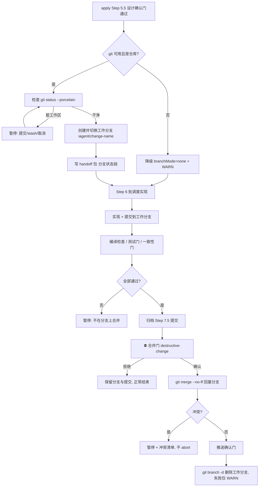

# Git 分支实现 + 思维发散能力 — 探索记录

> 探索类型：技能业务逻辑优化（流程编排 + 工作区策略）
> 探索对象：`src/core/templates/workflows/` 下 spec-explore / spec-propose / spec-apply / spec-archive / workflow / auto-workflow / debug / spec-update 八个模板，及 `src/core/git-capability.ts`
> 模式：mode=delegated（auto-workflow 编排器委派）

## Background

用户请求（原文，三轴）：

1. **功能实现增加 git 分支实现**：在独立分支上实现，实现完成并验证没问题后，**归档时**合并回主分支，防止直接在（主）分支上处理已有代码修改引发异常。
2. **debug / update 等模式在 git 分支实现后，验证完成后自动合并**。
3. **explore / proposal / workflow / auto-workflow / debug 等探索分析、实现提案过程中，增加思维发散处理能力**：对需求功能实现不能只局限于当前业务，需要扩展影响范围，保证实现范围和功能完整性。

## 提示词基线

**原始提示词**：见 Background（三项原文）。

**确认后的提示词基线**（清晰输入直通，六维无 ❌ / 实质 ⚠️）：

- **目标**：为 iagent 技能套件引入「分支隔离实现 → 验证通过 → 合并」的工作区策略，并在探索/提案阶段引入强制的影响面发散推理。
- **对象**：8 个相关技能模板 + `git-capability.ts` 内核（+ 可能的 CLI 扩展）。
- **范围**：模板正文、能力规格、必要的内核函数；不含目标项目的业务代码。
- **约束**：模板单一源 / `derive-command.ts` 派生 / `allowedTools` 走 `tool-whitelist.ts` / SKILL.md ≤500 行 + ≤20000 字符 / 门白名单 5 类不可扩张 / `GATE_SKIP_IDS` 不扩张 / 归档只读 / `pnpm build && pnpm generate:skills`。
- **验收**：分支创建与合并有确定性与失败处置；发散推理有可判定的落盘产物与验证维度。
- **歧义**：无实质歧义；细节级选择（是否新增 CLI 子命令、合并策略默认值）在 grill 中收敛。

## 项目规则基线

| 源 | 相关性 | 存在 | 读取 | 关键约束摘要 |
| :--- | :--- | :--- | :--- | :--- |
| `.iagent/config.yaml` | always | 是 | 已读 | TS 5.9 + Node ≥20 + Commander 14 + Vitest 3；分层 模板层 → 生成层 → 命令层；单一真源清单（skill-id / command-references / command-artifacts / version-bump）；测试门 `testGate` 与 `compileCheck` 段 |
| `.iagent/rules/spec.md` | phase | 是 | 已读 | Markdown-first 唯一真源（禁 change.json / tasks.json）；提案实现前 90% 评分门；handoff 包一次性产出跨阶段只读 |
| `.iagent/rules/coding-rules.md` | on-demand | 是 | 已读 | 零猜测标 `[待确认]`；设计先行；模板改动后 `pnpm build && pnpm generate:skills`；`allowedTools` 走共享常量；配置回写逐行段替换 |
| `.iagent/rules/testing-rules.md` | on-demand | 是 | 已读 | Vitest 3.2.6；主目录沙箱；CLI e2e 跑 `bin/iagent.js` → `dist/`，改 CLI 先 build；超时 20s |
| `CLAUDE.md` | always | 否 | 不存在 | 合法终态 |
| `AGENTS.md` | always | 是 | 已读 | 修改守则 11 条：①模板改后 build+generate ②白名单三层组合 ③新增 CLI 同步注册与补全表 ⑧规则三层加载 ⑨spec 模板单一源 ⑩归档自动提交窄通道 ⑪版本号随功能提交 |

## 项目技能基线

| 源 | 存在 | 读取 | 完整性 | 关键约束摘要 |
| :--- | :--- | :--- | :--- | :--- |
| `.iagent/skills/backend-design.md` | 是 | 已读 | ok | 后端设计约定（Commander.js 分层）；本次改技能模板正文，不直接约束 |
| `.iagent/skills/backend-implement.md` | 是 | 已读 | ok | phases=implement；本次不涉实现期后端代码 |

> 结论：技能基线完整（2/2 ok），无 `incomplete`。与本次改动无冲突。

## CONTEXT.md

- `openspec/CONTEXT.md` 已读取（758 行）。已有相关术语可直接复用：**Git 能力层**、**推送确认门**、**归档自动提交**、**门白名单**、**流程基准**、**影响范围一致性检查**、**handoff 包**、**门账本**。
- 本次需新增术语（拟）：**工作分支（work branch）**、**分支隔离实现**、**合并门（merge gate）**、**发散推理（divergence analysis）**。写入 CONTEXT.md 属归档/提案期写操作，本次先记录于此。
- 冲突检查：COTEXT.md 中「归档只读」与「归档时合并主分支」无冲突 —— 合并是版本库操作，非改写 `openspec/changes/archive/**` 内容，但**必须在规格中显式划界**（见 Pending U3）。

## Codebase Findings

### Discovered Files

- `src/core/git-capability.ts`（283 行）：检测（`detectGit` / `isGitRepository` / `findParentRepository` / `probeInstallers`）+ 执行（`initRepository` / `installGit` / `collectArchiveCommitPaths` / `stagePathsAndCommit` / `push`）。**当前无分支相关函数** —— 分支创建/切换/合并需新增。
- `src/commands/git.ts`（122 行）：仅 `status` / `init` 两个子命令，均 `--json`。
- `src/core/templates/workflows/spec-apply.ts`（583 行）：Step 1–11；Step 8 编译检查、Step 9 测试门、Step 10 清理、Step 10.5 精确暂存（不提交）。
- `src/core/templates/workflows/spec-archive.ts`（415 行）：Step 1–10；Step 7.5 归档自动提交（含推送确认门）。
- `src/core/templates/workflows/debug.ts`（579 行）：Phase 1–7；Phase 4 修复、Phase 7 verify-close。
- `src/core/templates/workflows/spec-update.ts`（198 行）：四环节闭环 Step 0–9；Step 6 委派 apply。
- `src/core/templates/workflows/spec-explore.ts`（1449 行）：强制检查点 1.1–1.8；1.2.2 深度分析触发、1.3 grill、1.5.5 功能流程图。
- `src/core/templates/workflows/spec-propose.ts`（372 行）：制品生成；`2.0` 影响分析在父编排（workflow / auto-workflow）中。
- `src/core/templates/workflows/workflow.ts`（488 行）/ `auto-workflow.ts`（263 行）：父编排 Phase 1–5；Phase 2.0 影响分析。
- `src/core/spec/templates/index.ts`：`PROPOSAL_TEMPLATE` 的 `## Impact` → `### Impact Analysis` 表（符号 / 位置 / 直接上游影响 / 波及的测试面 / 改动要求）。
- `src/core/spec/validation/anchors.ts`：影响面三锚点 + `[N<id>]` 单一源。
- `src/core/spec/validation/readiness.ts`：就绪门四判定（结构 / 覆盖 / 锚点 / 能力）。
- `src/core/templates/verify-checklist.ts`：D1-D10 + B1-B7 单一源。
- `src/core/templates/tool-whitelist.ts`：`GIT_CLI` / `CODEGRAPH_*` / `SUBAGENT_DISPATCH` / `skillDelegation()`。
- `openspec/specs/git-capability/spec.md`、`git-capability-cli/spec.md`、`archive-auto-commit/spec.md`、`workflow-suite-skills/spec.md`、`host-orchestration/spec.md`、`spec-verify-anchors/spec.md`、`spec-readiness-gate/spec.md`。

### Identified Symbols

- `stagePathsAndCommit` (`src/core/git-capability.ts:236`)：精确 add + commit，已有严格路径校验（拒绝 `.` / `/*` / 结尾 `/`）。
- `push` (`src/core/git-capability.ts:262`)：无 remote 时返回说明不抛错。
- `collectArchiveCommitPaths` (`src/core/git-capability.ts:207`)：固定清单收集。
- `runGitStatus` / `runGitInit` (`src/commands/git.ts:43` / `:69`)：可注入 detect，纯只读。
- `resolveDelegationContract` (`src/core/host-orchestration/delegation-contract.ts:73`)：双轴契约；`GATE_SKIP_IDS` 当前只有 `design-confirmation`。
- `VERIFY_ANCHORS` (`src/core/spec/validation/anchors.ts:18`)：`impactAnalysis` / `architectureImpact` / `callerUpdates`。
- `PROPOSE_SELF_CHECK_ITEMS` (`src/core/templates/verify-checklist.ts:56`)：含「影响面三锚点齐备」。

### Pattern Matches

- **执行内核 + 注入 runner**：`git-capability.ts` 与 `dependencies.ts` 同范式；新分支函数 MUST 沿用（可测、无真实进程）。
- **固定清单 + 精确暂存**：`commit.ts` §2.5 与归档 Step 7.5 已成熟。
- **门账本 + gate-skip 双通道**：`host-orchestration/spec.md:525` 已定契约；新增「合并门」时应复用同类机制而非新造。
- **单一源 + 回归锁**：`test/template-consistency.test.ts`、`test/verify-checklist-single-source.test.ts`、`test/skill-size-budget.test.ts`、`test/skills-parity.test.ts`。

### Analysis

#### Deep Analysis Trigger

- Triggered: Yes
- Reason: 关键词「优化 / 调整 / 增加 / 扩展」命中修改意图；且涉及既有 8 个模板与 git 内核。
- Scope: 上述 8 模板 + `git-capability.ts` + 相关能力规格 + 可能的 CLI/补全表。

#### 现状证据（分支能力缺口）

| 事实 | 证据 |
| :--- | :--- |
| `git-capability.ts` 无 `createBranch` / `merge` / `currentBranch` 函数 | `grep -n "branch\|merge\|checkout" src/core/git-capability.ts` 无命中 |
| `iagent git` 仅 `status` / `init` | `src/commands/git.ts:84` / `:102` |
| 归档 Step 7.5 只做 commit + push，无 merge | `src/core/templates/workflows/spec-archive.ts:307-314` |
| apply 全程在当前分支写工作区 | `spec-apply.ts` Step 6 批调度无分支操作 |
| debug Phase 4 修复在当前分支 | `debug.ts:400-434` |
| spec-update Step 6 委派 apply，无分支隔离 | `spec-update.ts:137-141` |
| 影响面分析仅在父编排 Phase 2.0（workflow / auto-workflow），spec-explore 无发散推理段 | `workflow.ts:250`、`auto-workflow.ts:68`；`spec-explore.ts` 1.2.2 仅判「新增 vs 修改」 |
| debug 的排查深度分级看影响半径，但无「需求影响扩展」维度 | `debug.ts:68-98` |

#### 关键设计约束（来自规格与守则）

1. **门白名单 5 类不可扩张**（`host-orchestration/protocol.ts:98`）：合并门若需用户确认，只能归入既有 `destructive-change` 类别（改写版本库跟踪 / 不可逆动作），**不能新增第 6 类**。
2. **`GATE_SKIP_IDS` 不扩张**（`delegation-contract.ts:26`）：合并门不是「跳过语义」，除非明确裁决。合并门**不应**可被 gate-skip 跳过（与推送门同构）。
3. **归档只读边界**（CONTEXT.md「归档只读」）：合并改变当前分支 HEAD，属版本库状态而非归档目录内容 —— 需在规格中显式划界，并明确「合并失败 MUST NOT 回滚归档」。
4. **分支操作是破坏性动作**：`git checkout` / `git merge` / `git branch -d` 会改写工作区与历史；默认 MUST 经 `destructive-change` 门确认（与安装门、推送门同构），仅有显式委派授权时可自动（对应需求 2「debug/update 验证完成后自动合并」）。
5. **模板尺寸预算**：8 个模板中 4 个已接近 500 行 / 20000 字符上限（debug 579 行源 → 快照 410 行；archive 415 行源 → 436 行快照）。新增长段 MUST 下沉 `references/*.md`。
6. **`skills/` 快照与 `.claude/` dogfood 产物**：改模板后 `pnpm build && pnpm generate:skills`。
7. **分支策略不能破坏无 Git 场景**：项目可能未初始化 git（project-init Step 0 已允许跳过）；分支能力 MUST 在无 Git/非仓库时降级为「不分枝 + WARN」，MUST NOT 阻断实现与归档。
8. **仓库可能是只读/受保护主分支**（如 `main` 受保护）：合并失败须有明确处置，MUST NOT 静默。

## Questions

### L1 意图（做什么？）
- Q1：分支的**粒度**是「每个变更一条分支」还是「每次实现/修复一条分支」？
  - 建议 A：**每个变更一条工作分支**（`iagent/<change-name>`），spec-apply 首次写入前创建，spec-archive 归档成功后合并；debug/update 各自独立分支（`iagent/debug-<keyword>`、`iagent/update-<change>`）。
  - 理由：与「变更」这一既有工作单元对齐，运维成本最低，且归档点天然是合并点。
- Q2：**分支何时创建**？
  - 建议 A：`spec-apply` 的 **Step 6 批调度开始前**（设计确认门之后、首次写文件之前）创建并切换；若已在目标分支则幂等跳过。
  - 备选 B：父编排 Phase 4 委派 apply 之前创建（编排层负责）。建议 A，因为 apply 也被独立调用，且「首次写入前」是唯一能保证隔离的时点。
- Q3：**分支何时合并**？
  - 建议 A：需求 1 → `spec-archive` **Step 7.5 之后、Step 8 摘要之前**（提交后合并，合并对象是工作分支上的提交）；需求 2 → `debug` Phase 7 验证 PASS 后、`spec-update` Step 8 PASS 后自动合并。

### L2 方案（怎么做？）
- Q4：分支操作放在**内核 + CLI** 还是**仅技能正文手写 git 命令**？
  - 建议 A：**内核函数 + CLI 子命令**（`iagent git branch` / `iagent git merge`），技能正文确定性调用。理由：现有项目已确立「避免模型自行拼命令」的范式（`git.ts` 头注释），且可单测。
  - 代价：新增 CLI 命令须同步 `src/cli/index.ts` + `IAGENT_COMMANDS` 补全表（守则 3），版本判定信号自动为 minor。
- Q5：合并策略？
  - 建议 A：`git merge --no-ff`（保留分支拓扑，便于回溯）；冲突 → **不自动解决**，暂停并报告冲突文件清单，用户处置后重试。MUST NOT 自动 `--abort` 丢弃实现产出。
  - 备选 B：`--ff-only`（更保守，但工作分支通常落后主分支，会拒绝合并）。建议 A。
- Q6：基分支如何确定？
  - 建议 A：创建分支时记录当前分支名为 `baseBranch`，合并时 **merge 回 `baseBranch`**（而非硬编码 `main`），并把 `baseBranch` 写入 handoff 包 / 流程状态文件。避免硬编码主分支名（可能是 `master` / `develop`）。
- Q7：是否在 `spec-apply` 完成后立即删除工作分支？
  - 建议 A：**否** —— 删除由归档合并成功后执行（`git branch -d` 仅在已合并时成功），且失败只 WARN。debug/update 分支在自动合并成功后删除。

### L3 异常（失败怎么办？）
- Q8：无 Git / 非仓库 / detached HEAD 时？
  - 建议 A：**降级为不分枝**，记 WARN 并在回执声明 `branchMode=none`；实现与归档照常（现有行为不变）。
- Q9：工作区有未提交改动时创建/切换分支？
  - 建议 A：**MUST 先检查 `git status --porcelain`**；有未提交改动 → 暂停并让用户选择（提交 / 暂存 stash / 取消）。MUST NOT 带着脏工作区 `checkout -b`（会把无关改动带到新分支，正是用户说的「已有代码修改出现异常」）。
- Q10：合并冲突？
  - 建议 A：暂停 + 列出冲突文件 + 保留冲突态（不 abort），用户解决后重试合并。归档已完成的变更制品不移回。
- Q11：合并后是否推送？
  - 建议 A：合并本身是本地操作；**推送仍走既有推送确认门**（`destructive-change`），合并门与推送门是同一步内的一次确认（合并 + 推送合并呈现），减少停点。

### L4 一致性（跨决策 + 代码库）
- Q12：需求 3「思维发散」的**落盘形态**是什么？
  - 建议 A：新增**必填段** `## 需求发散（Divergence Analysis）`，写入探索文件 / proposal `## Impact` 之下的扩展小节，含五类扩展维度：
    1. **直接影响**（需求字面涉及的功能）
    2. **间接影响**（共享工具 / 数据模型 / 配置 / 公共组件）
    3. **契约影响**（API / CLI / 事件 / DB schema / 文件格式，含向后兼容）
    4. **同类场景**（同一模式的其他调用点 / 同类功能是否需要同步）
    5. **非功能影响**（性能 / 并发 / 权限 / 可观测性 / 多语言与多平台）
  - 每条 MUST 带 `文件:行` 证据或标 `[推断]` / `[新建]`，与既有「流程基准证据追溯」同构。
- Q13：需求 3 落到哪些技能、以什么强度？
  - 建议 A：**探索侧强制产出**（`spec-explore` 新增 1.5.6 段，与 1.5.5 流程图门合并呈现，不新增用户停顿）；**提案侧强制承接**（`spec-propose` 把发散结论映射到 proposal `## Impact` 的扩展行）；**父编排消费**（workflow / auto-workflow Phase 2.0 影响分析改用五维扩面查询，而非仅 `codegraph_impact` 上游）；**debug** 在 Phase 2.2.3.5 分级信号中加入「需求面扩展」检查。
- Q14：发散结论如何被**验证**（否则又是一份散文）？
  - 建议 A：并入既有就绪门为**第 5 判定**（`divergence`）：`## 需求发散` 段存在且五维非空（可写「无」但需显式）；并入 D2/D3 的影响范围一致性检查作为证据源。**不新增验证维度编号**（守则：D1-D10 编号不变）。
- Q15：合并门会不会与既有 5 类门冲突？
  - 建议 A：归入 `destructive-change`（`host-orchestration/protocol.ts:130`），MUST NOT 新增类别、MUST NOT 可被 `gate-skip` 跳过（与推送门同构）。自动合并（需求 2）的授权来自父流程已确认的「验证通过」回执，**仍 MUST 记录到门账本**。

### L5 边界
- BS1 项目无 Git → 不分枝 + WARN，全流程照常。
- BS2 工作区脏 → 暂停，用户选择提交 / stash / 取消。
- BS3 detached HEAD → 降级不分枝 + WARN（无法安全合并）。
- BS4 分支名已存在 → 复用并记 WARN（MUST NOT 覆盖）；分支名含非法字符（change-name 已 kebab）→ 归一化。
- BS5 合并冲突 → 暂停 + 冲突清单，不 abort、不丢产出。
- BS6 主分支受保护（远端拒绝 push）→ 本地合并成功即算完成，推送失败走既有推送门 WARN。
- BS7 归档已完成后合并失败 → 归档结果 MUST NOT 回滚（沿用「失败不阻断」语义）。
- BS8 多个变更并发在同一工作分支 → 分支名含 change-name，天然隔离；同名冲突按 BS4。
- BS9 `spec-update` 的归档态复活复制（`update-<原名>-<日期>`）→ 分支名取新变更名。
- BS10 发散推理全部标「无」→ 就绪门 `divergence` 判定 pass（显式「无」是合法终态），但 MUST 留痕。
- BS11 无 changes 目录（如独立 apply）→ 分支名回退 `iagent/apply-<timestamp>`。

## 术语表

| 术语 | 定义 | 避免使用 |
|------|------|---------|
| 工作分支（work branch） | 为一次变更 / 修复实现而创建的隔离分支，命名词根 `iagent/<change-name>`；实现全部提交落在该分支，验证通过后合并回基分支 | 功能分支、feature branch（与 git flow 语义混淆） |
| 基分支（base branch） | 创建工作分支时所在的分支，记录于流程状态（handoff 包 `## 分支状态` 段）；合并目标 | 主分支（可能不是 main）、target branch |
| 分支隔离实现（branch-isolated implementation） | 实现期所有写操作发生在工作分支，基分支在合并前不被触碰的策略 | 分支开发 |
| 合并门（merge gate） | 工作分支合并回基分支前的确认门，归 `destructive-change`；debug / update 的自动合并由父流程授权，仍记门账本 | 合并确认、merge 提示 |
| 需求发散（divergence analysis） | 探索/提案阶段强制的影响面扩展推理：直接影响 / 间接影响 / 契约影响 / 同类场景 / 非功能影响 五维，每条带证据 | 需求分析（过宽）、影响分析（那是既有 Impact Analysis 的符号级表） |

## 架构决策

- **ADR 候选 1**：分支策略放在 git 能力内核 + CLI，而非技能正文手写命令。
  - 三条件：难以逆转（技能正文散落命令后难收敛）✓；脱离上下文令人意外（读者会问为何不直接 `git checkout -b`）✓；真实权衡（多一个 CLI 面 vs 确定性与可测性）✓ → **建议创建 ADR**，提案阶段落 `openspec/docs/adr/`。
- **ADR 候选 2**：合并门归 `destructive-change` 而不新增门类别。
  - 相对可逆（规格可改），但属安全边界裁决 → 记为**设计决策 DD**，不单独提 ADR。

## 边界场景

- [x] BS1 项目无 Git → 不分枝 + WARN，全流程照常
- [x] BS2 工作区脏 → 暂停，用户选择提交 / stash / 取消
- [x] BS3 detached HEAD → 降级不分枝 + WARN
- [x] BS4 分支名已存在 → 复用 + WARN，不覆盖
- [x] BS5 合并冲突 → 暂停 + 冲突清单，不 abort
- [x] BS6 主分支受保护 → 本地合并成功即完成，推送失败 WARN
- [x] BS7 归档后合并失败 → 归档不回滚
- [x] BS8 并发变更 → 分支名含 change-name 天然隔离
- [x] BS9 update 复活复制 → 分支名取新变更名
- [x] BS10 发散全「无」→ 就绪门 pass + 留痕
- [x] BS11 无变更目录 → `iagent/apply-<timestamp>`

## Decision Process

### Decision: 分支粒度

**Options Considered**：
- Option A：每变更一条工作分支（`iagent/<change-name>`）
- Option B：每会话一条临时分支
- Option C：不建分支，用 `git stash` + 手动回滚

**Pros/Cons**：
- A：与变更一一对应，归档点即合并点；分支名可追溯；代价是需要 change-name（独立 apply 需回退命名）
- B：实现简单；但会话边界模糊，多变更混杂，无法按变更合并
- C：无隔离，无法验证后合并；正是用户要解决的问题

**Chosen**: A
**Rationale**: 唯一能同时满足「隔离实现」与「归档时合并」的粒度；独立 apply 用 `iagent/apply-<timestamp>` 回退（BS11）。

### Decision: 准入检查（脏工作区）

**Options Considered**：
- Option A：脏工作区直接拒绝并暂停
- Option B：自动 `git stash` 后继续，合并后 `stash pop`
- Option C：带脏工作区 `checkout -b`

**Pros/Cons**：
- A：零数据风险；代价是多一次用户交互
- B：自动化最好；但 stash 与实现改动交错时冲突概率高，且 `stash pop` 失败会让用户更难恢复
- C：把无关改动带入新分支，正是用户报告的风险来源

**Chosen**: A
**Rationale**: 用户原话「防止已有代码修改出现异常」—— 脏工作区必须显式处置，不得自动搬运。stash 作为用户可选项之一提供，不接受「自动 stash」。

## Decisions

- D1 分支粒度 = **每个变更一条工作分支** `iagent/<change-name>`；debug 用 `iagent/debug-<keyword>`，update 用 `iagent/update-<change>`，独立 apply 用 `iagent/apply-<timestamp>`。
- D2 分支创建点 = `spec-apply` **Step 6 批调度前**（Step 5.5 设计确认门之后、首次写文件之前），幂等：已在目标分支则跳过。
- D3 分支创建前 MUST 检查 `git status --porcelain`；脏工作区 → 暂停并呈现三出口（提交 / stash / 取消），MUST NOT 自动 stash、MUST NOT 带脏切换。
- D4 基分支 = 创建时所在分支，写入 handoff 包 `## 分支状态` 段（`branch` / `baseBranch` / `branchMode`），MUST NOT 硬编码 `main`。
- D5 合并点 = `spec-archive` Step 7.5（提交）之后、Step 8（摘要）之前；合并对象 = 工作分支上的本次变更提交。
- D6 合并策略 = `git merge --no-ff`；冲突 → 暂停 + 冲突清单，MUST NOT 自动 abort、MUST NOT 丢弃产出。
- D7 合并门归入 `destructive-change`（不可豁免、MUST NOT 被 `gate-skip` 跳过）；debug / update 的「验证后自动合并」授权来自父流程验证 PASS 回执，但 MUST 写入门账本 `## 已确认门`。**已裁决：归档必须经门；debug Phase 7 / spec-update Step 8 验证 PASS 后自动合并。**
- D8 无 Git / 非仓库 / detached HEAD → 降级 `branchMode=none` + WARN，实现与归档照常，MUST NOT 阻断。
- D9 分支删除 = 合并成功后 `git branch -d`（仅已合并时成功）；失败只 WARN，不阻断。
- D10 分支操作实现为 `git-capability.ts` 内核函数 + `iagent git branch|merge` CLI 子命令；技能正文确定性调用，MUST NOT 手写 `git checkout` 等命令。
- D11 `push` 仍走既有推送确认门；合并与推送合并为同一步内的一次确认（减少停点），推送失败不影响合并结果。
- D12 需求发散 = 探索产物强制段 `## 需求发散`，五维（直接影响 / 间接影响 / 契约影响 / 同类场景 / 非功能影响），每条带 `文件:行` 或 `[推断]` / `[新建]`。
- D13 发散结论并入就绪门为第 5 判定 `divergence`（段存在 + 五维非空或显式「无」），**不新增验证维度编号**；并作为 D2/D3 影响范围一致性检查的证据源。
- D14 发散产出的消费方 = `spec-propose`（映射到 proposal `## Impact` 扩展行）+ `workflow` / `auto-workflow` Phase 2.0（影响查询扩为五维）+ `debug` 2.2.3.5（分级信号加「需求面扩展」）+ `spec-explore`（1.5.6 强制段，与 1.5.5 流程图门合并呈现，不新增用户停顿）。
- D15 合并门与推送门都是本地/远端版本库动作，归档「只读」边界按 CONTEXT.md 释义（归档目录内容不可改写；版本库状态变更不属改写），规格中 MUST 显式声明该划界。

## 硬约束

- 门白名单 MUST 保持 5 类，MUST NOT 新增第 6 类（合并门归 `destructive-change`） — source: D7
- `GATE_SKIP_IDS` MUST NOT 扩张，合并门 MUST NOT 可被 `gate-skip` 跳过 — source: D7
- 分支创建前 MUST 检查 `git status --porcelain`，MUST NOT 带脏工作区切换分支 — source: D3
- 合并冲突时 MUST NOT 自动 `git merge --abort`、MUST NOT 丢弃实现产出 — source: D6
- 无 Git 场景 MUST NOT 阻断实现与归档，降级 `branchMode=none` + WARN — source: D8
- 合并失败 MUST NOT 回滚已完成的归档 — source: D5 / BS7
- 基分支 MUST 取自创建时所在分支，MUST NOT 硬编码 `main` — source: D4

## Scope Changes

| 变更时间 | 变更类型 | 变更描述 | 原因 |
|---------|---------|---------|------|
| 探索期 | expand | 需求 2 的「自动合并」扩展到 `spec-update` 第 6 步委派的 apply 之后（Step 8 PASS 后合并），不只 debug | 用户列举「debug/update 等模式」 |
| 探索期 | expand | 需求 3 增加就绪门第 5 判定 `divergence`，确保发散结论可被验证而非停留在散文 | 否则重蹈「生成侧不产出、验证侧却要求」的结构错配 |

## Pending

### For Phase 2 Impact Analysis

- `git-capability.ts` (`src/core/git-capability.ts:1`) — Priority: HIGH（新增分支内核函数）
- `commands/git.ts` (`src/commands/git.ts:80`) — Priority: HIGH（新增 branch/merge 子命令 + 补全表）
- `workflows/spec-apply.ts` (`src/core/templates/workflows/spec-apply.ts:270`) — Priority: HIGH（Step 6 前分支创建）
- `workflows/spec-archive.ts` (`src/core/templates/workflows/spec-archive.ts:307`) — Priority: HIGH（Step 7.5 后合并）
- `workflows/debug.ts` (`src/core/templates/workflows/debug.ts:226`) — Priority: HIGH（Phase 7 自动合并 + 2.2.3.5 发散信号）
- `workflows/spec-update.ts` (`src/core/templates/workflows/spec-update.ts:68`) — Priority: HIGH（Step 8 后自动合并）
- `workflows/spec-explore.ts` (`src/core/templates/workflows/spec-explore.ts:1`) — Priority: HIGH（1.5.6 需求发散段）
- `workflows/spec-propose.ts` (`src/core/templates/workflows/spec-propose.ts:1`) — Priority: MEDIUM（承接发散到 Impact）
- `workflows/workflow.ts` (`src/core/templates/workflows/workflow.ts:144`) — Priority: MEDIUM（Phase 2.0 五维扩面）
- `workflows/auto-workflow.ts` (`src/core/templates/workflows/auto-workflow.ts:17`) — Priority: MEDIUM（Phase 2.0 五维扩面）
- `spec/validation/readiness.ts` (`src/core/spec/validation/readiness.ts:79`) — Priority: MEDIUM（第 5 判定 divergence）
- `templates/tool-whitelist.ts` (`src/core/templates/tool-whitelist.ts:55`) — Priority: MEDIUM（若新增工具条目）

### 已裁决（流程最终确认门内一并裁决，2026-11-23）

- **U1（已裁决：A）分支上自动精确提交**：`spec-apply` 收尾在 `iagent/<change-name>` 分支上按固定清单**精确提交**（MUST NOT `git add -A`），仅分支隔离模式生效；提交前展示拟暂存清单，交互式「未确认不提交」约束在非分支模式保持。
  - 理由：分支隔离下提交是合并前提；只暂存会让切回基分支丢改动。
- **U2（已裁决：按建议）CLI 输出契约**：
  - `iagent git branch [--create <name>] [--base <branch>] [--json]` → `{ action: 'created'|'reused'|'skipped', branch, baseBranch, reason? }`
  - `iagent git merge <branch> [--into <branch>] [--json]` → `{ ok, merged: boolean, conflicts: string[], detail? }`
  - `iagent git branch --delete <name> [--json]` → `{ action: 'deleted'|'skipped', reason? }`
- **U3（已裁决：一次广查询 + 分维归集）**：Phase 2.0 影响分析扩为五维，但**一次** `codegraph_explore` 广查询后按维度归集，不逐维重复调用；CodeGraph 不可用时降级 Grep 并记 WARN。

## 补充决策（裁决后新增）

- D16 apply Step 10.5 语义变更：分支隔离模式（`branchMode=work-branch`）下，固定清单 + 代码改动**精确提交到工作分支**；`branchMode=none` 保持原「只暂存不提交」。
- D17 `iagent git branch` 支持三动作：创建（含基分支记录）、复用（已存在时 WARN）、删除（仅已合并时成功）；`iagent git merge` 返回冲突清单不抛错。
- D18 分支状态写入 handoff 包新增并列节 `## 分支状态`（`branch` / `baseBranch` / `branchMode` / `createdAt`），与六节并列、不计入六节；archive / debug / update 只读复用。
- D19 Phase 2.0 影响分析五维扩面为**一次广查询 + 分维归集**；`codegraph_impact` 不可用或 busy 耗尽时降级 Grep 估算并记 WARN，MUST NOT 阻塞提案。

> **流程最终确认门：已确认**（`flowBaselineConfirmed=true`，2026-11-23，功能流程图 N1–N25 与四项裁决一并确认）。

### Business Validation

- 合并门必须能在「用户拒绝合并」后让流程正常结束（保留分支与提交，不丢工作）。
- 发散段不得变成新的用户停点；它并入既有流程门与就绪门。

### Security Concerns

- `git merge --no-ff` 与 `git branch -d` 是版本库状态变更；MUST 经 `destructive-change` 门（D7）。
- 分支名来自 change-name（已是 kebab-case），仍需校验不含 `..` / `/` 开头 / 保留字符，防路径注入。

## Implementation Deep-Dive

### Design Rationale

- 分支能力放在内核而非技能正文：`commands/git.ts` 头注释明确「供技能正文确定性调用，避免模型自行拼命令」；`git-capability.ts` 头注释确立「检测纯只读 / 执行注入 runner」。新增分支函数必须延续该分层，否则 8 个模板各自拼命令会产生不可测的第二真源。
  - 置信度：HIGH（头注释 + 既有测试 `test/git-command.test.ts` 可注入 detect）

### Constraints

- 模板尺寸：`spec-apply` / `debug` / `spec-archive` 均已接近预算；分支段 MUST 下沉 references 或压缩为 <= 40 行。
- `derive-command.ts` 的 `<!-- CMD:SKIP -->` 标记：分支协议属 skill 与 command 都需要的内容，默认不标记。
- 门白名单与 `GATE_SKIP_IDS` 不扩张（AGENTS.md 守则 + `protocol.ts:98`）。

### Trade-offs

- 自动合并（需求 2）与合并门（不可豁免）存在张力：自动合并意味着不提问。裁决 = 自动合并仅用于 debug / update 且**验证 PASS 之后**，授权链是「父流程验证回执」，门账本记录；非自动路径（apply → 归档）仍走 `destructive-change` 门。这样既满足需求 2，又不破坏门白名单语义。
  - 置信度：MEDIUM（需在提案中显式写清「自动合并的授权来源」）

### Pattern Usage

- `stagePathsAndCommit` 的路径校验范式（拒绝 `.` / 通配）→ 合并函数同样需拒绝非具体分支名。
- `push()` 的「无 remote 返回说明不抛错」→ 合并函数「无冲突 / 冲突」返回状态不抛错。

### Historical Context

- `add-git-integration`（2026-11-22 归档）确立了 git 能力层与归档自动提交；其 D2/D7/D8 决策（固定清单、整批一次提交、推送门归 destructive-change）是本次分支能力的直接前置。
- `improve-orchestration-execution-mode` 确立了 inline 为主、回执与门账本机制 → 分支状态应沿用 handoff 包承载。

### Implicit Assumptions

- 假设目标项目使用 git（非 SVN）；SVN 场景由 `iagent_svn_commit` 承担，本次分支能力**不覆盖 SVN**（应显式声明）。
- 假设工作分支由 iagent 创建与管理；用户手工在同名分支上的改动视为既有工作，MUST NOT 覆盖（复用 + WARN）。

## 需求发散

| 维度 | 条目 |
| :--- | :--- |
| 直接影响 | 8 个技能模板正文（`src/core/templates/workflows/` 下 spec-apply / spec-archive / debug / spec-update / spec-explore / spec-propose / workflow / auto-workflow）；`src/core/git-capability.ts`；`src/commands/git.ts` |
| 间接影响 | `src/commands/completion.ts` 的 `IAGENT_COMMANDS` git 条目（漏改会让补全缺新子命令，`test/completion-config.test.ts` 拦截）；`src/core/templates/tool-whitelist.ts` 的 `GIT_CLI`（复用，零改动）；`src/core/host-orchestration/` 的门账本与回执契约（合并授权不得写 `## 已确认门`） |
| 契约影响 | `iagent git` CLI 新增 `branch` / `merge` 子命令（输出契约 `{action,branch?,baseBranch?,reason?}` / `{ok,merged,conflicts[],detail?}`）；`ReadinessResult.checks` 由 4 项变 5 项（消费方须按 `id` 查找而非长度断言）；handoff 包新增并列节 `## 分支状态`；proposal `## Impact` 新增 `### 需求发散承接` 小节。向后兼容：`iagent git status|init` 契约不变，无 Git 项目 `branchMode=none` 零行为变化 |
| 同类场景 | `spec-bulk-archive` 的归档提交（本次**不纳入**分支能力，正文须显式声明）；`iagent_svn_commit` 的 SVN 场景（分支语义不适用，须显式声明非目标）；`commit.ts` 的「MUST NOT 自动 commit」约束（需补分支模式说明，不扩张窄通道） |
| 非功能影响 | 4 个模板已接近/触达 500 行与 20000 字符预算（`test/skill-size-budget.test.ts` 硬门）→ 新增正文必须下沉 references；Phase 2.0 五维扩面若逐维调 CodeGraph 会触发 busy 阶梯 → 必须一次广查询；分支操作增加 `git checkout` / `git merge` 调用，需纳入 `GIT_CLI` 白名单（已覆盖）；Windows 路径与分支名注入面需校验（`validateBranchName` 拒绝 `..` / 前导 `/` / 控制字符） |

> 本次变更自身适用五维发散（dogfood）：直接影响 = 模板与内核；间接影响 = 补全表与门账本契约；契约影响 = CLI 输出与就绪门 checks 数组；同类场景 = 批量归档 / SVN / commit 约束；非功能影响 = 尺寸预算 / CodeGraph busy / 分支名注入。

## 功能流程图

本次改动是**技能流程改造**，其自身业务功能流程如下（Mermaid `flowchart TD`）：

| 节点 | 操作 | 触发条件 | 证据位置 | 异常路径 |
| :--- | :--- | :--- | :--- | :--- |
| N1 | 设计确认门通过 | apply 进入 Step 6 前 | `spec-apply.ts:370`（Step 5.5） | — |
| N2 | 探测 git 可用性与仓库状态 | N1 之后 | `git.ts:43` `runGitStatus` | 否 → N3 |
| N3 | 降级不分枝 + WARN | N2 为否 | `git-capability.ts:75` `detectGit` | → N10 |
| N4 | 检查工作区是否干净 | N2 为是 | 新增 `git-capability` 函数 | 脏 → N5 |
| N5 | 呈现脏工作区三出口 | N4 脏 | 门：`destructive-change`（动作级） | 用户取消 → 终止实现 |
| N6 | 创建并切换工作分支 | N4 干净 | 新增 `createWorkBranch` | 已存在 → 复用 + WARN（BS4） |
| N7 | 写入 handoff 包 `## 分支状态` | N6 之后 | `handoff 包`（`spec-apply.ts:20`） | 写失败 → 停止并报告 |
| N10 | 批调度实现 | N3/N7 之后 | `spec-apply.ts:433` | — |
| N11 | 实现 + 提交到分支 | N10 期间/收尾 | `spec-apply.ts:507`（原 Step 10.5 改提交） | 提交失败 → WARN，不阻断实现 |
| N12 | 编译 / 测试 / 一致性门 | 实现完成 | `spec-apply.ts:443` / `:492` / `:497` | 任一 fail → N14 |
| N13 | 三证据汇总判定 | N12 后 | `compile-check-gate` 四值 + test + conformance | — |
| N14 | 暂停，不进入合并 | N13 否 | 既有失败处置 | — |
| N15 | 归档 Step 7.5 提交 | 归档流程 | `spec-archive.ts:307` | 失败 → WARN 不阻断 |
| N16 | ⛔ 合并门 | N15 之后 | 归 `destructive-change` | 拒绝 → N17 |
| N17 | 保留分支与提交，正常结束 | N16 拒绝 | 既有退出语义 | — |
| N18 | `git merge --no-ff` | N16 确认 | 新增 `mergeWorkBranch` | 冲突 → N19/N20 |
| N19 | 冲突判定 | N18 后 | 同上（返回 `conflicts[]`） | — |
| N20 | 暂停 + 冲突清单，不 abort | N19 是 | 同上 | 用户解决后重试 N18 |
| N21 | 推送确认门 | N18 成功 | `spec-archive.ts:314` | 拒绝 → 保留本地合并 |
| N22 | 删除工作分支 | N18 成功后 | 新增 `deleteMergedBranch` | 失败 → WARN |

> 补充节点（代码证据）：
> - N23 `diff: 需求发散五维落盘` — 探索文件 `## 需求发散` 段生成（`spec-explore` 新 1.5.6）— 证据：`spec-explore.ts` 1.5.5 相邻段结构 [新建]
> - N24 `diff: 就绪门第 5 判定 divergence` — `readiness.ts` 新增 `checkDivergence` [新建]，输入为解析后的变更模型
> - N25 `diff: 五维扩面查询` — workflow / auto-workflow Phase 2.0 影响分析（`workflow.ts:250`）扩展为五维，非新增停点
