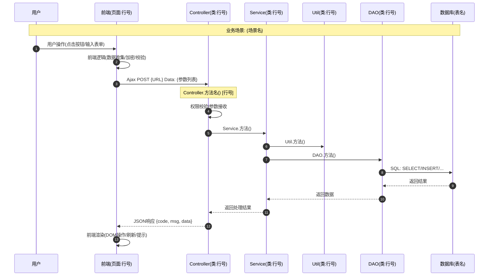
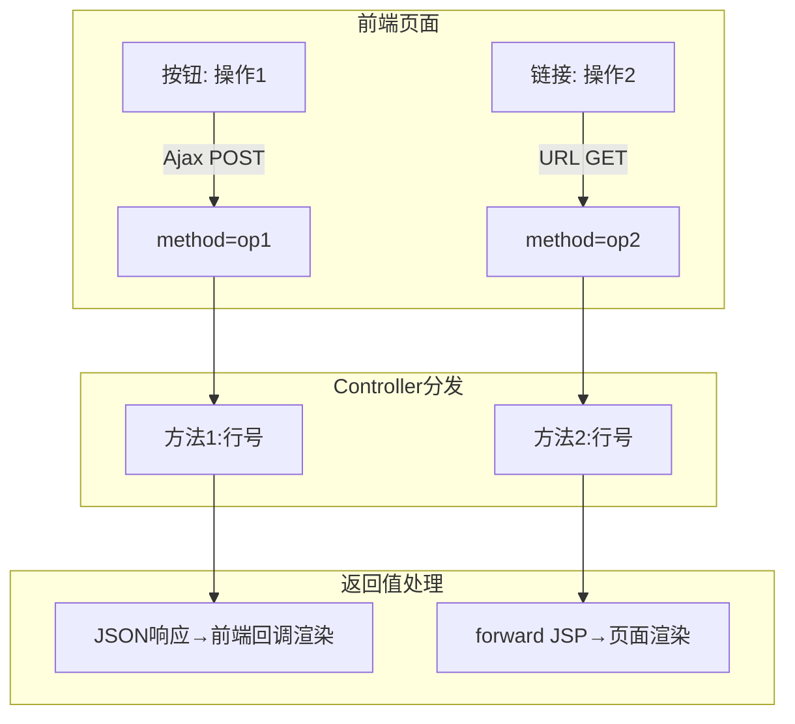
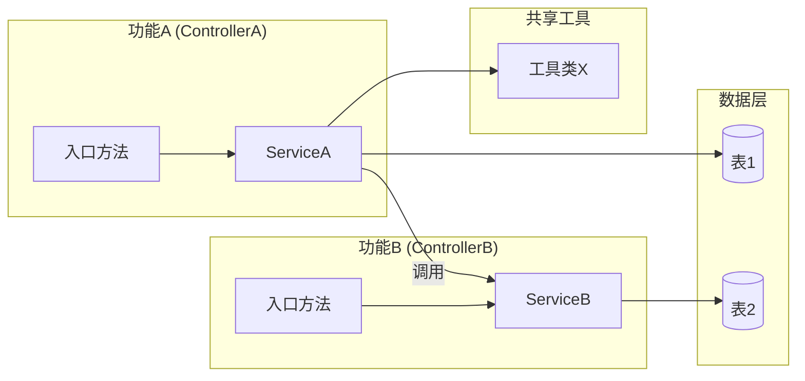

**适用项目护栏（impl 域蒸馏，见 .iagent/rules/coding-rules.md）。** 未定义项标 **[待确认]**，禁止猜测。

扫描源项目功能模块，生成完整的功能需求实现文档，覆盖前端实现、后端实现、字段级 API 契约、数据库调用链与跨模块交互。

**触发边界**：本技能扫描**源项目代码**以产出功能需求实现文档或项目功能地图（"scan feature"、"扫描功能"、"analyze feature implementation"、"项目功能地图"、"迁移需求文档"）。

**输入**：在命令后可选提供源项目路径与功能入口；缺失参数交互式收集，已提供的参数跳过；由自动迁移工作流（非交互模式）调用时直接使用注入参数，不提问。

---

## Step 0: 确定执行模式

**独立模式（直接调用时的默认模式）**：
- 使用 **AskUserQuestion 工具**交互式收集参数
- 每个参数都可跳过或有默认值 —— 绝不因缺失参数而阻塞启动
- 调用时已提供的参数跳过，只收集缺失项

**非交互模式（由自动迁移工作流调用时）**：
- 由调用方注入参数（源项目路径、功能入口、输出模式、框架档案、输出目录）
- MUST NOT 提问；已提供的参数跳过，其余使用默认值
- 注入参数无效 → 直接快速失败并给出明确错误报告，而非提示用户

## Step 1: 收集参数

| 参数 | 必填 | 默认/跳过行为 |
|------|------|---------------|
| 源项目根目录路径 | 是 | 无默认 — 必须获得有效路径 |
| 功能入口 | 是 | 全项目（跳过时） |
| 输出模式 | 否 | 新人上手模式 |
| 框架档案 | 否 | 未知框架 → 自动探测（Step 2） |
| 输出目录 | 否 | 按输出路由规则（见输出路由） |

**路径校验**：扫描前校验源项目路径存在且可读（Windows 盘符路径如 `e:\project\src` 与 POSIX 路径均为合法输入）。路径无效时 MUST 明确报错并要求用户重新输入 —— MUST NOT 猜测纠正、静默归一化，或按推测路径继续。

### 输出模式

| 模式 | 适用场景 | 文档侧重 | 输出范围 |
|------|----------|----------|----------|
| **新人上手模式** | 新成员快速理解项目 | 功能全景图、代码追踪路径、交互流程 | 全项目功能地图 + 指定模块详情 |
| **迁移重构模式** | 框架升级/技术栈迁移 | 业务逻辑提取、技术实现细节、迁移建议 | 指定模块深度分析 |
| **设计文档模式** | 编写正式技术文档 | 规范化格式、完整接口说明、数据库设计 | 指定模块规范文档 |
| **全景扫描模式** | 全面了解整个项目 | 全模块地图、交叉依赖、交互全景 | 全项目所有模块 |

## Step 2: 收集框架档案

框架档案把源项目的框架专属开发知识参数化。字段如下：

| 档案字段 | 说明 |
|----------|------|
| 框架名 | 从源项目探测到的框架标识 |
| 路由配置文件 | URL → Controller 映射的所在位置（基于注解的映射也算配置） |
| 前端交互方式清单 | 源项目中观测到的交互通道（Ajax / 表单提交 / URL 直达 / 反向推送 / ...） |
| 特有机制清单 | 驱动页面渲染或数据访问的框架特有机制 |
| 框架标准方法清单（可选） | 框架生成或派发的标准方法（如有文档） |

**不内置任何框架预设。** 档案 MUST 来自**实际源项目**（自动探测 + 用户确认）或由调用方提供 —— MUST NOT 硬编码。调用方提供的档案始终优先于探测结果。在无已确认的探测证据前 MUST NOT 假定任何框架。

**未知框架（自动探测降级）** —— 当用户选择「未知框架」或未提供档案时：
1. 读取项目结构文件（`pom.xml` / `build.gradle`、`web.xml`、`package.json`、`application.properties`、`struts.xml`、源码中的注解模式）以探测框架类型与路由配置
2. 以 **[待确认：框架档案探测]** 呈现探测结论 —— 用户 MUST 确认后才继续扫描
3. 非交互模式下，把探测结论记入输出报告；调用方提供的档案始终优先于探测结果

## Step 3: 确定扫描范围（入口类型识别）

| 入口类型 | 识别规则 | 处理方式 |
|----------|----------|----------|
| **文件路径** | 包含源码文件扩展名（`.java`、`.jsp`、`.html`、`.xml`、`.properties` 等）或包/目录路径 | 读取文件、提取路由与依赖，递归扫描依赖链（Controller → Service → DAO → Bean、相关页面） |
| **URL路由** | 以框架路由后缀结尾的 URL 字符串（`.do`、`.action` 或档案中的等价形式） | 按档案中的路由配置查找、定位 Action/Controller 类并扫描其依赖链 |
| **模块名称** | 描述性功能名（如 "账号管理"、"登录功能"） | 按名称推断包路径，扫描模块的 Action/Service/DAO/Entity，匹配相关表与页面 |
| **全项目** | "全部", "整个项目", "所有模块", "全景" | 分层全项目流程（见全项目扫描模式） |

## Step 4: 深度扫描功能实现

### 4.1 后端扫描

- **Controller 层**：类继承关系、全部 public 方法签名、请求派发逻辑（方法参数路由或注解映射）、参数获取（`request.getParameter()`、表单绑定）、返回处理（setAttribute + forward / JSON 写出 / redirect）；在档案的路由配置中定位 URL 映射
- **Service 层**：逐方法业务逻辑（计算/转换/判断/校验）、事务控制、权限校验、外部服务调用（WebService / MQ / SSH）、异步处理
- **DAO 层**：每条 SQL（SELECT/INSERT/UPDATE/DELETE）；参数化（`?` 占位符 vs 字符串拼接 —— SQL 注入风险 MUST 依据实际代码判定）；返回类型；连接处理；涉及的表与字段
- **Entity 层**：字段名、类型、表映射

### 4.2 前端扫描

- 识别页面类型（主页面/详情页/弹窗页/嵌套页）；记录表单字段、校验规则、按钮及其绑定的 JavaScript 函数、跳转逻辑
- 通过框架档案中列出的**每一条**交互通道分析数据获取与展示 —— MUST NOT 只扫描单一通道
- 按交互记录字段级请求参数与响应处理（原则 B）

### 4.3 配置扫描

读取档案的路由配置及其它关键配置（`web.xml`、DWR 配置、数据库连接配置、工作流配置），建立全局视图。

### 4.4 数据库扫描

从 SQL 语句与实体中提取表与字段；获取完整表结构（类型、长度、默认值、注释）；分析索引、约束、逻辑关系与枚举字段取值。

## Step 5: 构建功能层次分解

分解被扫描的功能：功能模块 → 功能组 → 功能点 → 子功能 → 实现点（实现点指向具体的类/方法/页面）。

生成：
1. 层次分解到实现点级别的 Mermaid **mindmap**
2. 模块内功能关系的 Mermaid **graph**（各功能之间的调用或依赖）

## Step 6: 构建跨模块交互全景

从三个层次分析：
- **Level 1 模块级依赖**：包 import 依赖、跨模块配置引用 → 依赖矩阵
- **Level 2 接口级调用**：跨模块 Action/Service 调用、调用方式（方法调用 / WebService / MQ / HTTP）、数据格式
- **Level 3 数据流级联动**：级联表操作、状态同步、一致性维护

生成模块交互全景图，并为每个跨模块交互给出明细表：源模块 / 目标模块 / 交互场景 / 调用链（类→方法→类→方法）/ 数据传递 / 数据库联动 / 状态同步 / 异常处理 / 事务边界。

## Step 7: 绘制 4 类必备图表

**⚠️ 4 类图表均为必备产出。缺少任一类即文档不合格。**

### 7.1 前后端业务交互时序图（每个核心功能点）

追踪链路：用户 → 前端JS → HTTP请求 → Controller → Service → Util → DAO → DB → 响应 → 前端渲染.
要求：每个节点标注 `文件名:行号` 或 `类名.方法名()`；HTTP 方法与 URL；前端加密/序列化；后端返回类型；回调中的前端 DOM 操作。至少覆盖：主要业务操作、列表查询、导入/导出链路。



### 7.2 接口交互流程图（每个 Controller / 路由入口）

展示前端按钮/链接如何映射到派发参数、Controller 方法、返回类型，以及前端对每种返回类型的处理。



### 7.3 功能间交互流程图（涉及 ≥2 个 Controller 或 ≥3 张表时必备）

展示跨功能调用链、共享工具、表依赖与异步触发点。



### 7.4 后端决策流程图（if/else 超 3 层或 switch 超 3 个 case 的方法必备）

每个条件节点 MUST 来自实际的 if 语句；每个分支展示其真实逻辑、数据库操作与异常路径。

```mermaid
flowchart TD
    A[开始: 方法名() 行号] --> B{判断条件1<br/>来自实际if语句}
    B -->|是| C[处理分支1 具体逻辑]
    B -->|否| D{判断条件2}
    D -->|是| E[处理分支2]
    D -->|否| F[异常/默认处理]
    C --> G[DB操作/返回结果]
    E --> G
    F --> H[记录日志/返回错误]
```

### Step 7 自查

- [ ] 7.1 时序图: 每个核心功能点都有？
- [ ] 7.2 接口交互流程图: 每个 Controller 的分发都有？
- [ ] 7.3 功能间交互: 多 Controller/多表操作时有？
- [ ] 7.4 决策流程: 所有复杂 if/else/switch 都有？
- [ ] 所有图中的方法名能在源码中找到？URL/参数与前端代码一致？

## Step 8: 数据库调用链追踪

按功能点：
1. **数据库操作汇总表**：步骤 / SQL类型 / 表名 / 操作说明 / 关键字段 / 调用位置（类.方法():行号）
2. **数据变换追踪**：前端表单数据 → Controller 参数 → Service 变换（加密/转换/计算）→ SQL 参数 → 数据库存储值，逐层给出具体取值与变换

## 反幻觉规则（6 条 —— 最高优先级）

### 规则1: 分析结论必须有代码证据

| 禁止行为 | 错误示例 | 正确做法 |
|----------|----------|----------|
| 猜测算法原理 | "使用Levenshtein编辑距离算法" | **必须读取源码确认**实际计算逻辑 |
| 猜测技术栈 | "使用Redis缓存" | **必须** Grep 搜索确认是否存在 |
| 猜测数据库操作 | "可能使用了事务" | **必须** 搜索事务控制语句确认 |
| 猜测第三方库 | "使用Apache Commons" | **必须** 读取 import 语句确认 |
| 泛化描述 | "对数据进行加密" | **必须** 定位到具体的 类.方法()，记录算法与密钥来源 |

### 规则2: 未确认的信息必须标记 [待确认]

- 代码调用了外部 jar 或不在当前项目中的类 → `[待确认：外部依赖]`
- 算法或逻辑过于复杂无法完全理解 → `[待确认：需进一步分析]`
- 配置文件中的参数含义不明确 → `[待确认：配置参数含义]`
- 数据库表的某些字段含义不明确 → `[待确认：字段含义]`

### 规则3: 关键代码必须完整读取

核心算法类、Service 核心方法必须读到方法结尾，不得只看前几十行就下结论；SQL 注入风险判定必须基于实际代码（参数化 vs 拼接）。

### 规则4: 流程图必须基于实际代码路径

时序图中的每个方法名必须能在实际代码中找到；分支流程图的每个条件必须对应实际的 if/else/switch 语句；不得凭"常见模式"画图。

### 规则5: 问题分析必须具体

安全/性能/规范问题必须定位到具体行号和代码片段、具体循环位置和数据量、实际命名或结构。

### 规则6: 禁止概括与模糊描述（Zero-Vagueness）

| 禁止的概括词汇 | 必须替换为 |
|----------------|-----------|
| "等"、"等等" | 完整列出所有项 |
| "主要包括" | 完整列出全部内容 |
| "诸如"、"例如" | 明确是全部还是举例；举例必须标注"（共N项，示例X项）" |
| "相关"、"一系列"、"各种" | 具体说明是什么（列出具体文件名/配置名） |
| "处理"、"操作" | 说清楚什么处理/操作，调用哪个类的哪个方法 |
| "某些"、"一些"、"若干" | 给出具体数量或列表 |

**验证方法**: 全文搜索禁止词汇，每个命中点必须被替换或标注为 `[待确认]`。

## 细节要求（A-G）

> 目的：文档必须足够详细，使迁移团队仅凭本文档即可重新实现该功能，无需猜测任何实现细节。

### 原则A: 每个前端页面独立文档化

每个页面包含：页面名称 / 页面类型（列表页/表单页/详情页/弹窗页/嵌套页）/ 路由入口 / 触发方式，以及：
- **完整字段列表**（每个字段一行，不允许"等"省略）: 字段名 / 数据库字段 / UI组件类型 / 是否只读 / 校验规则 / 默认值来源 / 事件绑定
- **组件交互逻辑**: 字段联动/级联/显隐关系，按钮点击后的完整链路
- **页面JavaScript函数列表**: 函数名 / 触发时机 / 功能 / 调用的后端URL

### 原则B: 前后端字段级契约

每个前后端交互包含：操作名称 / 触发页面:行号 / 触发方式（Ajax POST / Form 提交 / URL 跳转 / 框架特有方式），以及：
- **请求参数-字段级**: 参数名 / 来源字段或JS变量 / 类型 / 是否必填 / 前端处理（加密/编码/默认值）/ 后端接收方式
- **响应处理-字段级**: 响应字段 / 类型 / 前端使用方式 / DOM操作目标

### 原则C: 后端每个方法独立文档化

每个 Controller/Service/Util 方法包含：方法名 / 类 / 代码位置（行号范围）/ 功能 / 返回值类型，以及：
- **处理步骤**（逐步骤标注代码行）
- **数据库操作**表（SQL语句 / 表名 / 操作类型 / 执行位置）
- **调用的工具类/其他模块**表（类名 / 方法 / 调用位置 / 用途）

### 原则D: 迁移可执行性验证

生成后自问：如果只给这份文档，一个不了解项目的人能否完整重新实现该功能？覆盖要求：每个页面的所有字段及组件类型、每个字段的前端校验、每个按钮/链接触发的具体 URL 和方法、每个后端方法的入参列表和来源、每张表的字段列表和类型、每条 SQL 的操作类型和条件、每个 if/else 分支的判断条件。

### 原则E: 框架驱动页面的分组文档化

当许多页面由同一框架/模板机制渲染时（对应档案的「特有机制」）：
1. 一个「框架通用机制」小节，说明框架如何渲染页面（关键类和方法、配置→组件映射规则、页面如何读取数据）
2. 分组页面表：页面文件列表（全部列出，不可省略）、共同使用的配置来源、差异点
3. 每个分组引用完整字段表（第 2 章），而非重复抄写

禁止：只列少数页面其余用"等"省略；对每个同模板页面重复抄写相同字段表；完全不提其余页面的存在。

### 原则F: 所有方法覆盖（public + private 全覆盖）

被扫描的每个 Controller/Service/Util 类的每个方法 MUST 文档化，包括 private 方法：
- **复杂方法**（>10行或含分支/循环）→ 逐步骤描述（步骤编号/代码行/操作内容/调用的方法）
- **简单方法**（≤10行且无分支）→ 方法签名 + 代码行范围 + 一句话功能描述
- **纯委托方法** → 标注"委托父类{父类名}.{方法名}()"或"返回{字段名}"

**验证**: grep 每个扫描类的所有方法签名（含 private），确认文档中都有出现；遗漏任何 private 方法即文档不合格。

### 原则G: 工具类引用全覆盖

功能引用到的每个非 JDK 的 import 类都要有独立小节：类名 / 来源（项目内/第三方库/框架基础类）/ 引用者，以及一张列出**全部**被使用方法的表：被使用的方法 / 调用行号（调用者:行号）/ 本功能中的用途 / 方法功能描述。

**验证**: 从每个类的 import 语句反向检查 — 导入的每个非 JDK 类都有独立小节，代码中调用的每个方法都在方法清单中。禁止"使用了XxxUtil进行类型转换"式的笼统描述。

## Step 9: 生成文档

**输出结构**（以下章节不可缺失，不可使用概括性描述）:

```markdown
# {功能模块名称} - 功能需求实现文档

## 1. 功能概述与层次分解
   1.1 功能定位（是什么、做什么、为什么）
   1.2 功能-子功能层次分解图（Mermaid mindmap，分解到实现点级别 ★必选）
## 2. 数据库设计（每表独立小节，全字段列出；索引/约束；数据字典）
## 3. 前端页面实现（页面总览表；框架通用渲染机制；每页独立小节；分组清单）
## 4. API接口设计（每个接口独立小节：字段级请求参数+响应+调用示例）
## 5. 前后端业务交互流程（4类流程图 ★必选）
## 6. 后端功能实现（Controller/Service/工具类层，所有方法 public+private 全覆盖）
## 7. 数据库调用链追踪
## 8. 跨模块交互分析
## 9. 特殊功能点实现方式
## 10. 问题分析与建议
## 11. 迁移建议

## 附录
   A. 完整文件清单  B. 前端页面全矩阵  C. 前后端接口全契约
   D. 工具类引用全清单（每个 import 的类独立列出所有被使用方法+用途+调用行号）
   E. 建表SQL
```

**特殊功能点**（第 9 章）：安全相关（加密算法/权限校验/SQL 注入防护）、性能优化（缓存/分页/批量/异步）、复杂业务逻辑（递归/事务/工作流/定时任务）、系统集成（WebService/SSH/消息通知/SSO）—— 每个都记录：实现位置 / 实现原理 / 关键技术点 / 依赖关系 / 迁移建议。

**命名**：
- 单模块: `{功能模块名}_需求文档.md`
- 全项目: `{项目名}_功能地图.md` + 各模块独立文档
- 多个相关模块: `{模块集名称}_关联分析.md`

## 全项目扫描模式

三个层次：
1. **项目总体结构扫描**：从档案的路由配置读取全部路由映射，扫描所有顶层模块包与页面目录 → 模块总览表 + 模块依赖拓扑图
2. **模块级分析**（按模块、功能点级别 —— 非逐方法）：模块名称/包路径、Controller 列表、页面列表、涉及的数据库表、对外提供接口与依赖的其他模块
3. **模块交互分析**：Step 6 → 全项目模块交互全景图

产出：项目功能地图.md（整体架构图、所有模块列表及功能概述、模块交互全景图、每模块清单、全局配置说明）+ 可选的每模块详情文档。

## 输出路由

| 执行上下文 | 输出路径 |
|------------|----------|
| 变更上下文（由自动迁移调用，存在 `openspec/changes/<change-name>/`） | `openspec/changes/<change-name>/attachments/source-feature-doc/` |
| 独立模式，用户指定输出目录 | 用户指定目录 |
| 独立模式，未指定目录 | `openspec/migration/` |

- 所有输出路径 MUST 用 `path.join()` 构建（跨平台：Windows 盘符 + POSIX 分隔符）
- 目标目录缺失时创建
- 非交互模式始终走变更上下文路由

## CodeGraph 策略

源项目有索引时优先使用 CodeGraph 工具：

| 分析目标 | CodeGraph 工具 |
|----------|----------------|
| 查找符号 | `codegraph_search` |
| 功能上下文 | `codegraph_context` |
| 谁调用了此方法 | `codegraph_callers` |
| 此方法调用了谁 | `codegraph_callees` |
| 修改影响范围 | `codegraph_impact` |
| 符号源码 | `codegraph_node` |

**降级**：源项目无 CodeGraph 索引时，自动降级为 Glob/Grep/Read 手动扫描，并在文档头部记录降级（如 "扫描方式: Glob/Grep 手动扫描（CodeGraph 不可用）"）。MUST NOT 阻塞或询问用户。独立模式下，可在文档生成后建议初始化 CodeGraph。

## 特殊场景

- **前后端分离架构**：分别扫描后端 API（Controller 类、路由注解）与前端项目目录（Vue/React 等）；分析 API 契约（请求参数、响应格式）
- **多模块关联扫描**：扫描每个模块 → 分析交叉依赖 → 交互分析文档 → 合并为统一报告
- **交互方式以档案为准**：MUST NOT 假定交互通道 —— 严格扫描框架档案中列出的通道，外加任何代码中已证实存在的通道

## 产出校验

生成后自查：

- [ ] 每条技术描述可追溯到具体代码文件与行号（规则1）
- [ ] 无法确认的信息已标 **[待确认：...]**，无推测性描述（规则2）
- [ ] 无「等 / 主要包括 / 诸如 / 相关」类概括省略（规则6）
- [ ] 7.1 时序图覆盖每个核心功能点；7.2 覆盖每个 Controller；7.3 覆盖多功能/多表；7.4 覆盖复杂分支
- [ ] 流程图中所有方法名可在源码找到，URL/参数与前端代码一致（规则4）
- [ ] 每个页面有独立字段-组件映射表，或按原则 E 分组覆盖
- [ ] 每个前后端交互有字段级请求/响应清单（原则 B）
- [ ] 所有方法（public + private）有描述（原则 F）
- [ ] 所有 import 的工具类有独立小节（原则 G）
- [ ] 迁移可执行性：只读此文档能完整重新实现该功能（原则 D）
- [ ] 文件保存至按执行上下文路由的输出路径（path.join() 构建）

**Guardrails**
- MUST NOT 杜撰算法、库、表、端点或业务规则 —— 先读代码；缺口标 **[待确认]**
- MUST NOT 假定框架或交互通道 —— 框架档案（选定、提供或探测后确认的）是框架知识的唯一来源
- 无效路径一律报错并重新收集，MUST NOT 猜测纠正
- 非交互模式绝不因提问阻塞；独立模式绝不因可跳过参数阻塞启动
- 所有文件路径使用 `path.join()`
