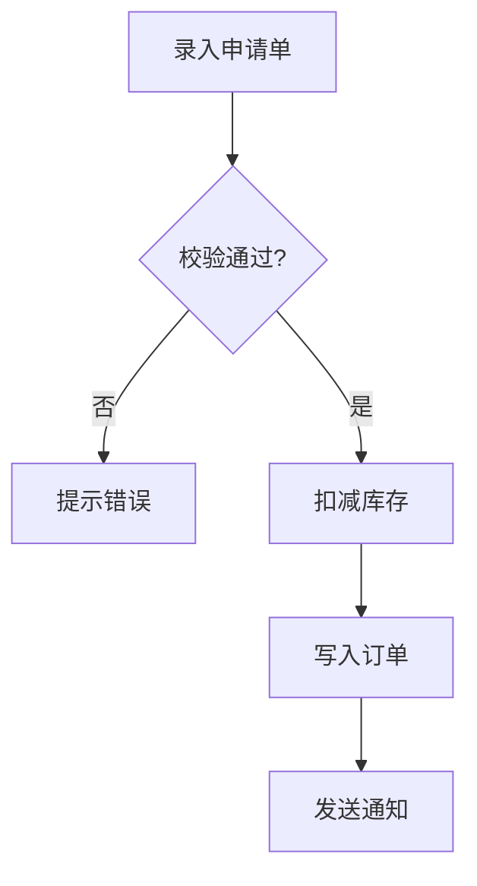

### 功能流程图（Functional Flowchart）

**Step 1 — 生成流程图与节点清单**

把探索发现的业务功能流程固化为探索产物的 `## 功能流程图` 段，由两部分组成：

节点清单表（表头与列以本场景列集为准）：

本场景列集（共 5 列）：节点 / 操作 / 触发条件 / 证据位置 / 异常路径

| 节点 | 操作 | 触发条件 | 证据位置 | 异常路径 |
| :--- | :--- | :--- | :--- | :--- |
<节点 | 操作 | 触发条件 | 证据位置 | 异常路径>

列定义：

| 列名 | 填写要求 | 必填性 |
| :--- | :--- | :--- |
| 节点 | 节点标识，形如 N1 / N2，在流程图与清单表中 MUST 稳定一致 | 必填 |
| 操作 | 该节点完成的操作，业务语义表述（如"扣减库存"） | 必填 |
| 触发条件 | 执行本节点的前置条件；无前置条件时以 "—" 占位 | 可选 |
| 证据位置 | 既有代码标 `文件:行` 或 类.方法；新建功能标 `[新建]` 并写明预期产物 | 必填 |
| 异常路径 | 本节点失败时的去向，用 `→ N<id>` 指向目标节点；无异常分支时以 "—" 占位 | 可选 |

**节点定义与准入规则**：

- **节点粒度** MUST 为**可独立验证的业务操作单元**（一次用户操作 / 一次业务判定 / 一次数据写入 / 一次外部调用）；MUST NOT 细到代码行级，MUST NOT 粗到模块级
- **节点标识** MUST 在 Mermaid 图与清单表中一致；一个功能含多条独立流程时 SHALL 按流程分小节组织（`### 流程 1` / `### 流程 2`），节点标识 SHALL **全局唯一递增**
- **证据追溯是硬约束**：每个节点 MUST 填写证据位置（`文件:行` 或 类.方法）；**新建功能**节点 SHALL 标 `[新建]` 并写明预期产物（新增哪个类 / 页面 / 接口），MUST NOT 要求预测文件路径；**无法追溯证据的节点 MUST NOT 进入清单**——虚假节点会成为提案的生成锚点，把偏差结构化固化，比散文偏差更难发现
- 节点数超过 50 时 SHALL 按子流程分节：主流程图以子流程节点聚合，子流程各自展开清单表

**Step 2 — ⛔ GATE: 流程最终确认门（强制停止）**

> **THIS IS A CONFIRMATION GATE. Your response MUST END here. Do NOT continue beyond this point.**

向用户呈现流程图与节点清单并**立即结束本次响应**；用户确认前 MUST NOT 进入探索完成检测，MUST NOT 将流程图传递给提案阶段。

出口有四条，不得只认一条：

① 用户确认 → 以确认版为**流程基准**
② 用户修改 → 以修改版为流程基准
③ 用户拒绝 → 记录原始流程图与**未确认状态**：提案降级为仅凭探索产物生成，验证的节点覆盖度维度 SKIP
④ 用户显式授权按推断继续 → 将推断节点标 `[推断]` 记入后继续

**MUST NOT 反复要求确认或陷入等待死锁。**

**Step 3 — 落盘与回改规则**

- 流程图与节点清单落盘为探索产物的 `## 功能流程图` 段，随探索文件迁移一并进入变更目录
- 确认后的流程图 = **流程基准**，是独立于提案自身的交叉验证锚点（区别于既有业务步骤维度的"自证"）
- 探索或提案阶段发现**遗漏节点**时 MUST 回到本步骤更新流程图并**重新经用户确认**；MUST NOT 在任务清单中静默补节点——静默补全正是偏差的主要来源
- 流程基准变更 MUST 回到本确认门重新确认