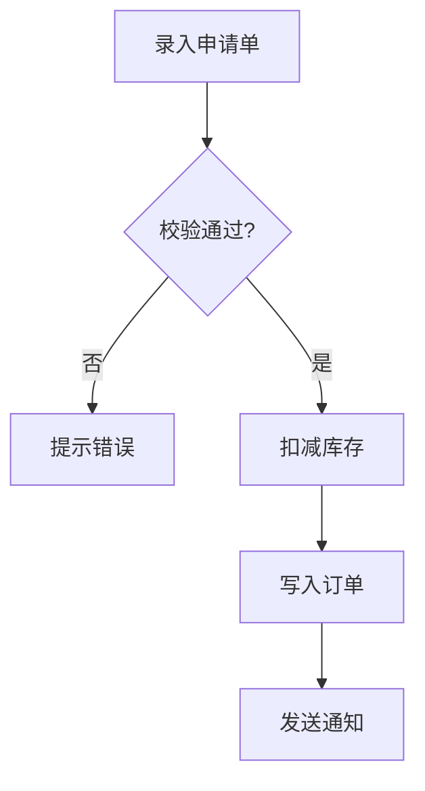

**Before proceeding, read openspec/rules/ai-coding.md for AI coding guardrails.** In Phase 1 (Reproduce), follow Section 1 (Zero-Assumption). In Phase 4 (Fix), follow Section 3 (Data & Storage) when schema changes are involved. In Phase 6 (Synchronization), check Sections 2 (Design-First) for the confirmation gate.

One-stop debugging workflow from reproduction to proposal synchronization.

This workflow guides you through:
1. **Reproduction phase** - Failing test or explicit reproduction procedure as acceptance criterion
2. **Investigation phase** - Capability memory injection + CodeGraph root cause analysis + depth triage (2.2.3.5: lightweight vs deep path by blast radius / cross-module / root-cause clarity) + grill-with-docs discipline
3. **Change association phase** - Determine which change owns the bug (in-progress / new fix change / archived origin / non-defect)
4. **Fix phase** - Implement the fix with a mandatory regression test
5. **Debug Loop** - After each fix, ask user if there are more related bugs; if yes, repeat P1-P4; if no, proceed to unified P5-P7
6. **Compile check phase** - Reuse the venus_spec_apply skill's compile check conventions (covers all loop fixes)
7. **Synchronization phase** - Update the change's artifacts and persist all root cause analyses (covers all loop fixes)
8. **Verification phase** - Auto-fix loop on failure; on pass, deep review then requirement document branch (regenerate when absent / in-place align when present) (covers all loop fixes)

---

## Startup

**Input**: The argument after the command is the bug description (symptom, error message, or failing behavior).

- If a description is provided, record it and enter Phase 1
- If no description is provided, prompt the user: "Describe the bug: symptom, error message, and reproduction steps if known" — start only after a description is received

### 0. Prompt Validation Gate（缺陷五维，MANDATORY）

**⚠️ MANDATORY: 本门在 Phase 1 强制复现之前执行，不得跳过。**

**执行前置**：用户最初未提供 bug 描述、由本技能提示后补充的，以补充内容为原始提示词执行本门；**MUST NOT 对空输入执行校验**。

### Prompt Validation Gate (提示词校验门)

**Step 1 — 清晰度自检**: 逐维判定用户输入，标记 `✅ 清晰` / `⚠️ 歧义` / `❌ 缺失`

| 维度 | 判定问题 | 升级为硬不明确的信号 |
| :--- | :--- | :--- |
| 症状 Symptom | 现象是什么？在哪个功能 / 页面上出现？ | 只有笼统断言（如"导出有 bug"）而无现象描述 |
| 复现步骤 Repro | 怎样触发？前置条件是什么？ | 无任何复现线索，无法判断触发场景 |
| 期望 vs 实际 Expected vs Actual | 以为会发生什么？实际发生了什么？ | 两者混淆或只给出其一，无法确立验收判据 |
| 环境 Environment | 版本 / 部署形态 / 数据条件？ | 环境差异导致无法判断是否为缺陷 |
| 歧义 Ambiguity | 有无"时好时坏"类不确定描述、指代不清、前后矛盾？ | 影响复现或验收的实质歧义 |

**Step 2 — 分级判定**

- **清晰**（症状 Symptom / 复现步骤 Repro / 期望 vs 实际 Expected vs Actual / 歧义 Ambiguity 均无 `❌` 与实质 `⚠️`）→ 用一句话复述你的理解，然后**直接进入探索**；不输出校验表格、不要求用户确认
- **不明确**（任一维 `❌` 或存在实质 `⚠️`）→ 执行 Step 3，并**阻塞等待确认**
- **软不明确**（仅细节级歧义，不涉及范围 / 行为契约 / 验收标准）→ 记为 `[假设]` 并继续，不进入 Step 3

**Step 3 — 提示词优化**（仅不明确分支）

- **不篡改用户原始意图**：只做结构化与约束补全，绝不擅自增加用户未提出的需求
- 推断补齐的内容标 `[推断]`，无法推断的内容标 `[待确认]`；禁止把猜测写成既定事实
- 输出两部分：`【优化后提示词】`（目标 / 对象 / 范围 / 约束 / 验收 / 已知歧义）+ `【优化说明】`（改了哪里、为什么）
- 列出仍需用户补充的信息项

**Step 4 — 确认门（阻塞）**

- 呈现 `【优化后提示词】` 与 `【优化说明】` 后**停下来等待用户确认或修改**
- 用户确认前 MUST NOT 进入探索、创建探索文件、扫描代码库或发起追问
- 出口有四条，不得只认一条：① 用户确认 → 以优化版为基线；② 用户修改 → 以修改版为基线；③ 用户拒绝优化 → 记录原始提示词，按其原有理解继续；④ 用户显式授权按推断继续（如"你按你的判断来"）→ 将推断项标 `[推断]` 记入基线后继续。**MUST NOT 反复要求确认而陷入等待死循环。**

**Step 5 — 落盘提示词基线**

- 将「原始提示词」与「确认后的提示词基线」一并写入探索产物的 `## 提示词基线` 段（保留原始提示词供审计）
- 下游（提案 / 设计 / 规格 / 任务）以**提示词基线**为唯一语义来源；基线变更 MUST 回到本门重新确认

**入口形态适配**

- 校验对象 = 用户**最终提供**的需求描述：调用未携带描述时，先交互收集，再以收集后的描述执行本门；**MUST NOT 对空输入执行校验**
- 输入为**变更名**时，以该变更的既有制品为校验与探讨对象，MUST NOT 把变更名本身当作需求提示词评估清晰度
- 已存在经用户确认的提示词基线时（尤其上游已完成本门），**直接通过，不重复校验或再次要求确认**

**本技能内的执行要求**：

- 门的位置固定在此处：记录 bug 描述之后、TodoWrite 初始化与 Phase 1 复现之前
- 缺陷版的「复现步骤」维与 Phase 1 的复现要求直接衔接：维度判定出的期望与实际在 Phase 1 成为复现的验收判据
- 不明确分支的确认门是**澄清门（确认 WHAT）**：用户确认或修改前 MUST NOT 进入 Phase 1，**MUST NOT 凭猜测编写失败测试**
- 校验结论（原始提示词 + 确认后的提示词基线）写入诊断记录的 `## 提示词基线` 段（Phase 6 随根因分析一并持久化到变更 exploration.md）

Use the **TodoWrite tool** to initialize tracking:
```
[{"content": "Bug #1: Phase 1 复现", "status": "in_progress"},
 {"content": "Bug #1: Phase 2 排查定位", "status": "pending"},
 {"content": "Bug #1: Phase 3 关联变更判定", "status": "pending"},
 {"content": "Bug #1: Phase 4 修复 + 回归测试", "status": "pending"},
 {"content": "Phase 5: 编译检查 (汇总所有修复)", "status": "pending"},
 {"content": "Phase 6: 同步提案 (汇总所有修复)", "status": "pending"},
 {"content": "Phase 7: 验证 (覆盖所有修复)", "status": "pending"}]
```

**Dynamic bug tracking**: When the debug loop continues to a new bug, append new entries to the TodoWrite list for that bug's P1-P4 phases. Mark each bug's phases as complete when they finish. For example:
```
[{"content": "Bug #1: Phase 1 复现", "status": "completed"},
 {"content": "Bug #1: Phase 2 排查定位", "status": "completed"},
 {"content": "Bug #1: Phase 3 关联变更判定", "status": "completed"},
 {"content": "Bug #1: Phase 4 修复 + 回归测试", "status": "completed"},
 {"content": "Bug #2: Phase 1 复现", "status": "in_progress"},
 {"content": "Bug #2: Phase 2 排查定位", "status": "pending"},
 ...]
```

---

## Phase 1: Reproduce (复现)

**⚠️ MANDATORY: The bug must be reproduced before any code is modified.**

The reproduction is the acceptance criterion for the fix — do not skip it.

### 1.1 Reproduce via failing test (preferred)

- Locate or write a test that demonstrates the bug
- Run the test and confirm it FAILS for the reported reason (not an unrelated setup error)
- Record: test file path, test name, expected vs. actual outcome

### 1.2 Reproduce via explicit procedure

When the bug cannot be captured by an automated test (e.g., environment-specific behavior, timing, UI-only):

- Record an explicit reproduction procedure: numbered steps, inputs, expected outcome, actual outcome
- Present the procedure to the user and confirm it matches the observed behavior
- No fix is applied until the reproduction is confirmed

**Checkpoint Enforcement**:
- If reproduction cannot be established, report this to the user with what was attempted — do NOT proceed to fixing an unreproducible bug on assumption (Zero-Assumption Policy)
- If the reported behavior cannot be triggered at all, go to Phase 2 and investigate whether this is a non-defect (expected behavior)

Update the diagnosis record (a scratch section in your working notes, later persisted in Phase 6) with the reproduction evidence.

---

## Phase 2: Investigate Root Cause (排查定位)

**⚠️ MANDATORY: Inject capability memory and apply grill-with-docs discipline during investigation.**

### 2.1 Capability exploration memory injection

1. Infer the capability (module) the bug belongs to from the affected code and the bug description
   - Scan `openspec/specs/` directory names with the Glob tool and match against the affected area
2. For each involved capability `<capability>`, check if `openspec/specs/<capability>/explorations.md` exists (use `path.join()`)
3. If it exists: read it and inject historical Decisions, terminology, and boundary scenarios into the investigation context
   - Sections marked `已过时（由 <change-name> 取代）` serve as historical reference ONLY — the superseding change's decisions are current
   - Historical boundary scenarios are frequent root-cause leads: the bug may be a known edge case that was consciously accepted
4. If no memory file exists: log "无能力级探索记忆 — 全新排查" and proceed

### 2.2 CodeGraph 排查（分层结构）

Adapt the workflow's CodeGraph query system (status check → file scan → symbol + context → call chain + impact → **triage** → explore + deep-dive) to the debug investigation context. Record all findings to the diagnosis record in real time (after EACH query step, not batched at the end) so Phase 6 can persist the full investigation path.

#### 2.2.0 Status 预检（强制首动作与硬回退）

**MUST run `codegraph_status` as the FIRST action of Phase 2.** Until `codegraph_status` returns unavailable, you MUST NOT use Grep or Glob for symbol/file investigation — the `codegraph_*` tools (2.2.1–2.2.4) are the primary path, not an optional one.

- If initialized (files/nodes > 0): proceed with the CodeGraph tools in 2.2.1–2.2.4
- If `codegraph_status` confirms unavailable (uninitialized, error, or tool not mounted): ONLY THEN fall back to Glob (file structure) and Grep (symbol search), record "CodeGraph unavailable — used Glob/Grep fallback" in the diagnosis record

Grep/Glob is a **last resort**, permitted ONLY after `codegraph_status` confirms unavailability — never as a shortcut to skip CodeGraph. The fallback MUST NOT block the investigation, but it MUST NOT be taken before the availability check runs.

#### 2.2.1 文件结构扫描（codegraph_files）

- Scan the project file tree with `codegraph_files` to identify directories and files relevant to the bug description
- Write findings to the diagnosis record Codebase Findings > Discovered Files as "<file-path>: <relevance-reason>"
- All file paths MUST be constructed with `path.join()` for cross-platform compatibility (Windows/macOS/Linux) — never hardcode slashes
- Fallback (when CodeGraph unavailable): Glob for file structure discovery

#### 2.2.2 符号定位与任务级上下文（codegraph_search + codegraph_context）

- `codegraph_search` — locate the symbols involved in the failing behavior; record "<symbol-name> (<file-path>:<line>): <reason>" to Codebase Findings > Identified Symbols
- `codegraph_context --task <bug-description>` — build comprehensive task-level context around the bug (aggregating entry points, related symbols, key code), turning the bug description into a scoped investigation context
- Fallback (when CodeGraph unavailable): Grep for symbol search

#### 2.2.3 调用链追踪与爆炸半径（codegraph_callers / codegraph_callees / codegraph_impact）

- `codegraph_callers` / `codegraph_callees` — trace the call chain around the suspected code (upstream callers and downstream callees)
- `codegraph_impact` — assess the blast radius of the suspected defect AND of the candidate fix
- Record call chains (ASCII diagrams when helpful) and affected symbols in the diagnosis record for root cause confirmation

#### 2.2.3.5 排查深度分级（Triage · 事前选定排查路径）

**⚠️ MANDATORY: 本步在常规查询（2.2.1–2.2.3）之后、深度探索（2.2.4）之前执行。** 三条分级信号全部产自常规查询，故本步不得前移；编号采用**十进制插入**（`2.2.3.5`）以**不重排既有编号**（2.2.0–2.2.4 的编号与语义均不变）。

**分级信号（三条客观信号，任一命中即深度路径）**：

- **(a) 爆炸半径**：`codegraph_impact` 在 depth ≤ 2 的受影响符号数 **≥ 5**，或受影响文件数 **≥ 3**
- **(b) 跨模块**：受影响范围跨 **≥ 2** 个模块 / 目录
- **(c) 根因清晰度**：2.2.2（`codegraph_search` + `codegraph_context`）**未能**一步定位单一高置信根因

**分级结果（两条路径）**：

- **轻量路径（路径 A）**：止步于 2.2.1–2.2.3，**不执行** 6 维根因深度分析
- **深度路径（路径 B）**：进入 2.2.4 执行 `codegraph_explore` + 6 维根因深度分析

**保守取值**：信号缺失或落在阈值边界（无法判定是否超阈）时**取深度路径** —— 误走深度路径的代价是查询成本，误走轻量路径的代价是**漏检根因**（不可逆），宁可多查不漏。

**信号降级（CodeGraph 不可用时分级仍生效）**：

- 信号 **(a)** 降级为 **Grep 代理指标**（以 2.2.1 的文件结构扫描结果计受影响文件数，阈值同 3）
- 信号 **(b)(c)** 不依赖 CodeGraph，照常判定
- 诊断记录 MUST 标注「信号降级」；**MUST NOT 因 CodeGraph 不可用而跳过分级**

**信号可追溯（反幻觉硬约束）**：信号取值 MUST 可追溯至 `codegraph_impact` / `codegraph_files`（降级时为 Grep）的**实测查询结果**并在诊断记录留痕；MUST NOT 以"半径小"等未经实测的结论支撑轻量路径判定（违反 Zero-Assumption）。

**与 2.5 解耦**：分级结果**只**影响 2.2.4 是否执行；2.5 缺陷链路图与流程最终确认门对两条路径**均强制**产出，轻量路径 MUST NOT 豁免。

**记录规范**：分级结论（三条信号取值 + 所选路径 + 是否降级）随 Step 2.2 的记录规范一并实时写入诊断记录，供 Phase 6 随根因分析持久化到变更 `exploration.md`。

#### 2.2.4 深度探索与根因深度分析（条件触发）

**Trigger**: 满足以下任一条件时执行本节 ——

1. **分级为深度路径（2.2.3.5 路径 B）** —— 即便已一步定位到单一高置信根因，大范围 / 跨模块缺陷仍须经 6 维分析确认是否存在未检视的系统性根因（设计意图 / 约束 / 权衡 / 模式 / 历史边界 / 隐式假设）
2. **升级兜底**：轻量路径（路径 A）下 2.2.1–2.2.3 **未能**定位单一高置信根因（多候选或置信不足）

**仅当**分级为轻量路径 **且** 已定位单一高置信根因时，SKIP 本节以让简单缺陷走轻量路径。

**⚠️ 兜底是触发条件，不是独立步骤**：本节的内容与编号（2.2.4）**保持不变**；升级兜底即上述条件 2，MUST NOT 为其新建独立章节或编号。

When triggered:
- `codegraph_explore` — deep exploration of the suspected code area
- 6-dimension root cause deep analysis (adapted from workflow Implementation Deep-Dive, repositioned for root cause localization — the root cause often hides in WHY the code was designed this way):
  - **Design Rationale** — why the code was designed this way (code comments, docstrings, ADRs) — root cause may be a violated design intent
  - **Constraints** — hard constraints that shaped the code (config files, linter rules) — root cause may be a constraint that no longer holds
  - **Trade-offs** — multi-option trade-offs consciously accepted (TODO/FIXME/HACK comments) — root cause may be a trade-off that failed under new conditions
  - **Pattern Usage** — design patterns in use (class/interface structure) — root cause may be a pattern misuse
  - **Historical Context** — design evolution (`git log --follow`, `git blame`) — root cause may be a consciously accepted historical edge case (cross-reference capability memory boundary scenarios)
  - **Implicit Assumptions** — undocumented assumptions (type guards, default values, missing null checks) — root cause frequently hides here
- Write findings to the diagnosis record Implementation Deep-Dive section; dimensions with no findings are marked "<!-- No findings -->"
- Connects to the 2.4 root cause confirmation gate: multiple candidates → STOP and let the user choose; deep-dive insights assist confirmation

#### 记录规范（所有子节共用）

All CodeGraph findings (Discovered Files / Identified Symbols / call chains / blast radius / Implementation Deep-Dive) MUST be structured into the diagnosis record's corresponding subsections and updated in real time after EACH query step (not batched at the end of the investigation). When CodeGraph is unavailable and the Glob/Grep fallback is used, findings still follow the same structure with the fallback noted — investigation traceability MUST NOT be lost due to fallback.

### 2.3 Grill-with-docs discipline during investigation

Apply the full discipline while narrowing down the root cause:

- **One question at a time**: when input from the user is needed, ask a single question and wait
- **Terminology sharpening**: each time a term is resolved during the investigation, write it to `openspec/CONTEXT.md` NOW (not deferred). Format: `**<Term>**: <definition>
_Avoid_: <synonyms>`
- **Real-time record updates**: update the diagnosis record (root cause hypothesis, evidence, boundary scenarios) after EVERY questioning exchange — not batched at the end

### 2.4 Root cause confirmation gate (Zero-Assumption)

- **Single high-confidence root cause**: present it with code evidence (call chain, affected symbols, reproduction link), get user acknowledgment, then proceed to Phase 3
- **Multiple candidates or insufficient confidence**: STOP. Present the candidate list with per-candidate evidence and your recommendation. No code is modified until the user selects a candidate
- **Investigation concludes non-defect**: the reported behavior is intended — exit to the non-defect branch (Phase 3.5)

### 2.5 缺陷链路图与流程最终确认门 (MANDATORY CHECKPOINT)

**⚠️ MANDATORY: 根因确认门（2.4）通过后必须强制产出缺陷链路图，并经流程最终确认门确认后才进入 Phase 3。**

触发点：2.4 根因确认门通过（单一高置信根因）之后、Phase 3 关联变更判定之前——异常与根因节点须待根因确认后方可知，故本步骤不得前移。经确认的缺陷链路是 Phase 3 / Phase 4 的**验证口径来源**。

### 功能流程图（Functional Flowchart）

**Step 1 — 生成流程图与节点清单**

把探索发现的业务功能流程固化为探索产物的 `## 功能流程图` 段，由两部分组成：



节点清单表（表头与列以本场景列集为准）：

本场景列集（共 4 列）：节点 / 操作 / 证据位置 / 标记

| 节点 | 操作 | 证据位置 | 标记 |
| :--- | :--- | :--- | :--- |
<节点 | 操作 | 证据位置 | 标记>

列定义：

| 列名 | 填写要求 | 必填性 |
| :--- | :--- | :--- |
| 节点 | 节点标识，形如 N1 / N2，在流程图与清单表中 MUST 稳定一致 | 必填 |
| 操作 | 该节点完成的操作，业务语义表述（如"点击导出"） | 必填 |
| 证据位置 | 既有代码标 `文件:行` 或 类.方法；无法追溯证据的节点 MUST NOT 进入清单 | 必填 |
| 标记 | 缺陷链路角色：异常现象节点标 `🔴异常`，根因节点标 `🟠根因`，其余以 "—" 占位 | 可选 |

**节点定义与准入规则**：

- **节点粒度** MUST 为**可独立验证的业务操作单元**（一次用户操作 / 一次业务判定 / 一次数据写入 / 一次外部调用）；MUST NOT 细到代码行级，MUST NOT 粗到模块级
- **节点标识** MUST 在 Mermaid 图与清单表中一致；一个功能含多条独立流程时 SHALL 按流程分小节组织（`### 流程 1` / `### 流程 2`），节点标识 SHALL **全局唯一递增**
- **证据追溯是硬约束**：每个节点 MUST 填写证据位置（`文件:行` 或 类.方法）；**新建功能**节点 SHALL 标 `[新建]` 并写明预期产物（新增哪个类 / 页面 / 接口），MUST NOT 要求预测文件路径；**无法追溯证据的节点 MUST NOT 进入清单**——虚假节点会成为提案的生成锚点，把偏差结构化固化，比散文偏差更难发现
- 节点数超过 50 时 SHALL 按子流程分节：主流程图以子流程节点聚合，子流程各自展开清单表

**Step 2 — 流程最终确认门（阻塞）**

向用户呈现流程图与节点清单并**停止等待确认**；用户确认前 MUST NOT 进入探索完成检测，MUST NOT 将流程图传递给提案阶段。

出口有四条，不得只认一条：

① 用户确认 → 以确认版为**流程基准**
② 用户修改 → 以修改版为流程基准
③ 用户拒绝 → 记录原始流程图与**未确认状态**：提案降级为仅凭探索产物生成，验证的节点覆盖度维度 SKIP
④ 用户显式授权按推断继续 → 将推断节点标 `[推断]` 记入后继续

**MUST NOT 反复要求确认或陷入等待死锁。**

**Step 3 — 落盘与回改规则**

- 流程图与节点清单落盘为探索产物的 `## 功能流程图` 段，随探索文件迁移一并进入变更目录
- 确认后的流程图 = **流程基准**，是独立于提案自身的交叉验证锚点（区别于既有业务步骤维度的"自证"）
- 探索或提案阶段发现**遗漏节点**时 MUST 回到本步骤更新流程图并**重新经用户确认**；MUST NOT 在任务清单中静默补节点——静默补全正是偏差的主要来源
- 流程基准变更 MUST 回到本确认门重新确认

**本技能内的执行要求**：

- **节点范围只覆盖缺陷链路**：前置条件 → 触发 → 异常 → 根因；**MUST NOT 展开被测功能的完整业务流程**（区别于需求版的全流程覆盖，避免与 Phase 1 复现步骤重复）
- **标记**：异常现象节点 MUST 标 `🔴异常`、根因节点 MUST 标 `🟠根因`，其余节点以 "—" 占位
- **证据追溯**：每节点 MUST 填证据位置（`文件:行` 或 类.方法）；无法追溯证据的节点 MUST NOT 进入清单
- **落盘位置**：诊断记录新增的 `## 功能流程（缺陷链路）` 段，Phase 6 随根因分析一并持久化到变更 exploration.md
- **与分级解耦**：2.2.3.5 的排查深度分级结果 MUST NOT 影响本步产出 —— **轻量路径（路径 A）同样强制产出**缺陷链路图并经本门确认；分级只决定 2.2.4 是否执行，不决定是否产出缺陷链路（轻量 ≠ 不验证）
- **四出口确认门**：呈现缺陷链路图与节点清单后停止等待确认，出口四条（确认 / 修改 / 拒绝后记录未确认状态并按原理解继续 / 显式授权按推断继续），**MUST NOT 反复要求确认或陷入等待死锁**
- **验证口径**：修复方案与回归测试 MUST 覆盖该链路的「异常节点 + 根因节点」（见 4.1 / 4.2）；仅覆盖触发节点而未覆盖根因节点时，验证不通过

---

## Phase 3: Change Association Determination (关联变更判定)

Determine which change owns the bug BEFORE fixing.

### 3.1 Bug originates from an in-progress change

- The affected code belongs to a change under `openspec/changes/` (not archived)
- → The fix updates THAT change; Phase 4–7 operate on it

### 3.2 Independent bug (no owning change)

- The bug is not attributable to any in-progress change
- → Create a new change named `fix-{module}-<topic>` following the change naming convention:
```bash
venus spec new "fix-<module>-<topic>"
```
- The fix proceeds under the new change

### 3.3 Bug originates from an archived change

- The affected code belongs to a change under `openspec/changes/archive/`
- → **NEVER modify the archived directory** — archives are historical fact
- Create a new change and reference the original archived change name in the new change's proposal for traceability

### 3.5 Non-defect exit (诊断报告收尾)

When Phase 2 concluded the behavior is intended:

- Output a diagnosis report: symptom, investigation path, code/test evidence proving intended behavior
- Do NOT create a change and do NOT modify code
- Persist the diagnosis record and inform the user of the conclusion — workflow ends here

---

## Phase 4: Fix (修复)

Implement the fix following the venus_spec_apply skill's task execution norms.

### 4.1 Fix implementation

- Follow `openspec/rules/ai-coding.md` (Zero-Assumption, minimal changes, layering)
- Keep the change surgical: every changed line must trace to the root cause
- If the fix requires database/schema changes, output the DDL separately and request explicit confirmation before applying (per guardrails)
- If implementation reveals a design issue, pause and suggest updating the change's artifacts rather than silently deviating
- **验证口径（2.5）**：修复方案 MUST 覆盖该缺陷链路的**「异常节点 + 根因节点」**；仅覆盖触发节点而未覆盖根因节点时，视为修复未完成

### 4.2 Mandatory regression test

- Add (or confirm the Phase 1 test serves as) a regression test that:
  - FAILS before the fix
  - PASSES after the fix
- Add a corresponding task to the change's tasks.md if it is not yet listed
- Run the reproduction from Phase 1 and confirm it now passes
- **回归测试验证口径（2.5）**：回归测试 MUST 覆盖该缺陷链路的**「异常节点 + 根因节点」**；仅覆盖触发节点而未覆盖根因节点时，验证不通过

### 4.3 Debug Loop Confirmation (调试循环确认)

After each fix is complete, ask the user:

> "还有相关 bug 需要修复吗？"
> [有 - 继续修复下一个] [没有 - 进入收尾阶段]

**If user responds "有"**:
- Record the current bug as completed in TodoWrite
- Ask the user to describe the next bug
- Re-enter Phase 1 for the new bug (independent reproduction, investigation, and fix)
- Update TodoWrite: append new Bug #N entries for the new bug's P1-P4 phases

**P3 Simplified for subsequent bugs**:
- Default: the new bug is fixed under the same change (current change from the first bug's Phase 3)
- Present the default association to the user for acknowledgment
- If the user declares this bug should be a separate change:
  - Finalize the current change (enter Phase 5-7 for accumulated fixes)
  - Inform the user: "请用 `/venus:tr-impl-debug` 单独处理这个独立 bug"
  - Do NOT create a new change automatically

**Non-defect in loop**: If Phase 2 concludes a bug in the loop is non-defect (expected behavior):
- Follow the non-defect exit path (output diagnosis report, no code change, no change creation)
- Continue the loop: ask "还有相关 bug 需要修复吗？" — the non-defect bug does NOT block other bugs

**Mid-loop exit**: If the user wants to exit the loop during any phase (P1-P4) of a subsequent bug:
- Discard the incomplete current bug's work
- Preserve all previously completed fixes
- Proceed directly to Phase 5-7 for the accumulated fixes

**Long loop advisory**: If the loop reaches 5 or more iterations, advise the user:
> "已连续修复 5 个 bug。建议检查是否应拆分为独立 change。"
- Do NOT force termination — the user decides whether to continue

**If user responds "没有"**:
- Proceed to Phase 5 — all accumulated fixes will be covered by unified compile check, synchronization, and verification

---

## Phase 5: Compile Check (编译检查) — 汇总所有修复

遵循 venus_spec_apply 技能的编译检查约定（Step 8）。This phase runs ONCE covering ALL bugs fixed in the loop.

### 5.1 Load configuration

- Read `openspec/config.yaml` for `compileCheck` settings
- If `compileCheck.enabled` is false or the section is not configured (defaults to disabled), skip to Phase 6

### 5.2 Execute checks

- Detect the tech stack from `config.yaml` context (TypeScript, Java, Go, Rust, ...)
- Classify changed files into backend (TypeScript/Java/Go/Rust) and frontend (JSP/Vue/React)
- Execute the compile command per tech stack:
  - TypeScript: `tsc --noEmit` or `pnpm run build`
  - Java-Maven: `mvn compile -DskipTests`
  - Java-Gradle: `gradle compileJava`
  - Go: `go build ./...`
  - Rust: `cargo build`

### 5.3 Auto-fix loop

- If `autoFix.enabled` is true: classify issues by fixability, apply fixes to change-scope files, re-run checks (up to `maxRetries`, default 3)

### 5.4 Report

- Summarize results (compile, lint, frontend) with fixed vs. remaining issues
- Remaining failures are REPORTED to the user — never proceed silently past a failing check

---

## Phase 6: Synchronize Proposal (同步提案) — 汇总所有修复

**⚠️ MANDATORY: After all fixes in the loop, the change's artifacts must reflect ALL implemented fixes.**

### 6.1 Update artifacts

- **proposal.md**: add root causes and fix descriptions for ALL bugs in the loop (under What Changes, organized per bug)
- **tasks.md**: check off completed tasks for all fixes; add regression test tasks for each bug if missing
- **design.md**: update when any fix changed a documented decision
- **specs/**: update delta specs when any fix changes documented behavior (use `#### Scenario:` with WHEN/THEN)

### 6.2 Persist root cause analysis

- Write the full diagnosis records for ALL bugs (prompt baseline, reproduction, investigation path, evidence, root cause, chosen fix rationale) to the change directory's `exploration.md`, organized per bug — the `## 提示词基线` section is included so the change retains the user-confirmed semantics source, and the `## 功能流程（缺陷链路）` section (2.5) carries the confirmed fault chain and node list
- **分级判定结果**（2.2.3.5）：每个 bug 的排查深度分级结论 MUST 一并持久化 —— 三条信号取值、所选路径（轻量 A / 深度 B）、是否信号降级；即"为什么这个缺陷走了这条排查路径"须可追溯，避免事后无法复盘排查深度是否合理

### 6.3 Artifact format validation

After synchronization, validate that the update did not break artifact format:

- proposal.md retains required sections: Why, What Changes, Capabilities, Impact
- Delta specs keep the `#### Scenario:` format (4 hashtags) with WHEN/THEN structure
- tasks.md keeps the `- [ ] X.Y` / `- [x] X.Y` checkbox format

Fix any format violation before proceeding — synchronization must not corrupt the artifacts.

Proceed to Phase 7 only after artifacts reflect all implemented fixes.

---

## Phase 7: Verification (验证) — 覆盖所有修复

### 7.1 Invoke the verification skill

Execute verification by **invoking the `venus_spec_verify_proposal` skill** (via the Skill tool) for change `<name>`:

- `venus_spec_verify_proposal` is a SKILL name, NOT a valid `venus spec instructions` artifact ID — do not run it as a CLI instruction
- The skill performs D1–D9 scoring by reading the artifacts and exploration.md

**Fallback (skill unavailable)**: If the skill is not installed or its invocation fails, fall back to AI inline reading of the artifacts with manual D1–D9 scoring, and emit WARN: "venus_spec_verify_proposal skill unavailable, degraded to inline scoring". Do NOT silently skip verification.

### 7.2 Verification FAIL → auto-fix loop

When ANY dimension scores below the threshold (<90%):

- Do NOT generate the requirement document while verification fails
- Auto-generate specific fix suggestions for each failed dimension (e.g., missing boundary scenario → add scenario to spec)
- Apply the fixes to the artifact files
- Auto re-run verification after fixes are applied
- Display a fix summary ("Auto-Fix Applied — Re-running verification...")
- If the re-run still fails: present remaining issues with options — [1] Manual edit, [2] Return to exploration, [3] View detailed diff report. **No skip-to-apply path.**

### 7.3 Verification PASS → deep review + requirement document generation

After verification passes:

1. **Auto-invoke the `venus_tr_impl_review_proposal` skill** (via Skill tool) for a deep read-only review of the proposal (a deep consistency and coverage audit beyond the D1–D9 scoring). The review runs automatically (no [Yes/No] prompt). User MAY interrupt to skip; otherwise it runs.
   - **Fallback (skill unavailable)**: If the skill is not installed or its invocation fails, fall back to AI inline read-only deep review with a WARN: "venus_tr_impl_review_proposal skill unavailable, degraded to inline review". Do NOT silently skip the deep review.
2. **Determine whether the requirement document already exists** (⚠️ MANDATORY branch point — sits AFTER the deep review and BEFORE any generation):
   - Target path: `openspec/changes/<change-name>/需求文档.md` (build with `path.join()`)
   - Scope is **ONLY** the active change directory — debug only operates on in-progress changes; a bug originating from an archived change creates a **NEW** change (Phase 3.3), whose directory necessarily has no such file
   - If the directory cannot be read (IO failure): log WARN and treat it as "does not exist"
3. **Branch A — the document does NOT exist**: **Auto-invoke the `venus_tr_docs_requirement_doc` skill** (via Skill tool) in **non-interactive mode**:
   - Markdown format, placeholder basic information (需求编号/需求名称/交付时间 as placeholders)
   - Do NOT ask the user any questions
   - Output: `openspec/changes/<change-name>/需求文档.md`
   - Display the generated document path to the user
4. **Branch B — the document ALREADY exists** (e.g. produced by an earlier `venus_tr_impl_workflow` / `venus_tr_impl_auto_workflow` pass): perform an **in-place incremental alignment update** on that file. **Do NOT invoke `venus_tr_docs_requirement_doc`** — its own rule is "when the target file already exists, overwrite it silently", which would erase human-authored review content.
   - **人工域白名单（MUST NOT overwrite, preserve verbatim）**: `## 基本信息` (需求编号 / 需求名称 / 交付时间, including placeholder state) and `## 八、评审记录`
   - **重新派生域**: `一、原始需求` through `七、影响分析` are re-derived from the artifacts as synchronized in Phase 6
   - **MUST NOT delete any section** (only content removed from the artifacts may be dropped); when the existing document is missing a section (malformed), MUST recreate that section and log a WARN — never pass silently
   - Display the updated document path to the user
5. **Failure handling**: if generation or the in-place alignment fails or is interrupted, log WARN with the reason and CONTINUE — the user can re-run the skill standalone later

---

## Output

```
## Debug Workflow: <change-name or diagnosis-only>

### Loop Summary
- Total bugs fixed: N
- Non-defect findings: M (diagnosis only)

### Per-Bug Summaries

#### Bug #1: <one-line summary>
- Phase 1: Reproduction: <failing test / procedure> — confirmed ✗/✓
- Phase 2: Triage: <lightweight A / deep B — signals (a)(b)(c) values, degraded yes/no>; Root cause: <one-line summary>, Evidence: <call chain / symbols>
- Phase 3: Association: <in-progress change / new fix-{module}-<topic> / archived origin (traced)>
- Phase 4: Fix: <summary>, Regression test: <test reference> — passes ✓

#### Bug #2: <one-line summary>
- ...

### Phase 5: Compile Check (汇总所有修复)
- Compile check: PASS / FAIL(n issues) / SKIPPED(disabled)

### Phase 6: Synchronization (汇总所有修复)
- Artifacts updated: proposal / tasks / design / specs
- All root causes persisted to exploration.md ✓
- Format validation: PASS

### Phase 7: Verification (覆盖所有修复)
- Score: XX% — PASS/FAIL
- Deep review: completed ✓ / WARN (reason)
- Requirement document: branch <A: generated / B: in-place aligned> → openspec/changes/<change-name>/需求文档.md ✓ / WARN (reason)

Ready for `/venus:spec-apply` (fixes already applied) or archive.
```

---

## Guardrails

- **Validate the bug report before reproducing**: Startup 段的提示词校验门（缺陷五维）是强制前置——清晰描述一句话复述理解后直通；含糊描述须先做提示词优化并等待用户确认或修改，未确认前 MUST NOT 进入 Phase 1，不得凭猜测编写失败测试
- **Don't deadlock on the confirmation gate**: 确认门有四条出口（确认 / 修改 / 拒绝后按原理解继续 / 显式授权按推断继续），不得反复要求确认
- **Do persist the prompt baseline**: 原始提示词与确认后的基线写入诊断记录 `## 提示词基线` 段，Phase 6 随根因分析一并持久化
- **MUST produce the fault chain diagram**: 2.5 在根因确认门（2.4）通过后强制产出诊断记录 `## 功能流程（缺陷链路）` 段（Mermaid + 节点清单表），节点**只覆盖缺陷链路**（前置条件 → 触发 → 异常 → 根因），异常节点标 `🔴异常`、根因节点标 `🟠根因`；MUST NOT 展开被测功能的完整业务流程
- **Don't deadlock on the flowchart gate**: 2.5 确认门有四条出口（确认 / 修改 / 拒绝后记录未确认状态并按原理解继续 / 显式授权按推断继续），不得反复要求确认
- **Fix and regression test cover the exception and root cause nodes**: 修复方案与回归测试 MUST 覆盖缺陷链路的「异常节点 + 根因节点」（4.1 / 4.2）；仅覆盖触发节点而未覆盖根因节点时，验证不通过
- **Reproduce first**: no fix without a confirmed reproduction (failing test or user-confirmed procedure) — applies to EVERY bug in the loop
- **Triage by blast radius, not by convenience**: 2.2.3.5 的分级信号取值 MUST 可追溯至实测查询结果（`codegraph_impact` / `codegraph_files`，降级时为 Grep）；MUST NOT 编造"半径小"以走轻量路径；信号缺失或阈值边界 MUST 取深度路径
- **Triage decoupled from the fault chain diagram**: 分级只决定 2.2.4 是否执行，2.5 缺陷链路图与流程最终确认门对轻量路径同样**强制产出**，MUST NOT 豁免
- **Upgrade fallback is a trigger, not a step**: 升级兜底即 2.2.4 扩展后的触发条件之一，MUST NOT 为其新建独立章节或编号（2.2.4 的内容与编号不变）
- **Triage survives CodeGraph degradation**: CodeGraph 不可用时分级仍生效（信号 (a) 降级为文件数代理指标，(b)(c) 照常）；MUST NOT 因降级跳过分级，诊断记录 MUST 标注「信号降级」
- **Requirement document branch is mandatory**: Phase 7.3 判定需求文档是否已存在（范围仅 active 变更目录）；已存在时 MUST 走就地增量对齐更新，MUST NOT 调 `venus_tr_docs_requirement_doc`（其"静默覆盖"规则会抹掉人工内容）
- **Human-authored fields are protected**: 就地增量对齐时 `## 基本信息`（需求编号/需求名称/交付时间，含占位符状态）与 `## 八、评审记录` MUST NOT 覆盖；MUST NOT 删除章节（仅制品已移除的内容可删）
- **Zero-assumption**: multiple candidate root causes → STOP and let the user choose; never guess
- **Archives are read-only**: never modify `openspec/changes/archive/`
- **Regression test mandatory**: every fix ships with a test that failed before and passes after — applies to EVERY bug in the loop
- **Proposal sync mandatory**: artifacts must reflect ALL implemented fixes before verification
- **Verification never skipped**: skill → inline fallback with WARN; FAIL → auto-fix loop with no skip path; PASS → deep review (skill → inline fallback with WARN) then requirement document
- **Loop non-defect non-blocking**: non-defect findings in the loop do NOT block other bugs — record diagnosis and continue
- **Loop exit preserves completed work**: exiting mid-loop preserves completed fixes, discards incomplete current bug
- **Independent change separation**: when user declares a bug needs a separate change, finalize current change and prompt separate debug
- **Use `path.join()`** for all file paths (cross-platform: macOS/Linux/Windows)
- **Terminology in real time**: resolved terms go to CONTEXT.md immediately during investigation
